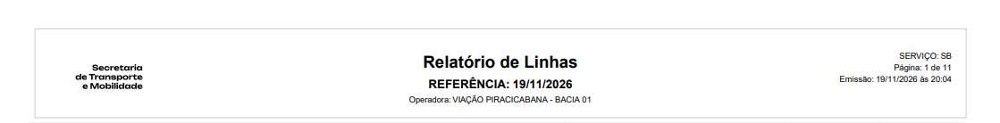
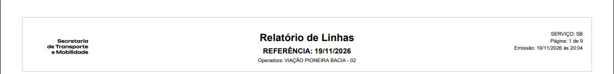
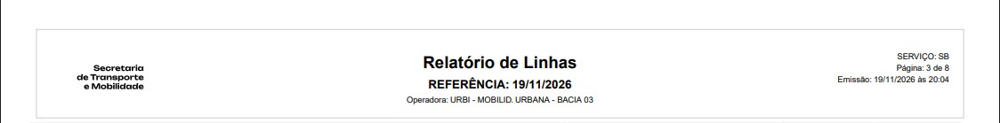
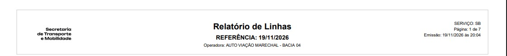
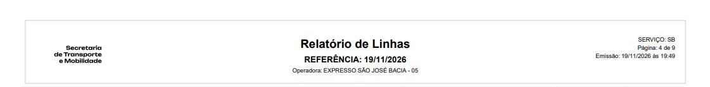

# Relátorio de Linhas de Ônibus

Esta lista registra as 20 linas escolhidas de A01 - A20 com código, nome variante e itinerário

| Caso | Cód. da Linha | Denominação da Linha | Operadora | Tipo 
|---|---|---|---|---|
| A01 | 0.110 | CIRCULAR - RODOVIÁRIA DO PLANO PILOTO / UNB | PR - VIAÇÃO PIRACICABANA - BACIA 01 | Circular
|A02|0.504| PLANALTINA (DF-128 / ESTÂNCIA) / SOBRADINHO|PR - VIAÇÃO PIRACICABANA - BACIA 01|Circular|
|A03|062.1|SOBRADINHO II / SOBRADINHO I|PR - VIAÇÃO PIRACICABANA - BACIA 01 |Circular|
|A04|620.1|PLANALTINA (AVENIDA INDEPENDÊNCIA) / EIXO NORTE / RODOVIÁRIA DO PLANO PILOTO|PR - VIAÇÃO PIRACICABANA - BACIA 01|Duplo Sentido|
|A05|0.102|RODOVIÁRIA DO PLANO PILOTO/AEROPORTO|PI - VIAÇÃO PIONEIRA BACIA - 02|Circular|
|A06|0.761|PARANOÁ (ENTRE LAGOS)/RODOVIÁRIA DO PLANO PILOTO (PONTE JK)|PI - VIAÇÃO PIONEIRA BACIA - 02|Duplo Sentido|
|A07|180.2|JARDINS MANGUEIRAL/RODOVIÁRIA DO PLANO PILOTO (PONTE JK) |PI - VIAÇÃO PIONEIRA BACIA - 02|Duplo Sentido|
|A08|2201|TERMINAL DE INTEGRAÇÃO DO GAMA/RODOVIÁRIA DO PLANO PILOTO (EXPRESSA)|PI - VIAÇÃO PIONEIRA BACIA - 02|Duplo Sentido|
|A09|0.082|NÚCLEO BANDEIRANTE (METROPOLITANA)/ EPIA (PARKSHOPPING)/ SAAN / RCG / ÁGUA MINERAL |HP - URBI - MOBILID. URBANA - BACIA 03|Circular|
|A10|0.809|RECANTO DAS EMAS/ RODOVIÁRIA DO PLANO PILOTO (EIXO)|HP - URBI - MOBILID. URBANA - BACIA 03|Duplo Sentido|
|A11|119.0|NÚCLEO BANDEIRANTE/ VARGEM BONITA|HP - URBI - MOBILID. URBANA - BACIA 03|Circular|
|A12|870.1|RIACHO FUNDO II (QS 18 - CAUB II) / RODOVIÁRIA DO PLANO PILOTO (EIXO)|HP - URBI - MOBILID. URBANA - BACIA 03|Circular|
|A13|0.008|CIRCULAR ÁGUAS CLARAS (TAG. SHOPPING/ CATÓLICA)|VM - AUTO VIAÇÃO MARECHAL - BACIA 04|Circular|
|A14|0.336|SETOR "'P" SUL/RODOVIÁRIA DO PLANO PILOTO (EIXO)|VM - AUTO VIAÇÃO MARECHAL - BACIA 04|Duplo Sentido|
|A15|154.2|GUARÁ I-II/RODOVIÁRIA DO PLANO PILOTO (QE34- ZOO -EIXO SUL) |VM - AUTO VIAÇÃO MARECHAL - BACIA 04|Duplo Sentido|
|A16|933.1|P SUL / TAGUACENTER (VIA HÉLIO PRATES)|VM - AUTO VIAÇÃO MARECHAL - BACIA 04|Circular|
|A17|0.005|CIRCULAR VICENTE PIRES / FEIRA DO PRODUTOR (RUAS 4, 6, 8, 10, SÃO JOSÉ)|SJ - EXPRESSO SÃO JOSÉ BACIA - 05|Circular|
|A18|0.400|BRAZLÂNDIA (DF-240 INCRA 8)/ RODOVIÁRIA DO PLANO PILOTO (EPTG - EIXO)|SJ - EXPRESSO SÃO JOSÉ BACIA - 05|Duplo Sentido|
|A19|0.808|RECANTO DAS EMAS / SETOR O|SJ - EXPRESSO SÃO JOSÉ BACIA - 05|Duplo Sentido|
|A20|158.6|CIDADE ESTRUTURAL ( SIA T2 / FEIRA DOS IMPORTADOS) ROD. PLANO PILOTO|SJ - EXPRESSO SÃO JOSÉ BACIA - 05|Duplo Sentido|

L01 e L02 são duas linhas do Relatório de Linhas da Semob-DF[3], e P01 é uma parada do itinerário de L01. Eles são escolhidos e registrados antes da coleta.

| Caso | Cód. da Linha | Denominação da Linha | Operadora |
|---|---|---|---|
|L01|0.089|SETOR P SUL (AV. DAS PALMEIRAS) / AV. COMERCIAL E SAMDU NORTE / GUARÁ I-II (PARK SHOPPING) / FACULDADE EUROAMERICANA |VM - AUTO VIAÇÃO MARECHAL - BACIA 04
|L02|933.4|P SUL (AV DAS PALMEIRAS) / TAGUACENTER|VM - AUTO VIAÇÃO MARECHAL - BACIA 04| VM - AUTO VIAÇÃO MARECHAL - BACIA 04
|P01|1243|Parada N1 P Norte, Ceilândia, CEP 72225-273

Fonte de Coleta:

[Bacia 1](https://sismob.semob.df.gov.br/flq/linhas/PR)

[Bacia 2](https://sismob.semob.df.gov.br/flq/linhas/PI)

[Bacia 3](https://sismob.semob.df.gov.br/flq/linhas/HP)

[Bacia 4](https://sismob.semob.df.gov.br/flq/linhas/HP)

[Bacia 5](https://sismob.semob.df.gov.br/flq/linhas/SJ)
