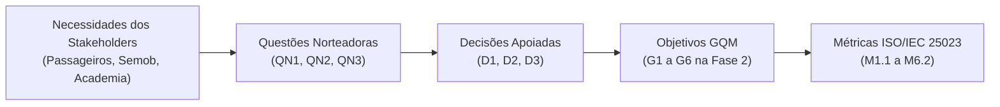

# Fase 1 - Requisitantes e Partes Interessadas

## 1. Introdução

O **DF no Ponto** é o aplicativo móvel oficial do Sistema de Transporte Público Coletivo do Distrito Federal (STPC-DF), sob a gestão da Secretaria de Transporte e Mobilidade (Semob-DF). Por se tratar de uma avaliação de qualidade de software conduzida em contexto acadêmico sobre um produto em produção, o ecossistema de partes interessadas (*stakeholders*) compreende diferentes perfis, cujas expectativas e dores direcionam as decisões técnicas da avaliação.

---

## 2. Metodologia de Mapeamento

A identificação e análise das partes interessadas fundamenta-se nos preceitos da norma **ISO/IEC 25040**, relacionando as necessidades reais de cada grupo aos atributos de qualidade da norma **ISO/IEC 25010**. Esse mapeamento assegura que nenhuma métrica seja definida de forma puramente teórica, mas que cada indicador responda a uma necessidade concreta de uso, governança ou avaliação técnica.

---

## 3. Papéis, Necessidades e Influência na Avaliação

A tabela a seguir detalha cada parte interessada, suas necessidades centrais, a conexão com as Decisões Apoiadas (D1, D2, D3) e com as Questões Norteadoras Transversais (QN1, QN2, QN3):

| Papel / Stakeholder | Necessidades Principais | Decisão Apoiada e Questão Norteadora | Influência no Escopo da Avaliação |
| :--- | :--- | :---: | :--- |
| **Usuários Finais (Passageiros e Cidadãos do DF)** | • Ter acesso ao app mesmo em celulares simples com tela compacta. • Não perder espaço de armazenamento do aparelho. • Ausência de travamentos no momento de consultar a linha. • Previsões de horários exatas e localização real do ônibus no mapa para não perder viagens. | **D1, D2, D3** *(QN1, QN2, QN3)* | Direciona o foco da avaliação para a experiência real de uso: alta **Adaptabilidade de telas**, **Maturidade** (ausência de crashes/ANRs), **Tolerância a Falhas** de conexão móvel e **Correção Funcional** (precisão de horários e coordenadas). |
| **Órgãos Mantenedores (Semob-DF / BRB Mobilidade)** | • Garantir a confiabilidade e transparência das informações de mobilidade pública. • Assegurar que o catálogo de linhas e itinerários do app esteja sincronizado com a operação oficial. • Identificar gargalos operacionais e falhas de exceção de software sem onerar a infraestrutura pública. | **D2, D3** *(QN2, QN3)* | Fundamenta a necessidade de validar a **Completude Funcional** do banco de dados (G6) e a **Tolerância a Falhas** (G4), fornecendo subsídios para correções prioritárias por parte do poder público. |
| **Equipe de Avaliação (Estudantes de Qualidade)** | • Aplicar rigorosamente os métodos de avaliação de qualidade de software aprendidos na disciplina. • Operacionalizar o paradigma GQM e as métricas da ISO/IEC 25023. • Avaliar o sistema sob a perspectiva de caixa preta com evidências auditáveis. | **D1, D2, D3** *(QN1, QN2, QN3)* | Delimita as técnicas de coleta para métodos observáveis em ambiente de caixa preta (testes em aparelhos físicos, emuladores e coletas de campo com auditoria cartográfica e temporal). |
| **Professora e Avaliadores Acadêmicos** | • Avaliar a coerência metodológica, a profundidade analítica e a rastreabilidade entre as fases do processo SQuaRE. • Garantir a legitimidade e fundamentação dos critérios de julgamento e escalas. | **D1, D2, D3** *(Metodologia Geral)* | Exige consistência conceitual estrita entre o escopo delimitado na Fase 1 e a formalização das métricas e limiares de decisão estabelecidos na Fase 2. |

---

## 4. Transição Lógica: Dos Requisitantes às Metas de Medição (Fase 2)

A ligação entre as dores das partes interessadas e a formulação matemática do modelo GQM dá-se por meio do encadeamento lógico estruturado na matriz abaixo:

| Stakeholder Primário | Demanda / Dor Observada | Questão Norteadora Transversal | Decisão Apoiada | Metas de Medição GQM (Fase 2) |
| :--- | :--- | :---: | :---: | :---: |
| **Passageiro / Cidadão** | O aplicativo não pode falhar ou desconfigurar em celulares de entrada nem sobrecarregar o armazenamento interno. | **QN1** *(Acesso Universal)* | **D1** | **G1** (Adaptabilidade de Telas e SO) **G2** (Instalação e Resíduos) |
| **Passageiro / Semob-DF** | O aplicativo não pode fechar inesperadamente nem travar no meio da rua sob sinal de internet oscilante ou sem GPS. | **QN2** *(Resiliência Operacional)* | **D2** | **G3** (Maturidade: Crashes/ANRs) **G4** (Tolerância a Falhas de Conexão/GPS) |
| **Passageiro / Semob-DF** | Os horários previstos e o mapa do ônibus devem ser pontuais e confere com a realidade das paradas e linhas oficiais. | **QN3** *(Fidelidade da Informação)* | **D3** | **G5** (Correção Temporal e Espacial) **G6** (Completude e Tarefas Essenciais) |

Essa conexão explícita assegura a rastreabilidade bidirecional do processo de avaliação: cada número medido na Fase 4 possui correspondência direta com uma necessidade humana e social estabelecida nesta Fase 1.

---

## 5. Referências Bibliográficas

- **ISO/IEC 25010:2023.** *Systems and software engineering — Systems and software Quality Requirements and Evaluation (SQuaRE) — Product quality model*.
- **ISO/IEC 25040:2011.** *Systems and software engineering — Systems and software Quality Requirements and Evaluation (SQuaRE) — Evaluation process*.
- **BASILI, Victor R.; CALDIERA, Gianluigi; ROMBACH, H. Dieter.** *The Goal Question Metric Approach*. Encyclopedia of Software Engineering, 1994.

---

## Histórico de Versões

| ID  | Descrição | Autor | Data | Revisor | Data |
| :-: | :--- | :--- | :---: | :--- | :---: |
| 01 | Criação do documento | [Bessa](https://github.com/bessazs) | 17/10/2026 | — | — |
| 02 | Correção da tabela de stakeholders e estruturação da transição lógica para o GQM | [João Guilherme Fonseca](https://github.com/JoaoGuilherme14) | 11/11/2026 | [Cristiano Morais](https://github.com/CristianoMoraiss) | 11/11/2026 |
