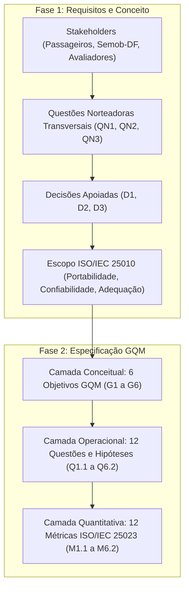

# Abordagem GQM e Metas de Avaliação

A validação de qualidade do aplicativo móvel **DF no Ponto** fundamenta-se nas diretrizes da norma **ISO/IEC 25040**, que divide o ciclo de avaliação de software em quatro etapas centrais: estabelecimento de requisitos, especificação, projeto e execução. Na Fase 1, determinou-se a relevância do sistema para a mobilidade urbana do Distrito Federal, identificando os principais *stakeholders*, delimitando o escopo nas características de **Portabilidade**, **Confiabilidade** e **Adequação Funcional** (ISO/IEC 25010) e formalizando as decisões estratégicas apoiadas (**D1**, **D2** e **D3**).

Esta seção consolida a **Fase 2 (Especificação da Avaliação)**. O intuito é traduzir as necessidades conceituais dos cidadãos e requisitantes em objetivos de medição e métricas operacionais concretas, estruturadas sob o paradigma *Goal–Question–Metric* (GQM) e alinhadas aos indicadores da **ISO/IEC 25023**.

---

## 1. Transição Metodológica: Da Fase 1 ao Ciclo GQM

A especificação da Fase 2 não é um artefato isolado; ela estabelece a continuidade lógica e a operacionalização dos requisitos levantados na Fase 1. A transição dá-se pela conexão entre as necessidades dos *stakeholders*, as **Questões Norteadoras Transversais** e as **Decisões Estratégicas Apoiadas**:

### 1.1. Questões Norteadoras Transversais

As **Questões Norteadoras Transversais** atuam como bússolas conceituais que guiam tanto a formulação dos objetivos na Fase 2 quanto a interpretação dos resultados empíricos que serão coletados na Fase 4:

1. **QN1 — Universalidade e Acesso Equitativo (Portabilidade / D1):**  
   *O aplicativo garante acesso inclusivo e funcional a todos os cidadãos do DF, independentemente da faixa de renda, tamanho da tela ou limitações de hardware e sistema operacional do aparelho?*  
   $\rightarrow$ **Desdobramento:** Orienta a Decisão **D1**, originando os objetivos **G1** (Adaptabilidade de Telas e SO) e **G2** (Instalabilidade e Ausência de Resíduos).

2. **QN2 — Resiliência Operacional sob Condições Reais (Confiabilidade / D2):**  
   *O aplicativo mantém sua integridade operacional e orienta o passageiro de forma confiável mesmo sob as frequentes oscilações da infraestrutura urbana (quedas de rede 3G/4G, ausência de GPS e horários de pico)?*  
   $\rightarrow$ **Desdobramento:** Orienta a Decisão **D2**, originando os objetivos **G3** (Maturidade contra Crashes e ANRs) e **G4** (Tolerância a Falhas de Conectividade e Localização).

3. **QN3 — Fidelidade da Informação e Utilidade Pública (Adequação Funcional / D3):**  
   *As informações de rotas, itinerários, horários previstos e geolocalização apresentadas pelo aplicativo correspondem à realidade da operação nas ruas com precisão suficiente para que o cidadão planeje sua viagem com segurança?*  
   $\rightarrow$ **Desdobramento:** Orienta a Decisão **D3**, originando os objetivos **G5** (Correção Temporal e Espacial) e **G6** (Completude da Base e Tarefas Essenciais).

---

## 2. Fundamentos do Modelo GQM

Proposto por Victor Basili, o modelo GQM parte da premissa fundamental de que qualquer medição de software deve possuir um propósito prático bem estabelecido. Sua estrutura organiza-se em três camadas hierárquicas:

| Camada | Componente | Aplicação Prática nesta Avaliação |
| :--- | :--- | :--- |
| **Conceitual** | **Objetivo** (*Goal*) | O que se pretende analisar no DF no Ponto, sob qual atributo de qualidade (ISO 25010), para qual finalidade (Decisões D1-D3) e sob a ótica de qual stakeholder. |
| **Operacional** | **Questão** (*Question*) | Interrogações analíticas cujas respostas comprovam o atendimento do objetivo, acompanhadas de hipóteses preditivas baseadas no uso real. |
| **Quantitativo** | **Métrica** (*Metric*) | Fórmulas, dados e escalas padronizadas (ISO 25023) coletadas objetivamente para responder a cada questão. |

O fluxo de trabalho opera bidirecionalmente: a especificação descende do conceito às métricas, enquanto a análise futura ascende dos dados empíricos para responder às questões e julgar os objetivos.

---

## 3. Visão Geral do Planejamento GQM

Para abranger as necessidades mapeadas na Fase 1, o escopo foi desdobrado em **6 objetivos de medição** (*Goals*), estruturados em estrita consonância com as Questões Norteadoras e as Decisões Apoiadas:

| Objetivo | Questão Norteadora | Decisão Apoiada | Característica / Subcaracterística (ISO 25010) | Questões Operacionais | Métricas (ISO 25023) |
| :---: | :---: | :---: | :--- | :---: | :---: |
| **G1** | **QN1** | **D1** | Portabilidade / Adaptabilidade | Q1.1, Q1.2 | M1.1, M1.2 |
| **G2** | **QN1** | **D1** | Portabilidade / Instalabilidade | Q2.1, Q2.2 | M2.1, M2.2 |
| **G3** | **QN2** | **D2** | Confiabilidade / Maturidade | Q3.1, Q3.2 | M3.1, M3.2 |
| **G4** | **QN2** | **D2** | Confiabilidade / Tolerância a Falhas | Q4.1, Q4.2 | M4.1, M4.2 |
| **G5** | **QN3** | **D3** | Adequação Funcional / Correção | Q5.1, Q5.2 | M5.1, M5.2 |
| **G6** | **QN3** | **D3** | Adequação Funcional / Completude (e Pertinência) | Q6.1, Q6.2 | M6.1, M6.2 |
| **Total** | **3 QNs** | **3 Decisões** | **3 Características / 6 Subcaracterísticas** | **12 Questões** | **12 Métricas** |

---

## 4. Metas de Medição (Objetivos GQM)

Os objetivos de medição foram formalizados utilizando o template clássico do GQM, explicitando a transição direta das prioridades da Fase 1:

### G1 — Portabilidade (Adaptabilidade) · *Orientado por QN1 e D1*
| Parâmetro do Template | Especificação do Alvo |
| :--- | :--- |
| **Analisar** | o aplicativo móvel DF no Ponto em diferentes arquiteturas de hardware e resoluções de tela |
| **com a finalidade de** | compreender o comportamento adaptativo da interface gráfica e a compatibilidade operacional |
| **no que se refere à** | Portabilidade (subcaracterística de Adaptabilidade) |
| **do ponto de vista de** | usuários finais e cidadãos que utilizam smartphones de entrada com telas compactas |
| **no contexto de** | testes de caixa preta em múltiplos dispositivos físicos e emuladores móveis |

### G2 — Portabilidade (Instalabilidade) · *Orientado por QN1 e D1*
| Parâmetro do Template | Especificação do Alvo |
| :--- | :--- |
| **Analisar** | o processo de distribuição, instalação e remoção do DF no Ponto |
| **com a finalidade de** | avaliar a taxa de sucesso nas lojas oficiais e a integridade de armazenamento pós-desinstalação |
| **no que se refere à** | Portabilidade (subcaracterística de Instalabilidade) |
| **do ponto de vista de** | cidadãos com aparelhos de armazenamento restrito e equipes de suporte |
| **no contexto de** | ciclos padronizados de instalação limpa e auditoria de arquivos residuais no sistema de arquivos |

### G3 — Confiabilidade (Maturidade) · *Orientado por QN2 e D2*
| Parâmetro do Template | Especificação do Alvo |
| :--- | :--- |
| **Analisar** | a estabilidade operacional e a frequência de travamentos do DF no Ponto |
| **com a finalidade de** | medir o índice de sessões sem falhas inesperadas de execução |
| **no que se refere à** | Confiabilidade (subcaracterística de Maturidade) |
| **do ponto de vista de** | passageiros em deslocamento diário sob uso ativo do sistema |
| **no contexto de** | sessões monitoradas de navegação contínua por fluxos de pesquisa e consulta de rotas |

### G4 — Confiabilidade (Tolerância a Falhas) · *Orientado por QN2 e D2*
| Parâmetro do Template | Especificação do Alvo |
| :--- | :--- |
| **Analisar** | a resiliência do DF no Ponto diante de oscilações adversas da infraestrutura externa |
| **com a finalidade de** | avaliar a capacidade de resposta e recuperação perante quedas de rede móvel e perda de GPS |
| **no que se refere à** | Confiabilidade (subcaracterística de Tolerância a Falhas) |
| **do ponto de vista de** | passageiros aguardando em paradas com sinal deficiente |
| **no contexto de** | ensaios de interrupção induzida de conexão 3G/4G e suspensão de localização |

### G5 — Adequação Funcional (Correção) · *Orientado por QN3 e D3*
| Parâmetro do Template | Especificação do Alvo |
| :--- | :--- |
| **Analisar** | a exatidão quantitativa das previsões de chegada e da localização dos ônibus no mapa |
| **com a finalidade de** | quantificar o erro temporal em minutos e o desvio espacial métrico das informações |
| **no que se refere à** | Adequação Funcional (subcaracterística de Correção) |
| **do ponto de vista de** | cidadãos que necessitam de previsibilidade para o embarque |
| **no contexto de** | auditoria comparativa entre os dados do aplicativo e a chegada física dos ônibus em paradas de campo |

### G6 — Adequação Funcional (Completude e Pertinência) · *Orientado por QN3 e D3*
| Parâmetro do Template | Especificação do Alvo |
| :--- | :--- |
| **Analisar** | a cobertura da malha de linhas/itinerários e o sucesso na execução de tarefas vitais |
| **com a finalidade de** | certificar a sincronização do banco com a Semob-DF e a eficácia das funções essenciais |
| **no que se refere à** | Adequação Funcional (subcaracterística de Completude, delimitada pela Pertinência) |
| **do ponto de vista de** | passageiros planejando trajetos complexos e órgãos gestores do transporte |
| **no contexto de** | execução integral do catálogo de tarefas essenciais e confronto amostral com a base da Semob-DF |

---

## 5. Matriz de Questões, Hipóteses e Abstraction Sheets

O desdobramento das metas conceituais resultou em 12 questões operacionais acompanhadas de suas hipóteses preditivas, harmonizadas com as métricas detalhadas em [Métricas e Julgamento](metricas-julgamento.md):

### Matriz de Questões e Hipóteses Operacionais

| Objetivo / Eixo | ID | Questão Operacional (*Question*) | Hipótese Preditiva (*Hypothesis*) | Métrica Vinculada |
| :--- | :---: | :--- | :--- | :---: |
| **G1 — Portabilidade (Adaptabilidade)** | **Q1.1** | A interface gráfica se redimensiona sem sobreposições em telas compactas? | **H1.1:** Telas abaixo de 5 polegadas podem apresentar sobreposições pontuais na camada do mapa. | **M1.1** |
| | **Q1.2** | O aplicativo executa sem erros críticos de compatibilidade em versões legadas de SO? | **H1.2:** Espera-se pleno funcionamento nas versões de SO testadas (Android 9 a 13). | **M1.2** |
| **G2 — Portabilidade (Instalabilidade)** | **Q2.1** | O processo de instalação nas lojas oficiais ocorre na primeira tentativa sem erro? | **H2.1:** Espera-se taxa de sucesso de 100% nas instalações oficiais. | **M2.1** |
| | **Q2.2** | O aplicativo remove totalmente seus dados temporários após a desinstalação? | **H2.2:** Espera-se a permanência de arquivos residuais de cache no armazenamento interno. | **M2.2** |
| **G3 — Confiabilidade (Maturidade)** | **Q3.1** | O aplicativo evita encerramentos forçados (*crashes*) durante sessões ativas? | **H3.1:** Alta estabilidade geral, com eventuais falhas concentradas em picos de requisição de dados. | **M3.1** |
| | **Q3.2** | O sistema previne congelamentos prolongados de tela superiores a 5 segundos (*ANRs*)? | **H3.2:** Ocorrência pontual de travamentos temporários ao sincronizar grandes bases geográficas. | **M3.2** |
| **G4 — Confiabilidade (Tolerância a Falhas)** | **Q4.1** | O aplicativo trata quedas momentâneas de conexão com mensagens amigáveis? | **H4.1:** O app pode apresentar telas de carregamento infinito por carência de modo offline. | **M4.1** |
| | **Q4.2** | O sistema reage apropriadamente à ausência ou desativação do sinal de GPS? | **H4.2:** O app orienta visualmente o usuário a restabelecer a localização sem quebrar a sessão. | **M4.2** |
| **G5 — Adequação Funcional (Correção)** | **Q5.1** | As previsões de horários de chegada refletem com precisão a aproximação física? | **H5.1:** Margem de divergência tolerável de poucos minutos decorrente do tráfego urbano real. | **M5.1** |
| | **Q5.2** | A posição dos ônibus e paradas no mapa coincide com a posição espacial real? | **H5.2:** Exatidão satisfatória, sujeita a eventuais atrasos na transmissão dos dados do hardware embarcado. | **M5.2** |
| **G6 — Adequação Funcional (Completude)** | **Q6.1** | O catálogo de tarefas essenciais executa de ponta a ponta com sucesso? | **H6.1:** Módulos de busca de rotas e salvamento de favoritos operam sem falhas estruturais. | **M6.1** |
| | **Q6.2** | A base de linhas e itinerários do app está plenamente sincronizada com a Semob-DF? | **H6.2:** Cobertura satisfatória das principais linhas troncais registradas no DF. | **M6.2** |

---

### *Abstraction Sheets* por Agrupamento de Qualidade

#### A. Portabilidade (G1 e G2) · *QN1 / D1*
| Foco de Qualidade (*Baseline* Esperada) | Fatores de Variação e Impacto |
| :--- | :--- |
| Telas abaixo de 5 polegadas podem sofrer sobreposição de elementos no mapa · A instalação via loja oficial ocorre sem fricção, mas podem persistir arquivos residuais de cache após a remoção. | • **Modos de acessibilidade do SO** (ex: fontes ampliadas) alteram o dimensionamento visual da UI. • **Permissões de hardware negadas** no primeiro uso podem ser interpretadas erroneamente como barreiras de instalação. |

#### B. Confiabilidade (G3 e G4) · *QN2 / D2*
| Foco de Qualidade (*Baseline* Esperada) | Fatores de Variação e Impacto |
| :--- | :--- |
| Estima-se que picos de acesso sobrecarreguem requisições, gerando índices pontuais de ANR · O aplicativo carece de um modo *offline* robusto, resultando em tempos de espera excessivos sob redes móveis instáveis. | • **Indisponibilidade temporária da API da Semob** paralisa o front-end, gerando falsos positivos de falha interna no cliente. • **Modos de economia de energia** ativados no dispositivo podem suspender serviços de localização em segundo plano. |

#### C. Adequação Funcional (G5 e G6) · *QN3 / D3*
| Foco de Qualidade (*Baseline* Esperada) | Fatores de Variação e Impacto |
| :--- | :--- |
| Espera-se uma margem de divergência tolerável entre as previsões e a chegada física dos coletivos · Os módulos principais de busca e salvamento de favoritos operam sem falhas estruturais em 100% dos testes. | • **Variáveis operacionais urbanas** (congestionamentos severos ou falhas físicas em rastreadores embarcados nos ônibus) distorcem a precisão do tempo estimado, refletindo limitações de infraestrutura externa e não de código. |

---

## 6. Referências Bibliográficas

- **BASILI, Victor R.; CALDIERA, Gianluigi; ROMBACH, H. Dieter.** *The Goal Question Metric Approach*. Encyclopedia of Software Engineering, 1994.
- **ISO/IEC 25010:2023.** *Systems and software engineering — Systems and software Quality Requirements and Evaluation (SQuaRE) — Product quality model*.
- **ISO/IEC 25023:2016.** *Systems and software engineering — Systems and software Quality Requirements and Evaluation (SQuaRE) — Measurement of system and software product quality*.
- **ISO/IEC 25040:2011.** *Systems and software engineering — Systems and software Quality Requirements and Evaluation (SQuaRE) — Evaluation process*.

---

## Histórico de Versões

| ID  | Descrição | Autor | Data | Revisor | Data |
| :-: | :--- | :--- | :---: | :--- | :---: |
| 01 | Criação inicial do documento | [Cristiano](https://github.com/CristianoMoraiss) | 31/10/2026 | [Bessa](https://github.com/bessazs) | 31/10/2026 |
| 02 | Formalização da Transição Metodológica (Fase 1 $\rightarrow$ Fase 2), inclusão das Questões Norteadoras (QN1-QN3) e alinhamento com Decisões D1-D3 | [João Guilherme Fonseca](https://github.com/JoaoGuilherme14) | 11/11/2026 | [Pedro Ramos](https://github.com/PedroRSR) | 11/11/2026 |
