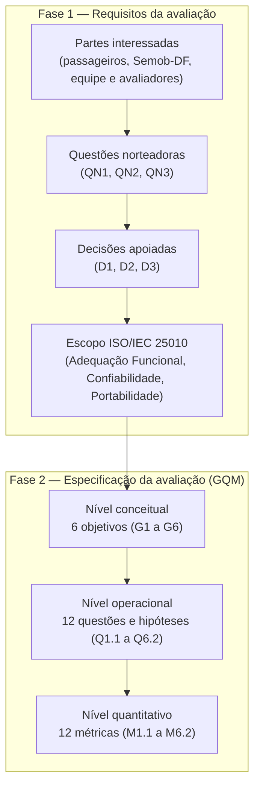

# Abordagem GQM e Metas de Avaliação

A validação de qualidade do aplicativo móvel **DF no Ponto** fundamenta-se nas diretrizes da norma **ISO/IEC 25040**, cujo processo de avaliação se organiza em cinco atividades: estabelecer os requisitos da avaliação, especificar a avaliação, projetar a avaliação, executar a avaliação e concluir a avaliação, agrupadas nas quatro fases do projeto (a execução e a conclusão compõem a Fase 4). Na Fase 1, determinou-se a relevância do sistema para a mobilidade urbana do Distrito Federal, identificando os principais *stakeholders*, delimitando o escopo nas características de **Portabilidade**, **Confiabilidade** e **Adequação Funcional** (ISO/IEC 25010) e formalizando as decisões estratégicas apoiadas (**D1**, **D2** e **D3**).

Esta seção consolida a **Fase 2 (Especificação da Avaliação)**. O intuito é traduzir as necessidades conceituais dos cidadãos e requisitantes em objetivos de medição e métricas operacionais concretas, estruturadas sob o paradigma *Goal–Question–Metric* (GQM) e alinhadas aos indicadores da **ISO/IEC 25023**.

---

## 1. Transição Metodológica: Da Fase 1 ao Ciclo GQM

A especificação da Fase 2 não é um artefato isolado; ela estabelece a continuidade lógica e a operacionalização dos requisitos levantados na Fase 1 e conecta-se diretamente à sua execução prática no **[Planejamento da Avaliação (Fase 3)](../fase3/introducao.md)**. Enquanto a Fase 1 delimitou as decisões estratégicas e a Fase 2 definiu as metas e métricas GQM, a Fase 3 projeta os roteiros operacionais ([Método](../fase3/1-metodo.md), [Procedimentos](../fase3/2-procedimentos.md), [Recursos](../fase3/3-recursos.md) e [Cronograma](../fase3/4-cronograma.md)) necessários para a coleta de dados que ocorrerá na Fase 4. A transição dá-se pela conexão entre as necessidades dos *stakeholders*, as **Questões Norteadoras Transversais** e as **Decisões Estratégicas Apoiadas**:

Figura 1. Transição da Fase 1 para o ciclo GQM da Fase 2. Fonte: elaboração própria (2026).

### 1.1. Questões Norteadoras Transversais

As **Questões Norteadoras Transversais** atuam como bússolas conceituais que guiam tanto a formulação dos objetivos na Fase 2 quanto a interpretação dos resultados empíricos que serão coletados na Fase 4:

1. **QN1 — Universalidade e Acesso Equitativo (Portabilidade / D1):**  
   *O aplicativo garante acesso inclusivo e funcional a todos os cidadãos do DF, independentemente da faixa de renda, tamanho da tela ou limitações de hardware e sistema operacional do aparelho?*  
   $\rightarrow$ **Desdobramento:** Orienta a Decisão **D1**, originando os objetivos [**G1**](#g1) (Adaptabilidade de Telas e SO) e [**G2**](#g2) (Instalabilidade e Ausência de Resíduos).

2. **QN2 — Resiliência Operacional sob Condições Reais (Confiabilidade / D2):**  
   *O aplicativo mantém sua integridade operacional e orienta o passageiro de forma confiável mesmo sob as frequentes oscilações da infraestrutura urbana (quedas de rede 3G/4G, ausência de GPS e horários de pico)?*  
   $\rightarrow$ **Desdobramento:** Orienta a Decisão **D2**, originando os objetivos [**G3**](#g3) (Maturidade contra Crashes e ANRs) e [**G4**](#g4) (Tolerância a Falhas de Conectividade e Localização).

3. **QN3 — Fidelidade da Informação e Utilidade Pública (Adequação Funcional / D3):**  
   *As informações de rotas, itinerários, horários previstos e geolocalização apresentadas pelo aplicativo correspondem à realidade da operação nas ruas com precisão suficiente para que o cidadão planeje sua viagem com segurança?*  
   $\rightarrow$ **Desdobramento:** Orienta a Decisão **D3**, originando os objetivos [**G5**](#g5) (Correção Temporal e Espacial) e [**G6**](#g6) (Completude da Base e Tarefas Essenciais).

---

## 2. Fundamentos do Modelo GQM

Proposto por Victor Basili, o modelo GQM parte da premissa fundamental de que qualquer medição de software deve possuir um propósito prático bem estabelecido. Sua estrutura organiza-se em três camadas hierárquicas:

| Camada | Componente | Aplicação Prática nesta Avaliação |
| :--- | :--- | :--- |
| **Conceitual** | **Objetivo** (*Goal*) | O que se pretende analisar no DF no Ponto, sob qual atributo de qualidade (ISO 25010), para qual finalidade (Decisões D1–D3) e sob a ótica de qual stakeholder. |
| **Operacional** | **Questão** (*Question*) | Interrogações analíticas cujas respostas comprovam o atendimento do objetivo, acompanhadas de hipóteses preditivas baseadas no uso real. |
| **Quantitativo** | **Métrica** (*Metric*) | Fórmulas, dados e escalas padronizadas (ISO 25023) coletadas objetivamente para responder a cada questão. |

O fluxo de trabalho opera bidirecionalmente: a especificação descende do conceito às métricas, enquanto a análise futura ascende dos dados empíricos para responder às questões e julgar os objetivos.

A escolha de cada métrica não é arbitrária: ela deriva de um objetivo, responde a uma questão e se apoia em norma e literatura, conforme resumido na [Seção 3.1](#31-fundamentacao-adaptacao-e-relevancia-das-metricas).

---

## 3. Visão Geral do Planejamento GQM

Para abranger as necessidades mapeadas na Fase 1, o escopo foi desdobrado em **6 objetivos de medição** (*Goals*), estruturados em estrita consonância com as Questões Norteadoras e as Decisões Apoiadas. Cada objetivo e métrica possui sua técnica de ensaio ou medição em campo projetada no **[Método de Avaliação da Fase 3](../fase3/1-metodo.md#3-tecnicas-de-avaliacao-por-metrica)**:

| Objetivo | Questão Norteadora | Decisão Apoiada | Característica / Subcaracterística (ISO 25010) | Questões Operacionais | Métricas (ISO 25023) |
| :---: | :---: | :---: | :--- | :---: | :--- |
| [**G1**](#g1) | [**QN1**](#qn1) | **D1** | Portabilidade / Adaptabilidade | [Q1.1](#q1-1), [Q1.2](#q1-2) | [**M1.1**](#m1-1) – Adaptabilidade de Hardware (Telas) [**M1.2**](#m1-2) – Adaptabilidade de Sistema Operacional |
| [**G2**](#g2) | [**QN1**](#qn1) | **D1** | Portabilidade / Instalabilidade | [Q2.1](#q2-1), [Q2.2](#q2-2) | [**M2.1**](#m2-1) – Sucesso de Instalação [**M2.2**](#m2-2) – Resíduo Pós-Desinstalação |
| [**G3**](#g3) | [**QN2**](#qn2) | **D2** | Confiabilidade / Maturidade | [Q3.1](#q3-1), [Q3.2](#q3-2) | [**M3.1**](#m3-1) – Sessões sem Crashes [**M3.2**](#m3-2) – Sessões sem Congelamentos |
| [**G4**](#g4) | [**QN2**](#qn2) | **D2** | Confiabilidade / Tolerância a Falhas | [Q4.1](#q4-1), [Q4.2](#q4-2) | [**M4.1**](#m4-1) – Mitigação de Perda de Conexão [**M4.2**](#m4-2) – Tratamento de Perda de GPS |
| [**G5**](#g5) | [**QN3**](#qn3) | **D3** | Adequação Funcional / Correção | [Q5.1](#q5-1), [Q5.2](#q5-2) | [**M5.1**](#m5-1) – Precisão de Tempo [**M5.2**](#m5-2) – Correção de Dados (Mapa) |
| [**G6**](#g6) | [**QN3**](#qn3) | **D3** | Adequação Funcional / Completude (e Pertinência) | [Q6.1](#q6-1), [Q6.2](#q6-2) | [**M6.1**](#m6-1) – Cobertura de Tarefas Essenciais [**M6.2**](#m6-2) – Completude do Banco |
| **Total** | **3 QNs** | **3 Decisões** | **3 Características / 6 Subcaracterísticas** | **12 Questões** | **12 Métricas** |

Tabela 1. Visão geral do planejamento GQM. Fonte: elaboração própria (2026).

### 3.1. Fundamentação, Adaptação e Relevância das Métricas

A ISO/IEC 25023 define medidas genéricas, em geral razões do tipo $X = A/B$. As métricas deste projeto são **adaptações** dessas medidas a um aplicativo móvel de transporte público; quando a norma não traz medida equivalente, a métrica é declarada como **extensão do projeto**. Fórmulas, escalas e limiares estão detalhados em [Métricas e Julgamento](metricas-julgamento.md#detalhamento-das-metricas).

| Métrica | Embasamento teórico | Adaptação do projeto | Impacto técnico e relevância |
| :--- | :--- | :--- | :--- |
| [**M1.1** Adaptabilidade de Hardware (Telas)](metricas-julgamento.md#m11-adaptabilidade-de-hardware-telas) | ISO/IEC 25010 (adaptabilidade); ISO/IEC 25023 (adaptabilidade ao ambiente de hardware); WCAG 2.1, critério 1.4.4 (texto ampliável a 200%) | Unidade de contagem: caso *tela $\times$ configuração* (resolução, orientação, tamanho de fonte); razão $T_s / T_t$. Depende da amostra de dispositivos, que deve ser informada | Sobreposição ou corte de controles sobre o mapa impede a consulta no ponto de ônibus, sem alternativa imediata; indica quais configurações corrigir (**D1**) |
| [**M1.2** Adaptabilidade de Sistema Operacional](metricas-julgamento.md#m12-adaptabilidade-de-sistema-operacional) | ISO/IEC 25010 (adaptabilidade); ISO/IEC 25023 (adaptabilidade ao ambiente de software de sistema) | Versão aprovada somente se **todos** os fluxos críticos concluírem sem erro impeditivo. Mede proporção de **versões**, não de usuários | Aparelhos de entrada tendem a ficar em versões antigas; incompatibilidade exclui esse grupo ([**QN1**](#qn1)) |
| [**M2.1** Sucesso de Instalação](metricas-julgamento.md#m21-sucesso-de-instalacao) | ISO/IEC 25010 (instalabilidade); ISO 9241-11 (eficácia); Tullis e Albert (2013) (taxa de sucesso de tarefa) | **Extensão do projeto** (sem medida equivalente na ISO/IEC 25023). Conta só a primeira tentativa | Falha de instalação impede qualquer uso posterior; falta de espaço em aparelhos de armazenamento restrito é cenário plausível ([**QN1**](#qn1)) |
| [**M2.2** Resíduo Pós-Desinstalação](metricas-julgamento.md#m22-residuo-pos-desinstalacao) | ISO/IEC 25010 (instalabilidade inclui a desinstalação) | **Extensão do projeto.** Os locais inspecionados devem incluir áreas que sobrevivem à desinstalação (no Android, o armazenamento compartilhado; os dados específicos do app são removidos). Não mede o volume em bytes | Arquivos órfãos ocupam armazenamento escasso em aparelhos de entrada |
| [**M3.1** Sessões sem Crashes](metricas-julgamento.md#m31-sessoes-sem-crashes) | ISO/IEC 25010 (maturidade); Musa, Iannino e Okumoto (1987) e IEEE 982.1 (taxa de falhas); Android vitals (crash percebido: 1,09%) | A sessão é a unidade; o Android vitals conta usuários ativos diários, então os limiares servem como ordem de grandeza, não como equivalência | Encerramento inesperado durante a aproximação do ônibus pode custar a viagem ([**QN2**](#qn2)) |
| [**M3.2** Sessões sem Congelamentos](metricas-julgamento.md#m32-sessoes-sem-congelamentos) | ISO/IEC 25010 (maturidade); Android Developers (ANR: sem resposta a eventos de entrada em cerca de 5 s); Android vitals (ANR: 0,47%) | Mede o congelamento percebido (> 5 s), conceito não restrito ao Android; o diagnóstico formal de ANR exige evidência em log | Interface congelada no ponto tem efeito próximo ao de um crash: a informação não chega no momento necessário |
| [**M4.1** Mitigação de Perda de Conexão](metricas-julgamento.md#m41-mitigacao-de-perda-de-conexao) | ISO/IEC 25010 (tolerância a falhas); ISO/IEC 25023 (*failure avoidance*); Avižienis et al. (2004); Hsueh, Tsai e Iyer (1997) (injeção de falhas); heurísticas de Nielsen | Falha injetada: queda de rede. Ensaio binário; informar o total de ensaios $R_t$ junto ao resultado | Com conectividade oscilante, um app que quebra ou fica em carregamento infinito transfere ao usuário o custo da falha de infraestrutura ([**QN2**](#qn2)) |
| [**M4.2** Tratamento de Perda de GPS](metricas-julgamento.md#m42-tratamento-de-perda-de-gps) | Mesma base de [M4.1](#m4-1) | Falha injetada: localização desativada. Avalia o *tratamento* da perda, não a qualidade do sinal | Funções de localização param com o GPS desativado (inclusive por economia de energia); consultas independentes devem continuar disponíveis |
| [**M5.1** Precisão de Tempo](metricas-julgamento.md#m51-precisao-de-tempo) | ISO/IEC 25010 (correção funcional); Watkins et al. (2011), Mishalani et al. (2006) e Brakewood et al. (2015) (informação em tempo real para ônibus) | Erro absoluto mediano em minutos, robusto a valores atípicos (Fenton e Bieman, 2014). Limiares de 2, 5 e 10 min são decisão do projeto; informar também a dispersão e o tamanho da amostra | Previsão errada leva o passageiro a decidir mal entre esperar, caminhar ou buscar alternativa ([**QN3**](#qn3)) |
| [**M5.2** Correção de Dados (Mapa)](metricas-julgamento.md#m52-correcao-de-dados-mapa) | ISO/IEC 25010 (correção funcional); ISO/IEC 25012 (exatidão); Sinnott (1984) (haversine); GPS.gov (cerca de 4,9 m sob céu aberto) | Razão $P_s / P_t$ de posições dentro da tolerância $\varepsilon$, fixada **antes** da coleta e sem ficar abaixo do erro do receptor de referência. Apurada apenas com paradas, que são entidades fixas | Posição incorreta de parada ou veículo leva o usuário a esperar no local errado |
| [**M6.1** Cobertura de Tarefas Essenciais](metricas-julgamento.md#m61-cobertura-de-tarefas-essenciais) | ISO/IEC 25010 (completude e pertinência funcional); ISO 9241-11; Tullis e Albert (2013) | Tarefas executadas de ponta a ponta; combina completude e correção do fluxo, por isso o catálogo fixa entradas e resultados esperados | Buscar linha, ver itinerário e horários e salvar favoritos são o propósito do app ([**QN3**](#qn3)) |
| [**M6.2** Completude do Banco](metricas-julgamento.md#m62-completude-do-banco) | ISO/IEC 25012 (completude); ISO/IEC 25024; ISO/IEC 25023 (completude funcional) | Confronto, em amostra auditada, com o catálogo oficial da Semob-DF; o resultado vale para a amostra e a data de referência | Linha ou itinerário ausente é invisível ao usuário, que não sabe que o app está incompleto ([**QN3**](#qn3)) |

Tabela 2. Fundamentação, adaptação e relevância das 12 métricas. Fonte: elaboração própria (2026).

---

## 4. Metas de Medição (Objetivos GQM)

Os objetivos de medição foram formalizados utilizando o template clássico do GQM, explicitando a transição direta das prioridades da Fase 1 e o encadeamento entre cada objetivo, suas questões operacionais e suas métricas. A forma de medição prática de cada objetivo é projetada no **[Método de Avaliação da Fase 3](../fase3/1-metodo.md)** e detalhada nos **[Procedimentos de Execução](../fase3/2-procedimentos.md)**:

### G1 — Portabilidade (Adaptabilidade) · *Orientado por [QN1](#qn1) e D1*
| Parâmetro do Template | Especificação do Alvo |
| :--- | :--- |
| **Analisar** | o aplicativo móvel DF no Ponto em diferentes resoluções de tela, orientações, escalas de fonte e versões do Android |
| **com a finalidade de** | compreender o comportamento adaptativo da interface gráfica e a compatibilidade operacional |
| **no que se refere à** | Portabilidade (subcaracterística de Adaptabilidade) |
| **do ponto de vista de** | usuários finais e cidadãos que utilizam smartphones de entrada com telas compactas |
| **no contexto de** | testes de caixa preta em múltiplos dispositivos físicos e emuladores móveis |

* **Questões operacionais:** [**Q1.1**](#q1-1) (redimensionamento e escala visual da interface) e [**Q1.2**](#q1-2) (compatibilidade entre versões de SO).
* **Métricas do objetivo:**
  * [**M1.1 – Adaptabilidade de Hardware (Telas):**](#m1-1) proporção de casos de tela e configuração (resolução, orientação, tamanho de fonte) em que a interface permanece utilizável ([fórmula e limiares](metricas-julgamento.md#m11-adaptabilidade-de-hardware-telas)).
  * [**M1.2 – Adaptabilidade de Sistema Operacional:**](#m1-2) proporção de versões de SO em que todos os fluxos críticos concluem sem erro impeditivo ([fórmula e limiares](metricas-julgamento.md#m12-adaptabilidade-de-sistema-operacional)).

### G2 — Portabilidade (Instalabilidade) · *Orientado por [QN1](#qn1) e D1*
| Parâmetro do Template | Especificação do Alvo |
| :--- | :--- |
| **Analisar** | o processo de distribuição, instalação e remoção do DF no Ponto |
| **com a finalidade de** | avaliar a taxa de sucesso nas lojas oficiais e a integridade de armazenamento pós-desinstalação |
| **no que se refere à** | Portabilidade (subcaracterística de Instalabilidade) |
| **do ponto de vista de** | cidadãos com aparelhos de armazenamento restrito e órgãos mantenedores (Semob-DF) |
| **no contexto de** | ciclos padronizados de instalação limpa e auditoria de arquivos residuais no sistema de arquivos |

* **Questões operacionais:** [**Q2.1**](#q2-1) (sucesso na primeira tentativa de instalação) e [**Q2.2**](#q2-2) (ausência de arquivos residuais pós-desinstalação).
* **Métricas do objetivo:**
  * [**M2.1 – Sucesso de Instalação:**](#m2-1) taxa de instalações concluídas com sucesso na primeira tentativa ([fórmula e limiares](metricas-julgamento.md#m21-sucesso-de-instalacao)).
  * [**M2.2 – Resíduo Pós-Desinstalação:**](#m2-2) ausência de arquivos residuais observáveis após a remoção do aplicativo ([fórmula e limiares](metricas-julgamento.md#m22-residuo-pos-desinstalacao)).

### G3 — Confiabilidade (Maturidade) · *Orientado por [QN2](#qn2) e D2*
| Parâmetro do Template | Especificação do Alvo |
| :--- | :--- |
| **Analisar** | a estabilidade operacional e a frequência de travamentos do DF no Ponto |
| **com a finalidade de** | medir o índice de sessões sem falhas inesperadas de execução |
| **no que se refere à** | Confiabilidade (subcaracterística de Maturidade) |
| **do ponto de vista de** | passageiros em deslocamento diário sob uso ativo do sistema |
| **no contexto de** | sessões monitoradas de navegação contínua por fluxos de pesquisa e consulta de rotas |

* **Questões operacionais:** [**Q3.1**](#q3-1) (evitação de encerramentos forçados) e [**Q3.2**](#q3-2) (prevenção de congelamentos superiores a 5 segundos).
* **Métricas do objetivo:**
  * [**M3.1 – Sessões sem Crashes:**](#m3-1) proporção de sessões que não sofrem encerramento inesperado ([fórmula e limiares](metricas-julgamento.md#m31-sessoes-sem-crashes)).
  * [**M3.2 – Sessões sem Congelamentos:**](#m3-2) proporção de sessões sem congelamento da interface superior a 5 segundos ([fórmula e limiares](metricas-julgamento.md#m32-sessoes-sem-congelamentos)).

### G4 — Confiabilidade (Tolerância a Falhas) · *Orientado por [QN2](#qn2) e D2*
| Parâmetro do Template | Especificação do Alvo |
| :--- | :--- |
| **Analisar** | a resiliência do DF no Ponto diante de oscilações adversas da infraestrutura externa |
| **com a finalidade de** | avaliar a capacidade de resposta e recuperação perante quedas de rede móvel e perda de GPS |
| **no que se refere à** | Confiabilidade (subcaracterística de Tolerância a Falhas) |
| **do ponto de vista de** | passageiros aguardando em paradas com sinal deficiente |
| **no contexto de** | ensaios de interrupção induzida de conexão 3G/4G e suspensão de localização |

* **Questões operacionais:** [**Q4.1**](#q4-1) (tratamento e recuperação em quedas de conexão) e [**Q4.2**](#q4-2) (orientação e continuidade funcional sem GPS).
* **Métricas do objetivo:**
  * [**M4.1 – Mitigação de Perda de Conexão:**](#m4-1) proporção de ensaios de queda de rede em que o app não quebra, informa a indisponibilidade e retoma após a reconexão ([fórmula e limiares](metricas-julgamento.md#m41-mitigacao-de-perda-de-conexao)).
  * [**M4.2 – Tratamento de Perda de GPS:**](#m4-2) proporção de ensaios de desativação da localização em que o app orienta o usuário e mantém disponíveis as funções que não dependem da posição ([fórmula e limiares](metricas-julgamento.md#m42-tratamento-de-perda-de-gps)).

### G5 — Adequação Funcional (Correção) · *Orientado por [QN3](#qn3) e D3*
| Parâmetro do Template | Especificação do Alvo |
| :--- | :--- |
| **Analisar** | a exatidão quantitativa das previsões de chegada e da localização dos ônibus no mapa |
| **com a finalidade de** | quantificar o erro temporal em minutos e o desvio espacial métrico das informações |
| **no que se refere à** | Adequação Funcional (subcaracterística de Correção) |
| **do ponto de vista de** | cidadãos que necessitam de previsibilidade para o embarque |
| **no contexto de** | auditoria comparativa entre os dados do aplicativo e a chegada física dos ônibus em paradas de campo |

* **Questões operacionais:** [**Q5.1**](#q5-1) (precisão temporal das previsões de chegada) e [**Q5.2**](#q5-2) (exatidão espacial de ônibus e paradas no mapa).
* **Métricas do objetivo:**
  * [**M5.1 – Precisão de Tempo:**](#m5-1) erro absoluto mediano, em minutos, entre a previsão de chegada e a chegada real ([fórmula e limiares](metricas-julgamento.md#m51-precisao-de-tempo)).
  * [**M5.2 – Correção de Dados (Mapa):**](#m5-2) proporção de posições de ônibus e paradas dentro da tolerância espacial em relação à referência ([fórmula e limiares](metricas-julgamento.md#m52-correcao-de-dados-mapa)).

### G6 — Adequação Funcional (Completude e Pertinência) · *Orientado por [QN3](#qn3) e D3*
| Parâmetro do Template | Especificação do Alvo |
| :--- | :--- |
| **Analisar** | a cobertura da malha de linhas/itinerários e o sucesso na execução de tarefas vitais |
| **com a finalidade de** | verificar a correspondência do catálogo do aplicativo com o da Semob-DF e a conclusão das funções essenciais |
| **no que se refere à** | Adequação Funcional (subcaracterística de Completude, delimitada pela Pertinência) |
| **do ponto de vista de** | passageiros planejando trajetos complexos e órgãos gestores do transporte |
| **no contexto de** | execução integral do catálogo de tarefas essenciais e confronto amostral com a base da Semob-DF |

* **Questões operacionais:** [**Q6.1**](#q6-1) (execução ponta a ponta das tarefas essenciais) e [**Q6.2**](#q6-2) (sincronização da base de linhas e itinerários com a Semob-DF).
* **Métricas do objetivo:**
  * [**M6.1 – Cobertura de Tarefas Essenciais:**](#m6-1) proporção de tarefas essenciais executadas de ponta a ponta com sucesso ([fórmula e limiares](metricas-julgamento.md#m61-cobertura-de-tarefas-essenciais)).
  * [**M6.2 – Completude do Banco:**](#m6-2) proporção de linhas e itinerários do catálogo oficial da Semob-DF presentes no aplicativo, em amostra auditada ([fórmula e limiares](metricas-julgamento.md#m62-completude-do-banco)).

---

## 5. Matriz de Questões, Hipóteses e Abstraction Sheets

O desdobramento das metas conceituais resultou em 12 questões operacionais acompanhadas de suas hipóteses, vinculadas aos respectivos objetivos e métricas. Cada hipótese é formulada em termos da métrica e dos [limites de pontuação](metricas-julgamento.md#limites-de-pontuacao-por-metrica), de modo que possa ser confirmada ou refutada pelo resultado da Fase 4:

### Matriz de Questões e Hipóteses Operacionais

| Objetivo / Eixo | ID | Questão Operacional (*Question*) | Hipótese Preditiva (*Hypothesis*) | Métrica Vinculada |
| :--- | :---: | :--- | :--- | :--- |
| [**G1 — Portabilidade (Adaptabilidade)**](#g1) | **Q1.1** | A interface gráfica se redimensiona sem sobreposições ou cortes em telas compactas, diferentes orientações e fontes ampliadas? | **H1.1:** Espera-se M1.1 < 1,00: ao menos um caso de tela compacta ou fonte ampliada apresenta sobreposição ou corte na camada do mapa. | [**M1.1** – Adaptabilidade de Hardware (Telas)](#m1-1) |
| | **Q1.2** | O aplicativo executa sem erros críticos de compatibilidade em diferentes versões de SO (incluindo versões legadas)? | **H1.2:** Espera-se M1.2 = 1,00: todos os fluxos concluem nas versões testadas (Android 9, Android 13 e a versão do aparelho físico). | [**M1.2** – Adaptabilidade de Sistema Operacional](#m1-2) |
| [**G2 — Portabilidade (Instalabilidade)**](#g2) | **Q2.1** | O processo de instalação nas lojas oficiais ocorre na primeira tentativa sem erro? | **H2.1:** Espera-se M2.1 = 1,00: todas as instalações concluem na primeira tentativa. | [**M2.1** – Sucesso de Instalação](#m2-1) |
| | **Q2.2** | O aplicativo evita deixar arquivos residuais no armazenamento compartilhado após a desinstalação? | **H2.2:** Espera-se M2.2 < 1,00: ao menos um dos dez ciclos deixa arquivo residual no armazenamento compartilhado. | [**M2.2** – Resíduo Pós-Desinstalação](#m2-2) |
| [**G3 — Confiabilidade (Maturidade)**](#g3) | **Q3.1** | O aplicativo evita encerramentos forçados (*crashes*) durante sessões ativas? | **H3.1:** Espera-se M3.1 ≥ 0,95: no máximo uma sessão com *crash* em 20, associada ao carregamento de dados. | [**M3.1** – Sessões sem Crashes](#m3-1) |
| | **Q3.2** | O sistema previne congelamentos prolongados de tela superiores a 5 segundos (*ANRs*)? | **H3.2:** Espera-se M3.2 ≥ 0,95: no máximo uma sessão com congelamento em 20, ao carregar o mapa. | [**M3.2** – Sessões sem Congelamentos](#m3-2) |
| [**G4 — Confiabilidade (Tolerância a Falhas)**](#g4) | **Q4.1** | O aplicativo evita quebras, exibe mensagens amigáveis e retoma a operação após quedas momentâneas de conexão? | **H4.1:** Espera-se M4.1 < 0,85: sem modo *offline*, parte dos ensaios termina em carregamento sem aviso dentro do prazo. | [**M4.1** – Mitigação de Perda de Conexão](#m4-1) |
| | **Q4.2** | O sistema reage apropriadamente à ausência ou desativação do sinal de GPS? | **H4.2:** Espera-se M4.2 ≥ 0,85: o app avisa a perda de localização, mantém as funções que não dependem da posição e retoma a localização. | [**M4.2** – Tratamento de Perda de GPS](#m4-2) |
| [**G5 — Adequação Funcional (Correção)**](#g5) | **Q5.1** | As previsões de horários de chegada refletem com precisão a aproximação física? | **H5.1:** Espera-se erro absoluto mediano de até 5 minutos (nota 3 ou superior). | [**M5.1** – Precisão de Tempo](#m5-1) |
| | **Q5.2** | A posição dos ônibus e paradas no mapa coincide com a posição espacial real? | **H5.2:** Espera-se M5.2 ≥ 0,85 para paradas e valor menor para veículos, pela defasagem de transmissão da posição. | [**M5.2** – Correção de Dados (Mapa)](#m5-2) |
| [**G6 — Adequação Funcional (Completude)**](#g6) | **Q6.1** | O catálogo de tarefas essenciais executa de ponta a ponta com sucesso? | **H6.1:** Espera-se M6.1 = 1,00: as oito tarefas essenciais concluem com o resultado esperado. | [**M6.1** – Cobertura de Tarefas Essenciais](#m6-1) |
| | **Q6.2** | A base de linhas e itinerários do app está plenamente sincronizada com a Semob-DF? | **H6.2:** Espera-se M6.2 ≥ 0,95: no máximo um item oficial ausente ou divergente em 20. | [**M6.2** – Completude do Banco](#m6-2) |

Tabela 3. Matriz de questões e hipóteses operacionais. Fonte: elaboração própria (2026).

---

### *Abstraction Sheets* por Agrupamento de Qualidade

#### A. Portabilidade ([G1](#g1) e [G2](#g2)) · *[QN1](#qn1) / D1*
| Foco de Qualidade (*Baseline* Esperada) | Fatores de Variação e Impacto |
| :--- | :--- |
| Telas abaixo de 5 polegadas podem sofrer sobreposição de elementos no mapa · A instalação via loja oficial ocorre sem fricção, mas podem persistir arquivos residuais de cache no armazenamento compartilhado após a remoção. | • **Modos de acessibilidade do SO** (ex: fontes ampliadas) alteram o dimensionamento visual da UI. • **Permissões de hardware negadas** no primeiro uso podem ser interpretadas erroneamente como barreiras de instalação. |

#### B. Confiabilidade ([G3](#g3) e [G4](#g4)) · *[QN2](#qn2) / D2*
| Foco de Qualidade (*Baseline* Esperada) | Fatores de Variação e Impacto |
| :--- | :--- |
| Estima-se que picos de acesso sobrecarreguem requisições, gerando índices pontuais de ANR · O aplicativo carece de um modo *offline* robusto, resultando em tempos de espera excessivos sob redes móveis instáveis. | • **Indisponibilidade temporária da API da Semob** paralisa o front-end, gerando falsos positivos de falha interna no cliente. • **Modos de economia de energia** ativados no dispositivo podem suspender serviços de localização em segundo plano. |

#### C. Adequação Funcional ([G5](#g5) e [G6](#g6)) · *[QN3](#qn3) / D3*
| Foco de Qualidade (*Baseline* Esperada) | Fatores de Variação e Impacto |
| :--- | :--- |
| Espera-se uma margem de divergência tolerável entre as previsões e a chegada física dos coletivos · Os módulos principais de busca e salvamento de favoritos operam sem falhas estruturais em 100% dos testes. | • **Variáveis operacionais urbanas** (congestionamentos severos ou falhas físicas em rastreadores embarcados nos ônibus) distorcem a precisão do tempo estimado, refletindo limitações de infraestrutura externa e não de código. |

---

## 6. Referências Bibliográficas

- **BASILI, Victor R.; CALDIERA, Gianluigi; ROMBACH, H. Dieter.** *The Goal Question Metric Approach*. Encyclopedia of Software Engineering, 1994.
- **ISO/IEC 25010:2011.** *Systems and software engineering — Systems and software Quality Requirements and Evaluation (SQuaRE) — System and software quality models*.
- **ISO/IEC 25023:2016.** *Systems and software engineering — Systems and software Quality Requirements and Evaluation (SQuaRE) — Measurement of system and software product quality*.
- **BASILI, Victor R.; WEISS, David M.** *A methodology for collecting valid software engineering data*. IEEE Transactions on Software Engineering, v. SE-10, n. 6, p. 728–738, 1984.
- **ANDROID DEVELOPERS.** Documentação sobre ANRs, armazenamento específico do app e suporte a diferentes tamanhos de tela. Disponível em: <https://developer.android.com>.
- **AVIŽIENIS, Algirdas; LAPRIE, Jean-Claude; RANDELL, Brian; LANDWEHR, Carl.** Basic concepts and taxonomy of dependable and secure computing. IEEE Transactions on Dependable and Secure Computing, v. 1, n. 1, p. 11–33, 2004.
- **BRAKEWOOD, Candace; MACFARLANE, Gregory S.; WATKINS, Kari.** The impact of real-time information on bus ridership in New York City. Transportation Research Part C, v. 53, p. 59–75, 2015.
- **FENTON, Norman; BIEMAN, James.** *Software Metrics: A Rigorous and Practical Approach*. 3. ed. CRC Press, 2014.
- **GOOGLE.** *Android vitals — bad behavior thresholds*. Disponível em: <https://developer.android.com/google/play/vitals>. Acesso em: 13 nov. 2026.
- **GPS.GOV.** *GPS Accuracy*. Disponível em: <https://www.gps.gov/systems/gps/performance/accuracy/>.
- **HSUEH, Mei-Chen; TSAI, Timothy K.; IYER, Ravishankar K.** Fault injection techniques and tools. Computer, v. 30, n. 4, p. 75–82, 1997.
- **IEEE.** *IEEE Std 982.1-2005 — Standard Dictionary of Measures of the Software Aspects of Dependability*.
- **ISO 9241-11:2018.** *Ergonomics of human-system interaction — Part 11: Usability: Definitions and concepts*.
- **ISO/IEC 25012:2008.** *Software engineering — SQuaRE — Data quality model*.
- **ISO/IEC 25024:2015.** *Systems and software engineering — SQuaRE — Measurement of data quality*.
- **MISHALANI, Rabi G.; MCCORD, Mark M.; WIRTZ, John.** Passenger wait time perceptions at bus stops: empirical results and impact on evaluating real-time bus arrival information. Journal of Public Transportation, v. 9, n. 2, p. 89–106, 2006.
- **MUSA, John D.; IANNINO, Anthony; OKUMOTO, Kazuhira.** *Software Reliability: Measurement, Prediction, Application*. McGraw-Hill, 1987.
- **NIELSEN, Jakob.** *10 Usability Heuristics for User Interface Design*. Nielsen Norman Group.
- **SINNOTT, Roger W.** Virtues of the Haversine. Sky and Telescope, v. 68, n. 2, p. 159, 1984.
- **TULLIS, Thomas; ALBERT, William.** *Measuring the User Experience*. 2. ed. Morgan Kaufmann, 2013.
- **W3C.** *Web Content Accessibility Guidelines (WCAG) 2.1* — critério 1.4.4, Redimensionar texto. Disponível em: <https://www.w3.org/TR/WCAG21/>.
- **WATKINS, Kari E.; FERRIS, Brian; BORNING, Alan; RUTHERFORD, G. Scott; LAYTON, David.** Where Is My Bus? Impact of mobile real-time information on the perceived and actual wait time of transit riders. Transportation Research Part A, v. 45, n. 8, p. 839–848, 2011.
- **ISO/IEC 25040:2011.** *Systems and software engineering — Systems and software Quality Requirements and Evaluation (SQuaRE) — Evaluation process*.
- **Equipe Carol Shaw.** *Fase 3 — Método de Avaliação*. Disponível em: [Método de Avaliação](../fase3/1-metodo.md).

---

## Histórico de Versões

| ID  | Descrição | Autor | Data | Revisor | Data |
| :-: | :--- | :--- | :---: | :--- | :---: |
| 01 | Criação inicial do documento | [Cristiano](https://github.com/CristianoMoraiss) | 31/10/2026 | [Bessa](https://github.com/bessazs) | 31/10/2026 |
| 02 | Formalização da Transição Metodológica (Fase 1 $\rightarrow$ Fase 2), inclusão das Questões Norteadoras (QN1-QN3) e alinhamento com Decisões D1-D3 | [João Guilherme Fonseca](https://github.com/JoaoGuilherme14) | 11/11/2026 | [Pedro Ramos](https://github.com/PedroRSR) | 11/11/2026 |
| 03 | Inclusão da seção 3.1, dos nomes e descrições das métricas nas seções 3, 4 e 5 e das referências correspondentes | [Pedro Ramos](https://github.com/PedroRSR) | 13/11/2026 | [Cristiano Morais](https://github.com/CristianoMoraiss) | 15/11/2026  |
| 04 | Correção do número de atividades do processo de avaliação da ISO/IEC 25040 | [Pedro Ramos](https://github.com/PedroRSR) | 14/11/2026 | [Cristiano Morais](https://github.com/CristianoMoraiss)| 15/11/2026 |
| 05 | Alinhamento das questões do GQM aos objetivos e adição de links internos| [Cristiano Morais](https://github.com/CristianoMoraiss) | 15/11/2026 | — | — |
| 06 | Inclusão de links cruzados e rastreabilidade bidirecional com a Fase 3 (Planejamento, Método, Procedimentos e Recursos) | [João Fonseca](https://github.com/joaoguilherme14) | 15/11/2026 | [Pedro Ramos](https://github.com/PedroRSR) | 15/11/2026 |
| 07 | Hipóteses reescritas em termos das métricas e dos limiares, ajuste dos pontos de vista de G2 e da finalidade de G6, diagrama de transição em Mermaid e legendas das tabelas | [Bessa](https://github.com/bessazs) | 16/11/2026 | — | — |
