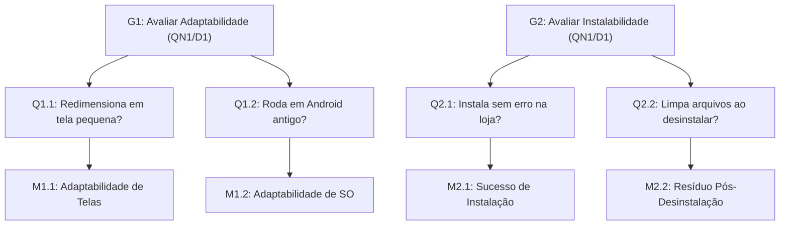
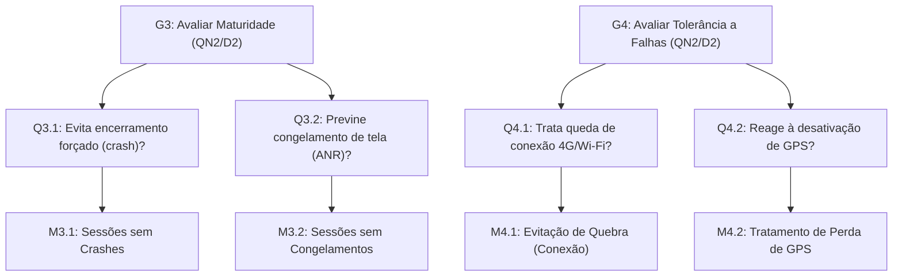
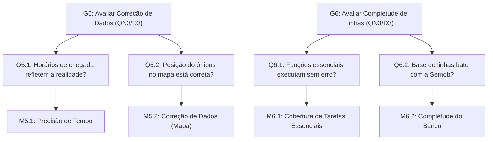

# Fase 2: Rastreabilidade e Diagrama GQM

## 1. Introdução e Propósito da Rastreabilidade

Este documento estabelece a cadeia de **rastreabilidade bidirecional** entre os requisitos conceituais definidos na Fase 1 e a modelagem formal do paradigma *Goal–Question–Metric* (GQM) na Fase 2. A rastreabilidade garante que nenhum indicador tenha sido formulado de maneira arbitrária: cada métrica deriva estritamente de uma necessidade real de um *stakeholder*, responde a uma **Questão Norteadora Transversal** e fundamenta uma **Decisão Estratégica Apoiada (D1, D2 ou D3)**.

---

## 2. Matriz de Rastreabilidade Transversal (Fase 1 $\leftrightarrow$ Fase 2)

A tabela abaixo explicita como as necessidades das partes interessadas da Fase 1 foram convertidas nas metas e indicadores mensuráveis da Fase 2:

| Necessidade da Parte Interessada (Fase 1) | Questão Norteadora Transversal | Decisão Apoiada | Característica / Subcaracterística (ISO 25010) | Meta GQM | Questões Operacionais | Métricas (ISO 25023) |
| :--- | :---: | :---: | :--- | :---: | :---: | :---: |
| **Cidadão:** Acessar o app com interface íntegra, independente do modelo ou resolução de tela do celular. | **QN1** *(Acesso Universal)* | **D1** | Portabilidade / Adaptabilidade | **G1** | Q1.1, Q1.2 | M1.1, M1.2 |
| **Cidadão:** Não sobrecarregar a memória interna do celular ao instalar e desinstalar o aplicativo. | **QN1** *(Acesso Universal)* | **D1** | Portabilidade / Instalabilidade | **G2** | Q2.1, Q2.2 | M2.1, M2.2 |
| **Passageiro / Semob:** O aplicativo não pode fechar sozinho (*crash*) nem travar no momento da aproximação do ônibus. | **QN2** *(Resiliência Operacional)* | **D2** | Confiabilidade / Maturidade | **G3** | Q3.1, Q3.2 | M3.1, M3.2 |
| **Passageiro:** Funcionar com orientação amigável em paradas com sinal ruim de 3G/4G ou sem GPS. | **QN2** *(Resiliência Operacional)* | **D2** | Confiabilidade / Tolerância a Falhas | **G4** | Q4.1, Q4.2 | M4.1, M4.2 |
| **Passageiro:** Confiar na precisão dos horários de chegada e na posição do ônibus no mapa para não perder a viagem. | **QN3** *(Fidelidade da Informação)* | **D3** | Adequação Funcional / Correção | **G5** | Q5.1, Q5.2 | M5.1, M5.2 |
| **Semob / Cidadão:** Encontrar todas as linhas oficiais da malha urbana e executar tarefas essenciais com sucesso. | **QN3** *(Fidelidade da Informação)* | **D3** | Adequação Funcional / Completude (e Pertinência) | **G6** | Q6.1, Q6.2 | M6.1, M6.2 |

Tabela 1. Matriz de Rastreabilidade Transversal entre Requisitos da Fase 1 e o Ciclo GQM da Fase 2.

---

## 3. Verificação de Conformidade e Critérios SQuaRE

| Requisito Metodológico de Conformidade | Atendido? | Justificativa Técnica |
| :--- | :---: | :--- |
| **As métricas correspondem à norma ISO/IEC 25023?** | **Sim** | Derivadas diretamente de medidas internacionais padronizadas para adaptabilidade, instalabilidade, sessões sem crashes/congelamentos, tolerância a falhas e exatidão de dados. |
| **Foram evitadas métricas puras de "Usabilidade subjetiva"?** | **Sim** | O foco da avaliação concentrou-se na mecânica de software, resiliência perante falhas e precisão métrica/temporal objetiva. |
| **Todos os dados podem ser obtidos via Testes de Caixa Preta?** | **Sim** | Por meio de ensaios e simulações no aplicativo em produção em aparelhos físicos, emuladores Android Studio e coleta de campo nas paradas do DF. |
| **A rastreabilidade entre Fases 1 e 2 é contínua e sem lacunas?** | **Sim** | Todas as decisões (D1-D3) e questões norteadoras (QN1-QN3) possuem desdobramento operacional completo até a camada quantitativa. |

---

## 4. Representação Gráfica da Hierarquia GQM

Abaixo apresenta-se a estrutura hierárquica completa nas três camadas do GQM (*Conceitual*, *Operacional* e *Quantitativo*), com as nomenclaturas perfeitamente harmonizadas com a especificação técnica de [Métricas e Julgamento](metricas-julgamento.md):

### 4.1. Característica: Portabilidade (Orientada por QN1 e Decisão D1)

Figura 1. Diagrama GQM da característica de Portabilidade (Adaptabilidade e Instalabilidade).

---

### 4.2. Característica: Confiabilidade (Orientada por QN2 e Decisão D2)

Figura 2. Diagrama GQM da característica de Confiabilidade (Maturidade e Tolerância a Falhas).

---

### 4.3. Característica: Adequação Funcional (Orientada por QN3 e Decisão D3)

Figura 3. Diagrama GQM da característica de Adequação Funcional (Correção e Completude/Pertinência).

---

## 5. Referências Bibliográficas 

- **BASILI, Victor R.; CALDIERA, Gianluigi; ROMBACH, H. Dieter.** *The Goal Question Metric Approach*. Encyclopedia of Software Engineering, 1994.   
- **ISO/IEC 25010:2023.** *Systems and software engineering — Systems and software Quality Requirements and Evaluation (SQuaRE) — Product quality model*.
- **ISO/IEC 25023:2016.** *Systems and software engineering — Systems and software Quality Requirements and Evaluation (SQuaRE) — Measurement of system and software product quality*.
- **ISO/IEC 25040:2011.** *Systems and software engineering — Systems and software Quality Requirements and Evaluation (SQuaRE) — Evaluation process*.

---

## Histórico de Versões

| ID  | Descrição | Autor | Data | Revisor | Data |
| :-: | :--- | :--- | :---: | :--- | :---: |
| 01 | Criação inicial do documento | [Cristiano](https://github.com/CristianoMoraiss) | 31/10/2026 | [Bessa](https://github.com/bessazs) | 31/10/2026 |
| 02 | Refatoração dos diagramas para Mermaid nativo | [João Capozzi](https://github.com/jonas3688) | 11/11/2026 | [Pedro Ramos](https://github.com/PedroRSR) | 11/11/2026 |
| 03 | Inclusão das Questões Norteadoras (QN1-QN3), Decisões (D1-D3) na matriz de rastreabilidade e harmonização das nomenclaturas com a ISO/IEC 25023 | [João Guilherme Fonseca](https://github.com/JoaoGuilherme14) | 11/11/2026 | [Cristiano Morais](https://github.com/CristianoMoraiss) | 11/11/2026 |
