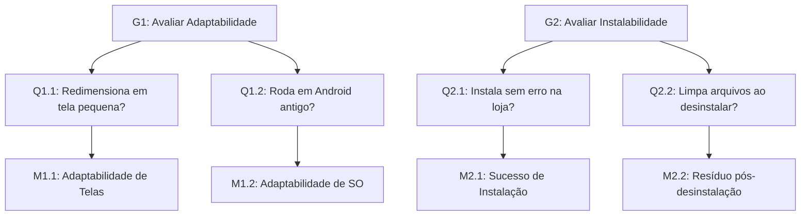
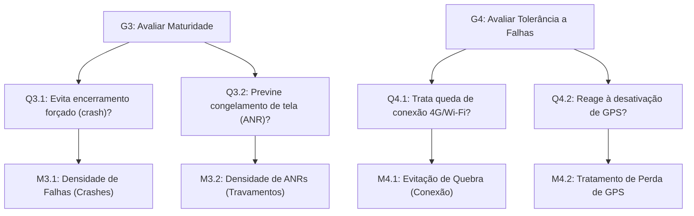
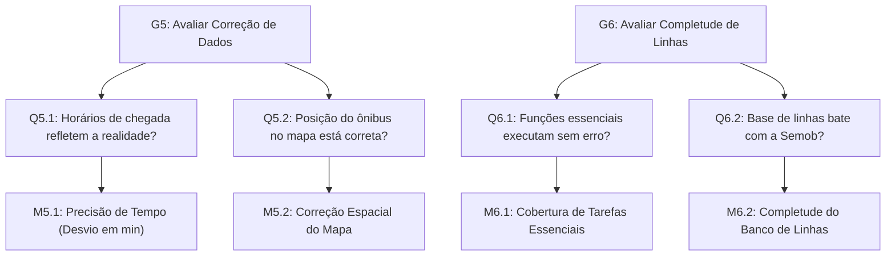

# Fase 2: Rastreabilidade e Diagrama GQM

Este documento garante que todas as métricas geradas estejam atreladas aos propósitos e partes interessadas mapeadas na Fase 1. Nenhum indicador foi criado aleatoriamente; todos derivam da utilidade pública do **DF no Ponto**.

## Matriz de Rastreabilidade GQM

A tabela abaixo explicita como os objetivos de medição foram derivados das características priorizadas. O contexto vem das decisões apoiadas.

| Necessidade da Parte Interessada (Fase 1) | Objetivo / Decisão | Característica / Subcaracterística (ISO 25010) | Questões | Métricas |
|---|---|---|---|---|
| **Cidadão:** Acessar o app independente da renda/modelo de celular. | G1 (D1) | Portabilidade / Adaptabilidade | Q1.1, Q1.2 | M1.1, M1.2 |
| **Cidadão:** Não sobrecarregar a memória do celular ao baixar/apagar. | G2 (D1) | Portabilidade / Instalabilidade | Q2.1, Q2.2 | M2.1, M2.2 |
| **Passageiro / Órgão Público:** O app não pode fechar sozinho quando o ônibus estiver chegando. | G3 (D2) | Confiabilidade / Maturidade | Q3.1, Q3.2 | M3.1, M3.2 |
| **Passageiro:** Funcionar minimamente em paradas com sinal ruim. | G4 (D2) | Confiabilidade / Tolerância a Falhas | Q4.1, Q4.2 | M4.1, M4.2 |
| **Passageiro:** Confiar no horário para não perder a condução. | G5 (D3) | Adequação Funcional / Correção | Q5.1, Q5.2 | M5.1, M5.2 |
| **Semob/Cidadão:** Poder favoritar rotas diárias e encontrar sua linha. | G6 (D3) | Adequação Funcional / Completude | Q6.1, Q6.2 | M6.1, M6.2 |

Tabela 1. Mapeamento das origens das métricas às necessidades do transporte público.

## Verificação e Conformidade (SQuaRE)

| Requisito de Conformidade | Atendido? |
|---|---|
| As métricas correspondem à ISO/IEC 25023? | Sim. Derivadas diretamente de medidas estipuladas na norma para adaptabilidade, instalabilidade, densidade de falhas e corretude de dados. |
| Foram evitadas métricas puras de "Usabilidade" (ex: tempo de clique)? | Sim. O foco esteve na mecânica, resiliência e precisão técnica. |
| Todos os dados podem ser obtidos via Teste de Caixa Preta? | Sim. Através de simulações reais no aplicativo em produção ou via emulador de dispositivos (Android Studio), acessíveis à equipe. |

---

## Diagrama GQM

Abaixo apresentamos a hierarquia estabelecida para a nossa análise, dividida por características de qualidade e utilizando as normas GQM nas três camadas exigidas (*Conceitual*, *Operacional* e *Quantitativo*). Os diagramas ilustram o desdobramento natural dos propósitos de qualidade até as taxas objetivas que serão medidas em campo na Fase 4.

### 1. Característica: Portabilidade

Figura 1. Diagrama GQM focado na característica de Portabilidade (Adaptabilidade e Instalabilidade) com seus níveis conceitual, operacional e quantitativo para o app DF no Ponto.

---

### 2. Característica: Confiabilidade

Figura 2. Diagrama GQM focado na característica de Confiabilidade (Maturidade e Tolerância a Falhas) com seus níveis conceitual, operacional e quantitativo para o app DF no Ponto.

---

### 3. Característica: Adequação Funcional

Figura 3. Diagrama GQM focado na característica de Adequação Funcional (Correção e Completude) com seus níveis conceitual, operacional e quantitativo para o app DF no Ponto.

## Referências Bibliográficas 

*   **BASILI, Victor R.; CALDIERA, Gianluigi; ROMBACH, H. Dieter.** *The Goal Question Metric Approach*. Encyclopedia of Software Engineering, 1994.   
*   **ISO/IEC 25010 / 25023 (Família SQuaRE).**

## Histórico de Versões

| ID  | Descrição                    | Autor                               | Data       | Revisor                              | Data     |
| :-: | :--------------------------- | :---------------------------------- | :--------- | :----------------------------------- | :------- |
| 01  | Criação inicial do documento | [Cristiano](https://github.com/CristianoMoraiss) | 31/10/2026 | [Bessa](https://github.com/bessazs) | 31/10/2026 |
| 02  | Refatoração dos diagramas para Mermaid nativo | [João Capozzi](https://github.com/jonas3688) | 11/11/2026 | - | - |