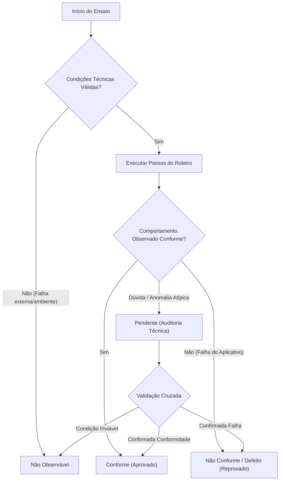

# Fase 3 — Procedimentos de Execução

## 1. Objetivo e escopo

Este documento estabelece as **instruções detalhadas de execução, roteiros de ensaio e formulários padronizados de coleta** para a avaliação de qualidade do aplicativo móvel **DF no Ponto** (versão `5.25.1(1149)`, plataforma Android), conforme a etapa de **projetar a avaliação** da norma **ISO/IEC 25040:2011**.[1]

O propósito deste guia operacional é garantir a **autossuficiência, reprodutibilidade e auditabilidade** dos ensaios. Qualquer membro da equipe técnica ou avaliador independente deve ser capaz de seguir estes procedimentos de ponta a ponta e obter medições consistentes e comparáveis, alimentando as fórmulas das 12 métricas formalizadas na Fase 2 ([Métricas e Critérios de Julgamento](../fase2/metricas-julgamento.md)) sob o método definido em [Método de Avaliação](1-metodo.md) e utilizando os recursos listados em [Recursos](3-recursos.md).

---

## 2. Princípios e diretrizes gerais de execução

A execução das atividades de medição é regida por diretrizes estritas que visam mitigar vieses de confirmação e preservar o rigor científico:

1. **Abordagem estrita de caixa-preta:** Toda a avaliação é conduzida exclusivamente a partir do comportamento externamente observável na interface gráfica e nos fluxos de dados disponibilizados ao usuário final, sem inspeção ou instrumentação de código-fonte interno.
2. **Fixação prévia de parâmetros:** Nenhum parâmetro de teste (tolerância temporal, raio geodésico $\varepsilon$, catálogo de telas, conjunto de linhas amostradas) pode ser alterado após o início da coleta.
3. **Imparcialidade e proibição de seleção retrospectiva:** Todos os ensaios executados devem ser registrados. É terminantemente vedado descartar execuções com resultados desfavoráveis ou reexecutar ensaios seletivamente até a obtenção de um resultado aprovado.
4. **Isolamento de variáveis:**
   - Para ensaios de laboratório, a bateria deve ser realizada com cache e dados limpos quando especificado, em ambientes com conectividade monitorada e sem aplicativos concorrentes de alto consumo em segundo plano.
   - Para ensaios de campo, as observações devem ocorrer em condições meteorológicas seguras e em pontos de parada previamente catalogados na malha da Semob-DF.

---

## 3. Gestão e convenção de evidências

Todas as medições devem ser respaldadas por evidências digitais verificáveis (capturas de tela, gravações contínuas de tela, registros de log do sistema ou arquivos de dados brutos).

### 3.1 Padrão de nomenclatura de arquivos

Os artefatos de evidência coletados devem ser nomeados obrigatoriamente seguindo o padrão estruturado:

$$\text{EVI\_[ID\_METRICA]\_[ID\_CASO]\_[DISPOSITIVO]\_[DATA\_HORA].[EXT]}$$

* **ID_METRICA:** Código da métrica associada (ex.: `M1.1`, `M2.2`, `M5.1`).
* **ID_CASO:** Identificador sequencial do caso de ensaio (ex.: `C01`, `C02`, `LINHA_0.108`).
* **DISPOSITIVO:** Código do dispositivo físico ou emulador utilizado, conforme catalogado em [Recursos](3-recursos.md) (ex.: `DISP-01`, `EMU-01`).
* **DATA_HORA:** Carimbo temporal no formato `YYYYMMDD_HHMMSS` (ex.: `20261116_143000`).
* **EXT:** Extensão do arquivo conforme o tipo de artefato (`png`, `mp4`, `log`, `json`, `csv`).

*Exemplo de registro fotográfico/print:* `EVI_M1.1_C03_DISP-01_20261116_091522.png`  
*Exemplo de gravação de vídeo de sessão:* `EVI_M3.1_C01_DISP-02_20261116_100015.mp4`

### 3.2 Repositório e armazenamento

* As evidências brutas de grande volume (vídeos e capturas completas) devem ser arquivadas em diretório compartilhado em nuvem de acesso restrito da equipe (`/evidencias_fase3/`), mantendo integridade com hash SHA-256 gerado no momento do arquivamento.
* Amostras ilustrativas de conformidade e falhas serão incluídas nos relatórios finais e artefatos de publicação da Fase 4.

---

## 4. Proteção de dados e privacidade (LGPD)

Em estrita conformidade com a Lei Geral de Proteção de Dados Pessoais (**LGPD — Lei nº 13.709/2018**):[3]

1. **Anonimização nas evidências visuais:** Gravações de tela e capturas em campo não devem enquadrar rostos de passageiros, transeuntes, operadores do transporte público, placas de veículos de terceiros ou documentos pessoais.
2. **Uso de contas de teste:** Caso qualquer fluxo exija autenticação ou dados de perfil, devem ser utilizadas contas fictícias de teste criadas especificamente para a avaliação, desvinculadas de dados bancários, CPF ou números de telefone pessoais dos avaliadores.
3. **Preservação de sigilo geográfico:** As medições de campo limitam-se a dados públicos do sistema de transporte coletivo do DF (linhas, paradas e horários operacionais da Semob-DF), não envolvendo rastreamento de rotas residenciais ou hábitos individuais privados.

---

## 5. Protocolo de coleta e formulário padronizado

Para garantir a homogeneidade dos registros efetuados pelos múltiplos avaliadores da equipe Carol Shaw, todas as execuções de ensaio devem ser documentadas em uma **Matriz de Coleta Padronizada**, elaborada em planilha eletrônica auditável e consolidada no repositório.

### 5.1 Campos obrigatórios do formulário de coleta

| Campo | Tipo | Descrição e formato esperado |
| :--- | :--- | :--- |
| **ID_EXEC** | Alfanumérico | Identificador único da execução (ex.: `EXEC-M1.1-001`). |
| **METRICA** | Código | Código da métrica avaliada (`M1.1` a `M6.2`). |
| **CASO_ID** | Código | Identificador do caso de teste dentro do roteiro (ex.: `TC-M1.1-01`). |
| **AVALIADOR** | Texto | Nome ou identificador do responsável pela execução do ensaio. |
| **DATA_HORA** | Timestamp | Data e horário de início da medição (`YYYY-MM-DD HH:MM`). |
| **DISPOSITIVO** | Código | Dispositivo utilizado (`DISP-01`, `EMU-01`), conforme [Recursos](3-recursos.md). |
| **VERSAO_SO** | Texto | Versão do Android e nível de API do dispositivo. |
| **VERSAO_APP** | Texto | Versão exata instalada (deve ser `5.25.1(1149)`). |
| **CONDICAO_CONEXAO** | Categórico | Tipo de conexão ativa (`Wi-Fi`, `4G/5G`, `Sem Conexão / Modo Avião`). |
| **PARAMETROS_ENTRADA** | Texto | Linha, parada, tela ou rota submetida ao ensaio. |
| **RESULTADO_OBSERVADO** | Texto | Descrição fática do comportamento da interface ou dado exibido. |
| **VALOR_MEDIDO** | Numérico / Texto | Valor numérico medido (ex.: segundos, metros, booleano sim/não). |
| **STATUS** | Categórico | Veredito do ensaio: `Conforme`, `Defeito`, `Não Observável` ou `Pendente`. |
| **EVIDENCIA_REF** | Nome de arquivo | Nome do arquivo de evidência gerado conforme o padrão da Seção 3.1. |
| **OBSERVACOES** | Texto livre | Notas contextuais, desvios operacionais ou comportamentos atípicos. |

### 5.2 Modelo estrutural da planilha de coleta

```csv
ID_EXEC;METRICA;CASO_ID;AVALIADOR;DATA_HORA;DISPOSITIVO;VERSAO_SO;VERSAO_APP;PARAMETROS_ENTRADA;RESULTADO_OBSERVADO;VALOR_MEDIDO;STATUS;EVIDENCIA_REF;OBSERVACOES
EXEC-001;M1.1;TC-M1.1-01;Avaliador 1;2026-11-16 10:00;DISP-01;Android 14;5.25.1(1149);Tela Inicial - Fonte Padrão;Layout íntegro sem sobreposição;1;Conforme;EVI_M1.1_TC01_DISP01.png;Nenhuma
EXEC-002;M4.1;TC-M4.1-01;Avaliador 2;2026-11-16 10:30;DISP-01;Android 14;5.25.1(1149);Perda de conexão em consulta;Exibiu snackbar e reteve tela;1;Conforme;EVI_M4.1_TC01_DISP01.mp4;Retomada em 2.1s
```

---

## 6. Tratamento de anomalias, estados de execução e política de reteste

A contabilização correta dos dados nas fórmulas do GQM requer a classificação inequívoca de cada caso executado em um dos quatro estados formais:



### 6.1 Definição dos estados de execução

* **Conforme (Aprovado):** O aplicativo executou a funcionalidade satisfazendo todos os critérios de aprovação definidos no roteiro, sem falhas de renderização, travamentos ou violações de tolerância.
* **Não Conforme / Defeito (Reprovado):** O aplicativo apresentou comportamento incorreto, erro de layout, travamento (*freeze*), encerramento forçado (*crash*) ou medição fora do limiar aceitável. **Permanece obrigatoriamente no denominador da amostra e pontua contra a métrica.**
* **Não Observável:** O ensaio não pôde ser concluído por impedimento externo ou limitação intransponível do ambiente de teste alheia ao aplicativo (ex.: queda total da infraestrutura de telecomunicações do provedor de telefonia, ausência de sinal de satélite em túnel, inexistência de ônibus em circulação no período noturno). Casos não observáveis são documentados com justificativa explícita e **excluídos do denominador válido** da métrica correspondente, sem penalizar o aplicativo.
* **Pendente:** Estado transitório aplicado quando há divergência de interpretação entre avaliadores ou instabilidade atípica do aparelho. Deve ser submetido à revisão cruzada antes da consolidação final da base da Fase 4.

### 6.2 Política de registro de anomalias e reteste

Para evitar o enviesamento de resultados ("garimpar" execuções bem-sucedidas):

1. **Vedação de descarte de defeitos:** Nenhum ensaio reprovado pode ser descartado ou ignorado. Se o aplicativo falhou sob as condições previstas no roteiro, a falha é definitiva para aquele ensaio.
2. **Critério estrito para reteste:** A repetição de um ensaio só é autorizada se comprovada anomalia na **infraestrutura de teste** (ex.: falha de hardware do aparelho avaliador, término de bateria no meio do ensaio ou erro operacional comprovado do avaliador ao executar um passo fora da ordem).
3. **Registro formal de anomalia:** Toda falha observada deve ser registrada em formulário de anomalia, contendo: descrição objetiva do sintoma, passos para reprodução, frequência observada e link da evidência correspondente.

---

## 7. Protocolo de validação cruzada entre pares

Para mitigar a variabilidade interobservador e garantir a clareza e precisão dos roteiros de ensaio:

1. **Execução cruzada de controle:** Antes do início da coleta em larga escala, uma amostra piloto de pelo menos 1 caso de cada métrica deve ser executada por um avaliador que **não participou da redação inicial** do respectivo roteiro.
2. **Identificação de ambiguidades:** Quaisquer passos que gerem dúvidas operacionais, interpretações dúbias de critérios de aceitação ou dificuldades no registro de evidências devem ser pontuados e sanados neste documento antes da batelada definitiva.
3. **Auditoria de amostra:** No encerramento da coleta, 10% dos registros de cada métrica serão auditados por um segundo membro da equipe, conferindo se a evidência arquivada comprova categoricamente o veredito assinalado na planilha.

---

## 8. Roteiros detalhados de execução — Portabilidade (G1 e G2)

Esta seção define os procedimentos operacionais para as métricas da característica **Portabilidade** (subcaracterísticas *Adaptabilidade* e *Capacidade de Instalação*), respondendo à **Decisão D1** (viabilidade de homologação e implantação no ecossistema Android).

---

### 8.1 Roteiro M1.1 — Adaptabilidade de hardware (telas)

* **Objetivo e métrica:** $M_{1.1} = \frac{T_s}{T_t}$ (Proporção de combinações de tela × configuração aprovadas sem defeitos visuais impeditivos).
* **Escopo do ensaio:** Laboratório (dispositivos físicos e emuladores do inventário de [Recursos](3-recursos.md)).
* **Catálogo de telas avaliadas:**
  1. `TELA-01`: Tela Principal / Mapa de Navegação;
  2. `TELA-02`: Pesquisa de Linhas e Itinerários;
  3. `TELA-03`: Detalhamento da Linha (trajeto e lista de paradas);
  4. `TELA-04`: Detalhes do Ponto de Parada e Previsões;
  5. `TELA-05`: Tela de Configurações / Informações do App.
* **Fatores de variação de tela:**
  - Orientação: Retrato (*portrait*).
  - Escala de fonte: Padrão (100%) e Aumentada / Acessibilidade (130%).
  - Densidades de tela: Pequena/Média (~320-360dp de largura) e Grande (~400-480dp de largura).

#### Procedimento de ensaio passo a passo

1. **Configuração inicial:** No dispositivo de teste, ajustar o tamanho da fonte do sistema para o valor do ensaio (100% ou 130%) nas configurações de acessibilidade do Android.
2. **Inicialização:** Abrir o aplicativo DF no Ponto com dados limpos de sessão anterior.
3. **Navegação sistemática:** Acessar sucessivamente as telas `TELA-01` a `TELA-05`. Em cada uma, realizar interações básicas de rolagem e toque nos botões principais.
4. **Inspeção de conformidade:** Verificar se há:
   - Texto truncado ou elipsado que oculte informação crítica (código de linha, horário, nome de parada);
   - Sobreposição de elementos visuais (botão cobrindo campo de busca ou texto);
   - Elemento interativo empurrado para fora da área visível e inacessível por rolagem.
5. **Registro de evidência:** Capturar screenshot de cada tela testada (`EVI_M1.1_TELAxx_...png`).
6. **Contabilização:**
   - **Aprovado ($T_s$):** A interface renderiza com layout íntegro, todas as informações essenciais estão legíveis e todos os botões e campos estão operacionais.
   - **Reprovado:** Há corte, distorção, sobreposição ou inacessibilidade de elemento que impeça ou dificulte gravemente a tarefa.

---

### 8.2 Roteiro M1.2 — Adaptabilidade de SO (versões de Android)

* **Objetivo e métrica:** $M_{1.2} = \frac{O_s}{O_t}$ (Proporção de versões de sistema operacional aprovadas na execução dos fluxos críticos).
* **Escopo do ensaio:** Laboratório em dispositivos físicos e emuladores cobrindo versões suportadas do Android (Android 9/10, Android 11/12, Android 13/14).
* **Catálogo de fluxos críticos de verificação:**
  - `FC-01`: Inicialização do app, solicitação e concessão de permissão de localização.
  - `FC-02`: Pesquisa de linha pelo código numérico e renderização do itinerário no mapa.
  - `FC-03`: Seleção de parada próxima e visualização das previsões de chegada.
  - `FC-04`: Retorno da aplicação após segundo plano (*background resume*).

#### Procedimento de ensaio passo a passo

1. **Preparação:** Selecionar o dispositivo configurado com a versão específica do Android a ser auditada.
2. **Conexão e permissões:** Assegurar conexão com a internet ativa e GPS ativado em modo alta precisão.
3. **Execução de fluxos:** Executar sequencialmente os fluxos críticos `FC-01`, `FC-02`, `FC-03` e `FC-04`.
4. **Verificação de anomalias:** Observar se ocorrem exceções não tratadas, diálogos de incompatibilidade do SO, congelamentos de renderização ou falhas nas APIs nativas do Android.
5. **Registro de evidência:** Gravação de tela contínua da execução dos quatro fluxos (`EVI_M1.2_ANDROIDxx_...mp4`).
6. **Contabilização:**
   - **Aprovado ($O_s$):** A versão de SO é aprovada se e somente se **todos os 4 fluxos críticos** forem concluídos com pleno êxito, sem erro de compatibilidade.
   - **Reprovado:** Falha impeditiva ou encerramento inesperado em qualquer um dos fluxos críticos na respectiva versão do SO.

---

### 8.3 Roteiro M2.1 — Sucesso de instalação

* **Objetivo e métrica:** $M_{2.1} = \frac{I_s}{I_t}$ (Taxa de sucesso na instalação a partir do canal oficial na primeira tentativa).
* **Escopo do ensaio:** Laboratório / Dispositivos físicos representativos com conexão Wi-Fi e dados móveis estáveis.

#### Procedimento de ensaio passo a passo

1. **Pré-condição obrigatória:** Certificar-se de que o aplicativo DF no Ponto **não está instalado** no dispositivo (desinstalar previamente se presente e reiniciar o aparelho).
2. **Acesso ao repositório oficial:** Abrir o aplicativo da Google Play Store e pesquisar por "DF no Ponto" (distribuição oficial da Semob-DF).
3. **Disparo do ciclo:** Tocar no botão "Instalar". Iniciar a cronometragem e observação no instante do toque.
4. **Monitoramento:** Acompanhar as fases de download, verificação de segurança da loja e instalação propriamente dita pelo instalador de pacotes do Android.
5. **Primeira abertura:** Concluída a instalação pela loja, tocar em "Abrir" e aguardar a renderização da tela inicial.
6. **Registro de evidência:** Captura de tela da página da loja indicando "Instalado" e da tela inicial do aplicativo aberto com sucesso (`EVI_M2.1_CICLOxx_...png`).
7. **Contabilização:**
   - **Aprovado ($I_s$):** Instalação e primeira inicialização concluídas na primeira tentativa sem códigos de erro (`Error -505`, falha de assinatura, loop de download ou congelamento).
   - **Reprovado:** Qualquer erro ou interrupção durante o download/instalação que exija intervenção do usuário para reiniciar o processo. Tentativas subsequentes não alteram uma reprovação inicial.

---

### 8.4 Roteiro M2.2 — Resíduo pós-desinstalação

* **Objetivo e métrica:** $M_{2.2} = 1 - \frac{D_r}{D_t}$ (Proporção de desinstalações limpas, sem arquivos órfãos remanescentes no armazenamento do usuário).
* **Escopo do ensaio:** Laboratório em aparelhos físicos ou emuladores com ferramenta de inspeção de arquivos (gerenciador de arquivos ou comando via `adb shell`).

#### Procedimento de ensaio passo a passo

1. **Pré-condição:** Aplicativo devidamente instalado e utilizado durante uma sessão de testes prévia (navegando por linhas e mapas) para garantir que arquivos de cache, preferências e bancos locais tenham sido criados.
2. **Mapeamento pré-remoção:** Conectar o dispositivo ao computador via USB com depuração ativada e inspecionar os diretórios públicos e acessíveis do armazenamento:
   ```bash
   adb shell ls -la /sdcard/Android/data/ | grep -i dfno
   adb shell ls -la /sdcard/Android/media/ | grep -i dfno
   adb shell ls -la /sdcard/Download/ | grep -i dfno
   ```
3. **Execução da desinstalação:** Desinstalar o aplicativo DF no Ponto pelo método padrão do sistema operacional (Arrastar para "Desinstalar" ou via Configurações -> Apps -> DF no Ponto -> Desinstalar).
4. **Mapeamento pós-remoção:** Imediatamente após a confirmação da desinstalação pelo SO, reexecutar a varredura nos mesmos caminhos de armazenamento:
   ```bash
   adb shell ls -la /sdcard/Android/data/ | grep -i dfno
   adb shell ls -la /sdcard/ | grep -i ponto
   ```
5. **Inspeção de resíduos:** Verificar se restaram pastas órfãs, arquivos de log, bancos SQLite residuais ou imagens temporárias gravadas fora do escopo do sandbox privado do app.
6. **Registro de evidência:** Registro em arquivo de log contendo a saída completa dos comandos `adb` antes e depois da desinstalação (`EVI_M2.2_CICLOxx_...log`).
7. **Contabilização:**
   - **Aprovado:** Nenhuma pasta ou arquivo atribuível ao DF no Ponto localizado no armazenamento inspecionado.
   - **Reprovado ($D_r$):** Pelo menos um diretório ou arquivo residual do aplicativo permaneceu no armazenamento do dispositivo após a remoção.
   - **Não Observável:** Caso restrições de permissão do Android (ex.: scoped storage estrito sem acesso de inspeção) impeçam categoricamente a verificação dos diretórios, registrar a impossibilidade técnica motivada.

---

## 9. Roteiros detalhados de execução — Confiabilidade (G3 e G4)

Esta seção estabelece os procedimentos operacionais para as métricas da característica **Confiabilidade** (subcaracterísticas *Maturidade* e *Tolerância a Falhas*), respondendo à **Decisão D2** (estabilidade operacional e resiliência em condições adversas de uso real).

---

### 9.1 Roteiro M3.1 — Sessões sem *crashes*

* **Objetivo e métrica:** $M_{3.1} = 1 - \frac{S_c}{S_t}$ (Proporção de sessões concluídas sem encerramento inesperado ou interrupção anômala).
* **Definição de sessão padronizada:** Uma sessão de uso ativo contínuo com duração planejada de **15 minutos**, executando um ciclo repetitivo de ações típicas do usuário: busca de linhas, consulta de horários, zoom e movimentação no mapa, alternância entre abas e retorno da aplicação após segundo plano.
* **Escopo:** Laboratório e campo, monitorando aparelhos físicos com gravação contínua ou registro em logcat:
  ```bash
  adb logcat -v time | grep -E "FATAL EXCEPTION|AndroidRuntime|SIGSEGV"
  ```

#### Procedimento de ensaio passo a passo

1. **Preparação:** Iniciar a gravação de tela no dispositivo de teste e disparar o cronômetro oficial do ensaio.
2. **Execução do ciclo de ações:** Durante o período de 15 minutos, alternar a cada 2 a 3 minutos entre:
   - Pesquisa de 3 linhas diferentes;
   - Seleção de itinerário e exibição da rota no mapa;
   - Consulta das previsões de chegada em 2 paradas distintas;
   - Minimização temporária do app por 10 segundos e reabertura.
3. **Detecção de anomalia:** Monitorar se ocorre:
   - Fechamento súbito do aplicativo com retorno involuntário à tela inicial do Android;
   - Exibição de diálogo nativo do sistema operacional (*"O DF no Ponto parou"* ou *"O app apresenta falhas contínuas"*);
   - Registro de exceção fatal no logcat.
4. **Tratamento de interrupção:** Se o aplicativo sofrer *crash* aos 7 minutos, a sessão é encerrada imediatamente, contabilizada como afetada por crash ($S_c$) no total de sessões $S_t$. Para continuar a bateria, uma nova sessão independente é iniciada com novo identificador.
5. **Registro de evidência:** Gravação de vídeo do momento do encerramento e captura de logcat com a pilha de chamada (*stack trace*) do erro (`EVI_M3.1_SESSAOxx_...mp4` e `.log`).
6. **Contabilização:**
   - **Aprovado:** A sessão completa os 15 minutos sem nenhum encerramento involuntário.
   - **Reprovado ($S_c$):** Ocorreu ao menos um *crash* durante a sessão.

---

### 9.2 Roteiro M3.2 — Sessões sem congelamentos

* **Objetivo e métrica:** $M_{3.2} = 1 - \frac{S_a}{S_t}$ (Proporção de sessões padronizadas livres de travamento de interface superior a 5 segundos).
* **Definição de congelamento (*freeze*):** Inoperância total ou ausência de resposta da interface gráfica a toques, rolagens ou comandos por tempo **$\Delta t > 5{,}0\text{ segundos}$**.
* **Distinção metodológica fundamental:** Requisições de rede lentas onde o aplicativo exibe um indicador visual ativo de progresso (*spinner*, barra de carregamento ou esqueleto de tela) mantendo o botão de voltar funcional **não são classificadas como congelamento**. O congelamento é caracterizado pela paralisação do thread de renderização (UI Thread travada ou diálogo ANR — *Application Not Responding*).

#### Procedimento de ensaio passo a passo

1. **Preparação:** Dispositivo físico ou emulador com gravação de tela com exibição de toques ativada nas Opções do Desenvolvedor do Android (*"Mostrar toques"* ativado).
2. **Execução do roteiro padrão:** Durante a sessão padronizada de 15 minutos, interagir ativamente com a interface a cada 10-15 segundos (clicar em linhas, expandir menus, arrastar mapa).
3. **Identificação e cronometragem de travamentos:**
   - Ao emitir um comando (toque em parada, abertura de linha ou rolagem de lista), observar se a resposta visual ocorre de imediato.
   - Caso a interface permaneça inerte e indiferente a novos toques, disparar cronômetro no vídeo gravado.
   - Se a paralisação ultrapassar **5,0 segundos** ou disparar diálogo de ANR do SO, o evento é registrado formalmente como congelamento.
4. **Registro de evidência:** Fragmento de vídeo contendo o carimbo de tempo evidenciando o período exato de inércia da tela superior a 5 segundos (`EVI_M3.2_SESSAOxx_...mp4`).
5. **Contabilização:**
   - **Aprovado:** Sessão sem nenhum evento de congelamento $> 5\text{s}$.
   - **Reprovado ($S_a$):** Sessão em que ocorreu ao menos um congelamento $> 5\text{s}$.

---

### 9.3 Roteiro M4.1 — Evitação de quebra por conexão

* **Objetivo e métrica:** $M_{4.1} = \frac{R_s}{R_t}$ (Proporção de interrupções de rede induzidas com tratamento aprovado e recuperação adequada).
* **Escopo do ensaio:** Laboratório, simulando a instabilidade crônica de cobertura celular na malha rodoviária do Distrito Federal.

#### Procedimento de ensaio passo a passo

1. **Pré-condição:** Aplicativo aberto em dispositivo físico conectado à rede de dados ou Wi-Fi, com exibição de linhas ou mapa em funcionamento.
2. **Disparo da consulta:** Realizar uma busca por linha ou abrir uma parada de ônibus que exija carregamento de dados em tempo real.
3. **Indução da falha de rede:** No exato momento do carregamento da consulta, acionar o **Modo Avião** na central rápida do Android, cortando integralmente o tráfego de dados por **15 segundos**.
4. **Verificação de resiliência (Critérios de aprovação):**
   - O aplicativo deve permanecer aberto sem encerrar ou exibir tela preta/branca opaca;
   - Deve apresentar, em até **5,0 segundos**, uma mensagem amigável e inteligível ao usuário informando a indisponibilidade de rede (ex.: *"Sem conexão com a internet"*, *"Verifique sua conexão"* ou ícone explicativo);
   - A interface deve manter botões de navegação e voltar totalmente operacionais.
5. **Restauração da rede:** Desativar o Modo Avião e tocar no botão de tentar novamente ou aguardar a atualização automática.
6. **Tempo de retomada:** O aplicativo deve reestabelecer os dados válidos na tela em até **10,0 segundos** após a reconexão.
7. **Registro de evidência:** Gravação contínua do ensaio demonstrando a injeção do corte, o alerta exibido e a recuperação dos dados (`EVI_M4.1_ENSAIOxx_...mp4`).
8. **Contabilização:**
   - **Aprovado ($R_s$):** Tratamento informativo claro sem travamento e retomada no tempo limite.
   - **Reprovado:** Fechamento forçado, travamento em loop infinito sem aviso de erro ou exigência de reiniciar o app para voltar a utilizá-lo.

---

### 9.4 Roteiro M4.2 — Tratamento de perda de GPS

* **Objetivo e métrica:** $M_{4.2} = \frac{G_s}{G_t}$ (Proporção de eventos de perda de sinal de geolocalização tratados com aviso adequado e continuidade de uso).
* **Escopo do ensaio:** Laboratório ou campo em aparelhos com sensor GNSS nativo.

#### Procedimento de ensaio passo a passo

1. **Pré-condição:** Aplicativo em execução com o mapa principal aberto, GPS ativo e a localização do usuário exibida com o marcador azul centralizado.
2. **Indução da falha de localização:** Deslizar a barra de notificações do Android e desativar o botão de **"Localização" / "GPS"**. Retornar imediatamente ao aplicativo.
3. **Inspeção de resposta do aplicativo:**
   - O aplicativo não pode encerrar nem travar;
   - Deve exibir diálogo ou aviso indicando que a localização está desativada, oferecendo atalho para ativar o recurso ou permitindo continuar em modo de busca manual;
   - O mapa deve manter operacionais as funcionalidades de navegação manual, busca de linhas por texto e consulta a paradas.
4. **Restauração:** Reativar a localização do aparelho e retornar ao aplicativo.
5. **Verificação de retomada:** O aplicativo deve identificar a volta do sensor e atualizar a posição no mapa em até **5,0 segundos**.
6. **Registro de evidência:** Gravação de tela do ciclo de desativação, aviso e reativação (`EVI_M4.2_ENSAIOxx_...mp4`).
7. **Contabilização:**
   - **Aprovado ($G_s$):** Mensagem de alerta adequada, retenção da operabilidade das buscas e reaquisição correta da posição.
   - **Reprovado:** Encerramento inesperado, mapa inoperante ou travamento generalizado da interface.

---
