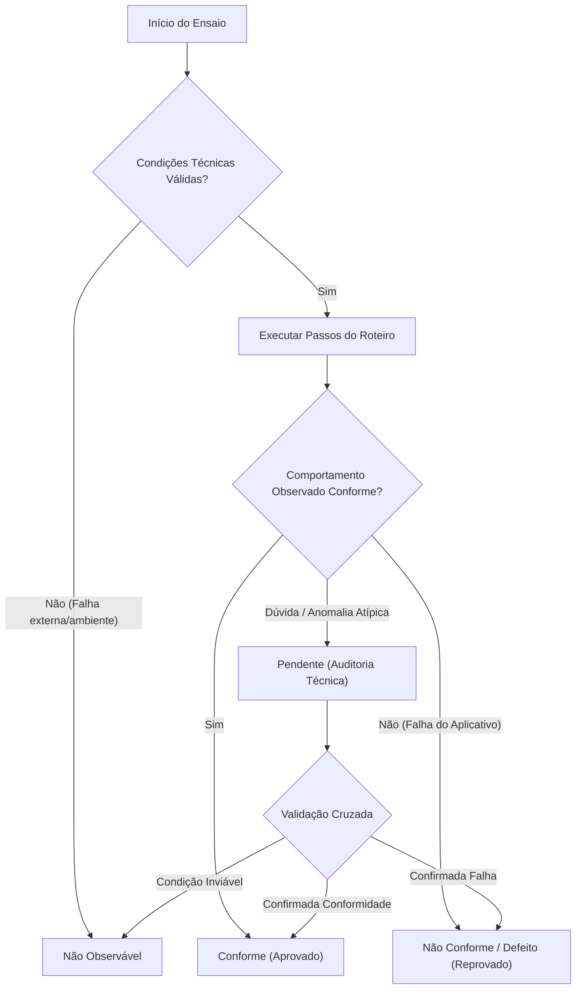

# Fase 3 — Procedimentos de Execução

## 1. Objetivo e escopo

Este documento estabelece as **instruções detalhadas de execução, roteiros de ensaio e formulários padronizados de coleta** para a avaliação de qualidade do aplicativo móvel **DF no Ponto** (versão `5.25.1(1149)`, plataforma Android), conforme a etapa de **projetar a avaliação** da norma **ISO/IEC 25040:2011**.[1]

O propósito deste guia operacional é garantir a **autossuficiência, reprodutibilidade e auditabilidade** dos ensaios. Qualquer membro da equipe técnica ou avaliador independente deve ser capaz de seguir estes procedimentos de ponta a ponta e obter medições consistentes e comparáveis, alimentando as fórmulas das 12 métricas formalizadas na Fase 2 ([Métricas e Critérios de Julgamento](../fase2/metricas-julgamento.md)) sob o método definido em [Método de Avaliação](1-metodo.md) e utilizando os recursos listados em [Recursos](3-recursos.md).

---

## 2. Princípios e diretrizes gerais de execução

A execução das atividades de medição é regida por diretrizes estritas que visam mitigar vieses de confirmação e preservar o rigor científico:

1. **Abordagem estrita de caixa-preta:** Toda a avaliação é conduzida exclusivamente a partir do comportamento externamente observável na interface gráfica e nos fluxos de dados disponibilizados ao usuário final, sem inspeção ou instrumentação de código-fonte interno.
2. **Fixação prévia de parâmetros:** Nenhum parâmetro de teste (tolerância temporal, raio geodésico $\varepsilon$, catálogo de telas, conjunto de linhas amostradas) pode ser alterado após o início da coleta.
3. **Imparcialidade e proibição de seleção retrospectiva:** Todos os ensaios executados devem ser registrados. É terminantemente vedado descartar execuções com resultados desfavoráveis ou reexecutar ensaios seletivamente até a obtenção de um resultado aprovado.
4. **Isolamento de variáveis:**
   - Para ensaios de laboratório, a bateria deve ser realizada com cache e dados limpos quando especificado, em ambientes com conectividade monitorada e sem aplicativos concorrentes de alto consumo em segundo plano.
   - Para ensaios de campo, as observações devem ocorrer em condições meteorológicas seguras e em pontos de parada previamente catalogados na malha da Semob-DF.

---

## 3. Gestão e convenção de evidências

Todas as medições devem ser respaldadas por evidências digitais verificáveis (capturas de tela, gravações contínuas de tela, registros de log do sistema ou arquivos de dados brutos).

### 3.1 Padrão de nomenclatura de arquivos

Os artefatos de evidência coletados devem ser nomeados obrigatoriamente seguindo o padrão estruturado:

$$\text{EVI\_[ID\_METRICA]\_[ID\_CASO]\_[DISPOSITIVO]\_[DATA\_HORA].[EXT]}$$

* **ID_METRICA:** Código da métrica associada (ex.: `M1.1`, `M2.2`, `M5.1`).
* **ID_CASO:** Identificador sequencial do caso de ensaio (ex.: `C01`, `C02`, `LINHA_0.108`).
* **DISPOSITIVO:** Código do dispositivo físico ou emulador utilizado, conforme catalogado em [Recursos](3-recursos.md) (ex.: `DISP-01`, `EMU-01`).
* **DATA_HORA:** Carimbo temporal no formato `YYYYMMDD_HHMMSS` (ex.: `20261116_143000`).
* **EXT:** Extensão do arquivo conforme o tipo de artefato (`png`, `mp4`, `log`, `json`, `csv`).

*Exemplo de registro fotográfico/print:* `EVI_M1.1_C03_DISP-01_20261116_091522.png`  
*Exemplo de gravação de vídeo de sessão:* `EVI_M3.1_C01_DISP-02_20261116_100015.mp4`

### 3.2 Repositório e armazenamento

* As evidências brutas de grande volume (vídeos e capturas completas) devem ser arquivadas em diretório compartilhado em nuvem de acesso restrito da equipe (`/evidencias_fase3/`), mantendo integridade com hash SHA-256 gerado no momento do arquivamento.
* Amostras ilustrativas de conformidade e falhas serão incluídas nos relatórios finais e artefatos de publicação da Fase 4.

---

## 4. Proteção de dados e privacidade (LGPD)

Em estrita conformidade com a Lei Geral de Proteção de Dados Pessoais (**LGPD — Lei nº 13.709/2018**):[3]

1. **Anonimização nas evidências visuais:** Gravações de tela e capturas em campo não devem enquadrar rostos de passageiros, transeuntes, operadores do transporte público, placas de veículos de terceiros ou documentos pessoais.
2. **Uso de contas de teste:** Caso qualquer fluxo exija autenticação ou dados de perfil, devem ser utilizadas contas fictícias de teste criadas especificamente para a avaliação, desvinculadas de dados bancários, CPF ou números de telefone pessoais dos avaliadores.
3. **Preservação de sigilo geográfico:** As medições de campo limitam-se a dados públicos do sistema de transporte coletivo do DF (linhas, paradas e horários operacionais da Semob-DF), não envolvendo rastreamento de rotas residenciais ou hábitos individuais privados.

---

## 5. Protocolo de coleta e formulário padronizado

Para garantir a homogeneidade dos registros efetuados pelos múltiplos avaliadores da equipe Carol Shaw, todas as execuções de ensaio devem ser documentadas em uma **Matriz de Coleta Padronizada**, elaborada em planilha eletrônica auditável e consolidada no repositório.

### 5.1 Campos obrigatórios do formulário de coleta

| Campo | Tipo | Descrição e formato esperado |
| :--- | :--- | :--- |
| **ID_EXEC** | Alfanumérico | Identificador único da execução (ex.: `EXEC-M1.1-001`). |
| **METRICA** | Código | Código da métrica avaliada (`M1.1` a `M6.2`). |
| **CASO_ID** | Código | Identificador do caso de teste dentro do roteiro (ex.: `TC-M1.1-01`). |
| **AVALIADOR** | Texto | Nome ou identificador do responsável pela execução do ensaio. |
| **DATA_HORA** | Timestamp | Data e horário de início da medição (`YYYY-MM-DD HH:MM`). |
| **DISPOSITIVO** | Código | Dispositivo utilizado (`DISP-01`, `EMU-01`), conforme [Recursos](3-recursos.md). |
| **VERSAO_SO** | Texto | Versão do Android e nível de API do dispositivo. |
| **VERSAO_APP** | Texto | Versão exata instalada (deve ser `5.25.1(1149)`). |
| **CONDICAO_CONEXAO** | Categórico | Tipo de conexão ativa (`Wi-Fi`, `4G/5G`, `Sem Conexão / Modo Avião`). |
| **PARAMETROS_ENTRADA** | Texto | Linha, parada, tela ou rota submetida ao ensaio. |
| **RESULTADO_OBSERVADO** | Texto | Descrição fática do comportamento da interface ou dado exibido. |
| **VALOR_MEDIDO** | Numérico / Texto | Valor numérico medido (ex.: segundos, metros, booleano sim/não). |
| **STATUS** | Categórico | Veredito do ensaio: `Conforme`, `Defeito`, `Não Observável` ou `Pendente`. |
| **EVIDENCIA_REF** | Nome de arquivo | Nome do arquivo de evidência gerado conforme o padrão da Seção 3.1. |
| **OBSERVACOES** | Texto livre | Notas contextuais, desvios operacionais ou comportamentos atípicos. |

### 5.2 Modelo estrutural da planilha de coleta

```csv
ID_EXEC;METRICA;CASO_ID;AVALIADOR;DATA_HORA;DISPOSITIVO;VERSAO_SO;VERSAO_APP;PARAMETROS_ENTRADA;RESULTADO_OBSERVADO;VALOR_MEDIDO;STATUS;EVIDENCIA_REF;OBSERVACOES
EXEC-001;M1.1;TC-M1.1-01;Avaliador 1;2026-11-16 10:00;DISP-01;Android 14;5.25.1(1149);Tela Inicial - Fonte Padrão;Layout íntegro sem sobreposição;1;Conforme;EVI_M1.1_TC01_DISP01.png;Nenhuma
EXEC-002;M4.1;TC-M4.1-01;Avaliador 2;2026-11-16 10:30;DISP-01;Android 14;5.25.1(1149);Perda de conexão em consulta;Exibiu snackbar e reteve tela;1;Conforme;EVI_M4.1_TC01_DISP01.mp4;Retomada em 2.1s
```

---

## 6. Tratamento de anomalias, estados de execução e política de reteste

A contabilização correta dos dados nas fórmulas do GQM requer a classificação inequívoca de cada caso executado em um dos quatro estados formais:



### 6.1 Definição dos estados de execução

* **Conforme (Aprovado):** O aplicativo executou a funcionalidade satisfazendo todos os critérios de aprovação definidos no roteiro, sem falhas de renderização, travamentos ou violações de tolerância.
* **Não Conforme / Defeito (Reprovado):** O aplicativo apresentou comportamento incorreto, erro de layout, travamento (*freeze*), encerramento forçado (*crash*) ou medição fora do limiar aceitável. **Permanece obrigatoriamente no denominador da amostra e pontua contra a métrica.**
* **Não Observável:** O ensaio não pôde ser concluído por impedimento externo ou limitação intransponível do ambiente de teste alheia ao aplicativo (ex.: queda total da infraestrutura de telecomunicações do provedor de telefonia, ausência de sinal de satélite em túnel, inexistência de ônibus em circulação no período noturno). Casos não observáveis são documentados com justificativa explícita e **excluídos do denominador válido** da métrica correspondente, sem penalizar o aplicativo.
* **Pendente:** Estado transitório aplicado quando há divergência de interpretação entre avaliadores ou instabilidade atípica do aparelho. Deve ser submetido à revisão cruzada antes da consolidação final da base da Fase 4.

### 6.2 Política de registro de anomalias e reteste

Para evitar o enviesamento de resultados ("garimpar" execuções bem-sucedidas):

1. **Vedação de descarte de defeitos:** Nenhum ensaio reprovado pode ser descartado ou ignorado. Se o aplicativo falhou sob as condições previstas no roteiro, a falha é definitiva para aquele ensaio.
2. **Critério estrito para reteste:** A repetição de um ensaio só é autorizada se comprovada anomalia na **infraestrutura de teste** (ex.: falha de hardware do aparelho avaliador, término de bateria no meio do ensaio ou erro operacional comprovado do avaliador ao executar um passo fora da ordem).
3. **Registro formal de anomalia:** Toda falha observada deve ser registrada em formulário de anomalia, contendo: descrição objetiva do sintoma, passos para reprodução, frequência observada e link da evidência correspondente.

---

## 7. Protocolo de validação cruzada entre pares

Para mitigar a variabilidade interobservador e garantir a clareza e precisão dos roteiros de ensaio:

1. **Execução cruzada de controle:** Antes do início da coleta em larga escala, uma amostra piloto de pelo menos 1 caso de cada métrica deve ser executada por um avaliador que **não participou da redação inicial** do respectivo roteiro.
2. **Identificação de ambiguidades:** Quaisquer passos que gerem dúvidas operacionais, interpretações dúbias de critérios de aceitação ou dificuldades no registro de evidências devem ser pontuados e sanados neste documento antes da batelada definitiva.
3. **Auditoria de amostra:** No encerramento da coleta, 10% dos registros de cada métrica serão auditados por um segundo membro da equipe, conferindo se a evidência arquivada comprova categoricamente o veredito assinalado na planilha.

---
