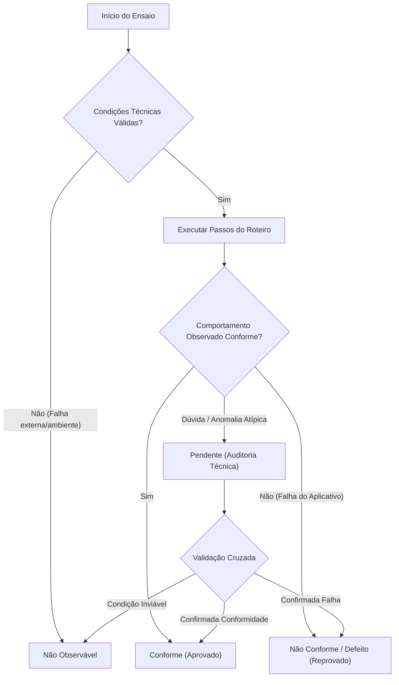

# Fase 3 — Procedimentos de Execução, Parâmetros, Catálogos e Amostragem

## 1. Objetivo e escopo

Este documento estabelece as **instruções detalhadas de execução, roteiros de ensaio e formulários padronizados de coleta** para a avaliação de qualidade do aplicativo móvel **DF no Ponto** (versão `5.25.1(1149)`, plataforma Android), conforme a etapa de **projetar a avaliação** da norma **ISO/IEC 25040:2011**.[1]

O propósito deste guia operacional é garantir a **autossuficiência, reprodutibilidade e auditabilidade** dos ensaios. Qualquer membro da equipe técnica ou avaliador independente deve ser capaz de seguir estes procedimentos de ponta a ponta e obter medições consistentes e comparáveis, alimentando as fórmulas das 12 métricas formalizadas na Fase 2 ([Métricas e Critérios de Julgamento](../fase2/metricas-julgamento.md)) sob o método definido em [Método de Avaliação](1-metodo.md) e utilizando os recursos listados em [Recursos](3-recursos.md).

O documento também define os catálogos, as amostras e os parâmetros das 12 métricas, conforme o [Método de Avaliação](1-metodo.md) e as [fórmulas, unidades e faixas de pontuação da Fase 2](../fase2/metricas-julgamento.md). Os parâmetros, catálogos e amostragem constam nas seções 3 a 7 e são a **fonte única dos valores**; a gestão de evidências, os formulários e as regras de anomalia estão nas seções 8 a 12; os roteiros passo a passo, nas seções 13 a 15, e o quadro síntese, na seção 16, apenas aplicam esses valores.

Adota-se uma **amostra intencional**, dimensionada para a execução acadêmica e a resolução dos resultados. Os valores são decisões do projeto, não medições realizadas ou exigências numéricas das normas ISO.

Prevê-se um smartphone com Android atualizado e a versão mais recente do app instalada. A [identificação do alvo](../fase1/3-descricao.md#4-alvo-da-avaliacao) e o método registram `5.25.1(1149)`; atualizar essa identificação se a versão usada for outra. Manter a mesma versão do app em todos os ambientes, registrando eventual indisponibilidade.

### 1.1. Definições anteriores à coleta

**Locais, dias e horários de campo serão definidos depois**, com verificação da viabilidade das quantidades propostas. A seleção das linhas/itinerários e da parada usada nas tarefas também ficará para outro integrante da equipe. Antes da coleta oficial, completar os registros abaixo e fixar os valores finais:

| Registro | Conteúdo a fixar |
| :--- | :--- |
| Ambiente | Modelo/perfil, versão exata do Android, versão/build do app, resolução, densidade e escala de fonte |
| Catálogo oficial | Fonte, data/hora da consulta e lista identificada de linhas, sentidos e variantes |
| Entradas funcionais | `L01` e `L02`: dois itens desse catálogo; `P01`: uma parada pertencente ao itinerário de `L01` |
| Campo | Paradas com código, sentido, linhas, dias, intervalos de observação e responsáveis |
| Comparação espacial | Referência de comparação, sistema de coordenadas, horários e precisão estimada |
| Inspeção de arquivos | Identificador do pacote e lista de locais acessíveis efetivamente inspecionados |

`L01`, `L02` e `P01` são identificadores internos dos itens selecionados na fonte oficial antes da consulta no app. Versionar o plano; alterações exigem justificativa e identificação das séries afetadas, mantendo separados os resultados obtidos sob critérios diferentes.

Em todas as métricas, informar quantidades previstas, executadas e válidas, com os motivos das pendências e exclusões. Manter as falhas observadas na avaliação; não excluir nem substituir casos por causa dos resultados. Denominador zero ou ausência de pares temporais válidos resulta em avaliação sem nota; casos obrigatórios pendentes mantêm a avaliação incompleta, conforme a Fase 2.

---

## 2. Princípios e diretrizes gerais de execução

A execução das atividades de medição é regida por diretrizes estritas que visam mitigar vieses de confirmação e preservar o rigor científico:

1. **Abordagem estrita de caixa-preta:** Toda a avaliação é conduzida exclusivamente a partir do comportamento externamente observável na interface gráfica e nos fluxos de dados disponibilizados ao usuário final, sem inspeção ou instrumentação de código-fonte interno.
2. **Fixação prévia de parâmetros:** Nenhum parâmetro de teste (tolerância temporal, raio geodésico $\varepsilon$, catálogo de telas, conjunto de linhas amostradas) pode ser alterado após o início da coleta.
3. **Imparcialidade e proibição de seleção retrospectiva:** Todos os ensaios executados devem ser registrados. É terminantemente vedado descartar execuções com resultados desfavoráveis ou reexecutar ensaios seletivamente até a obtenção de um resultado aprovado.
4. **Isolamento de variáveis:**
   - Para ensaios de laboratório, a bateria deve ser realizada com cache e dados limpos quando especificado, em ambientes com conectividade monitorada e sem aplicativos concorrentes de alto consumo em segundo plano.
   - Para ensaios de campo, as observações devem ocorrer em condições meteorológicas seguras e em pontos de parada previamente catalogados na malha da Semob-DF.

---

## 3. Catálogos de tarefas e compatibilidade

### 3.1. Tarefas essenciais — M6.1

O catálogo contém **oito tarefas** do [escopo do produto](../fase1/3-descricao.md#5-fronteiras-e-exclusoes-de-escopo), executadas uma vez no aparelho principal, com rede e localização disponíveis. Preparar o estado de favoritos indicado nas entradas.

| ID | Tarefa e entrada | Resultado esperado |
| :--- | :--- | :--- |
| TE01 | Buscar `L01` pelo código oficial | Encontrar a linha com identificação e sentido correspondentes à fonte oficial |
| TE02 | Consultar os horários de `L01` para o dia de referência registrado | Exibir a grade da linha, sentido e dia consultados, sem confundir horário de partida com previsão de chegada |
| TE03 | Abrir o itinerário de `L01` | Exibir o traçado e as paradas do sentido selecionado, permitindo consultar seus detalhes |
| TE04 | Consultar `P01` | Exibir a identificação da parada e permitir consultar as linhas que a atendem |
| TE05 | Acompanhar um veículo de `L02`, com operação confirmada no período | Exibir um veículo identificável e sua posição no mapa; a precisão dessa posição é avaliada separadamente em M5.2 |
| TE06 | Salvar `L01`, inicialmente ausente dos favoritos, e reabrir a lista | Encontrar `L01` nos favoritos com a identificação correta |
| TE07 | Salvar `P01`, inicialmente ausente dos favoritos, e reabrir a lista | Encontrar `P01` nos favoritos com a identificação correta |
| TE08 | Remover `L01`, previamente presente nos favoritos, e reabrir a lista | Confirmar sua ausência, mantendo os outros favoritos |

Contar uma falha por tarefa que não atingir o resultado esperado. Preparar cada estado independentemente da aprovação de outras tarefas; impedimentos deixam o catálogo incompleto. Em TE05, operação não verificável é um impedimento de observação, sem aprovação presumida ou atribuição automática de falha ao app.

### 3.2. Telas e configurações — M1.1

Selecionam-se cinco telas da consulta e navegação do passageiro:

| ID | Tela e conteúdo utilizado |
| :--- | :--- |
| T01 | Resultado da busca por `L01` |
| T02 | Horários de `L01` |
| T03 | Mapa do itinerário de `L01` |
| T04 | Detalhes de `P01` |
| T05 | Lista de favoritos com `L01` e `P01` previamente cadastrados |

Avaliar cada tela nas quatro configurações propostas, totalizando **20 casos**. Os perfis não descrevem o celular disponível.

| ID | Resolução e densidade do perfil | Orientação | Escala de fonte |
| :--- | :--- | :--- | :--- |
| C01 | 640 × 1136 px; 320 dpi | Retrato | 100% |
| C02 | Mesmo perfil de C01, com dimensões invertidas | Paisagem | 100% |
| C03 | Mesmo perfil de C01 | Retrato | 200% |
| C04 | 1080 × 2400 px; 420 dpi | Retrato | 100% |

Os perfis cobrem tela compacta, rotação, fonte ampliada e maior área de exibição. Registrar a configuração aplicada e o espaço das barras do sistema. Identificar cada caso como `Txx-Cxx` e aprovar quando informações e controles necessários estiverem visíveis e utilizáveis, sem corte ou sobreposição impeditivos.

Usar a mesma versão do Android nos quatro perfis. A configuração dos ambientes será descrita em [Recursos](3-recursos.md).

### 3.3. Versões do Android — M1.2

A lista prevista contém **Android 9, 10, 11, 12 e 13**, conforme a hipótese da Fase 2, e a **versão atual do aparelho físico**. Contar versões coincidentes uma única vez: são até seis versões distintas, com ambientes físicos ou emulados a especificar em [Recursos](3-recursos.md).

Aplicar TE01 a TE08 em cada versão, nas mesmas condições funcionais. Aprovar a versão somente se todos os fluxos concluírem sem erro impeditivo de compatibilidade. Registrar a causa observável, sem atribuir indisponibilidade externa automaticamente ao Android.

Instalação recusada por incompatibilidade demonstrada integra o resultado. Ambiente não preparado ou distribuição indisponível por motivo externo fica pendente/não observável, sem aprovação presumida. Repetições no mesmo Android não ampliam o denominador.

---

## 4. Parâmetros dos ensaios de laboratório

### 4.1. Instalação e resíduos — M2.1 e M2.2

Planejam-se **10 ciclos de instalação limpa e remoção** no aparelho principal, pela distribuição oficial, começando com o app ausente. M2.1 considera somente a primeira tentativa, sem exigir abertura inicial; tentativas posteriores não alteram esse resultado.

Para M2.2, usar busca, horários, mapa e favoritos entre a instalação concluída e a remoção. A instalação existente na preparação não conta como ciclo. Fixar os locais acessíveis abaixo e inspecionar o mesmo conjunto antes da instalação e depois da desinstalação:

| Grupo | Locais e critério de inspeção |
| :--- | :--- |
| Áreas específicas do app | Diretórios identificados pelo pacote em `Android/data` e `Android/obb`, quando acessíveis |
| Armazenamento compartilhado | Pastas identificadas com o app, `Download`, `Documents` e `Android/media`, quando acessíveis |
| Atribuição | Arquivo novo ou alterado durante o uso, com nome, conteúdo ou vínculo com o pacote que demonstre origem no app |

Excluir da contagem as evidências produzidas pelo avaliador e os arquivos sem atribuição demonstrável ao app. Segundo a [documentação do Android](https://developer.android.com/training/data-storage), áreas específicas são removidas na desinstalação, enquanto arquivos compartilhados podem permanecer. O resultado limita-se aos locais observáveis, sem presumir acesso irrestrito ou ausência de resíduos nas demais áreas.

Inspeção inviável de um local obrigatório invalida a inspeção do ciclo. Instalação não concluída não produz desinstalação aprovada. Registrar separadamente as quantidades de M2.1 e M2.2, conforme as regras comuns.

### 4.2. Sessões de uso — M3.1 e M3.2

Planejam-se **20 sessões de cinco minutos**, totalizando 100 minutos previstos. Cada sessão dedica **um minuto a cada atividade, nesta ordem**: busca de linha e resultados; horários; itinerário no mapa; parada e acompanhamento de veículo, quando disponível; consulta e manutenção dos favoritos. Registrar atrasos e interrupções sem prolongar a sessão. Não induzir quedas de rede ou desativação da localização.

**Crash** é encerramento inesperado. **Congelamento** é ausência de resposta da interface a uma ação por mais de cinco segundos, medida em gravação com marcação temporal. Carregamento responsivo não conta; diagnóstico de ANR do sistema operacional exige log específico.

Contar a sessão afetada uma vez por métrica aplicável, incluindo as encerradas por crash. A retomada inicia outra sessão identificada, sem apagar a falha ou ampliar automaticamente a amostra. Registrar duração efetiva e amostra válida por métrica.

### 4.3. Interrupções de rede e localização — M4.1 e M4.2

Planejam-se **20 ensaios de rede e 20 de localização**, separados das sessões de maturidade, com uma interrupção por ensaio. O recurso deve funcionar inicialmente e ser restabelecido antes do próximo caso.

| Parâmetro | Valor definido | Justificativa operacional |
| :--- | :--- | :--- |
| Duração da indisponibilidade induzida | 30 s | Sustentar a falha por um intervalo observável, permitindo verificar a orientação e o uso das funções disponíveis |
| Tempo máximo de aviso | 5 s | Dar retorno breve à tentativa de usar uma função dependente do recurso indisponível |
| Tempo máximo de retomada | 30 s | Delimitar uma espera controlada pela recuperação após reativação, incluindo nova consulta |

Os tempos não têm calibração empírica prévia. Medir o aviso da primeira solicitação dependente do recurso já desativado até a indicação inequívoca de indisponibilidade. Medir a retomada da confirmação da reativação no sistema até a conclusão de nova consulta dependente do recurso. Registrar os instantes na gravação e aplicar os prazos sem arredondamento.

Na interrupção de rede, desativar todas as conexões capazes de manter o app online. Em ambos os recursos, exigir que o app permaneça aberto, informe a indisponibilidade, mantenha a interface responsiva e retome a consulta nos prazos da tabela. Na localização, exigir também consultas independentes da posição disponíveis e retomada da função de localização.

Recurso indisponível antes do ensaio caracteriza impedimento de preparação. Os tempos refletem o conjunto app/ambiente; registrar limitações de infraestrutura sem presumir a causa interna das falhas.

---

## 5. Amostras e parâmetros de campo

### 5.1. Previsão e chegada — M5.1

Propõem-se **20 eventos de chegada**, em dois blocos de dez e pelo menos duas linhas. As paradas, os dias e as janelas de observação seguem pendentes. Na janela fixada, selecionar os primeiros eventos elegíveis das linhas registradas, sem seleção pelo erro observado.

Usar a primeira previsão obtida ao iniciar a observação de cada evento, registrando a captura sem substituí-la por atualizações. Deve ser uma previsão de chegada à parada selecionada, não uma grade de partidas de terminal.

Registrar a chegada quando a frente do veículo alcançar o ponto físico de referência da parada, identificado previamente. Parear linha, sentido, parada e veículo/viagem identificável. Usar relógios sincronizados, data completa, fuso `America/Sao_Paulo` e deslocamento UTC do dia. Converter tempo restante em previsão somando-o ao instante de captura, conforme a Fase 2.

Separar previsões ausentes, identificação insuficiente e chegadas não observadas na janela; esses casos não recebem erro zero. Informar a antecedência das previsões, a dispersão dos erros e as quantidades previstas e válidas. Calcular a mediana somente com os pares válidos, sem reposição de eventos após verificar os resultados.

### 5.2. Posições no mapa — M5.2

Propõem-se **dez paradas distintas e 20 eventos de parada de veículos**, uma comparação por entidade/evento. Nas janelas e linhas registradas, observar os primeiros eventos elegíveis. Quadros sucessivos do mesmo veículo no mesmo evento não ampliam a amostra.

| Parâmetro | Valor definido | Condição de uso |
| :--- | :--- | :--- |
| Tolerância espacial `ε` | 30 m, para paradas e veículos | Comparação com referência de campo, preservando a identificação da entidade |
| Diferença temporal máxima `Δt_max` | 2 s, para veículos | Comparar o horário da posição no app com o horário da referência |
| Precisão horizontal informada da referência | Até 10 m | Usar posição com precisão e horário disponíveis em ferramenta independente do DF no Ponto |

A tolerância de 30 m é três vezes a precisão informada máxima aceita para a referência. A precisão é uma estimativa, não um limite absoluto do erro real ([documentação do Android](https://developer.android.com/reference/android/location/Location#getAccuracy())). O limite de dois segundos reduz a defasagem entre as posições comparadas.

A referência é a posição do celular obtida pelo **GPSTest**, independente dos dados do DF no Ponto, com coordenadas WGS84, precisão e horário UTC ([documentação](https://github.com/barbeau/gpstest/blob/v3.10.6/LOGGING-v3.md)).

Medir as paradas no ponto físico identificado. Para veículos, observar somente os parados junto à parada, registrando o ponto que representa o veículo e o deslocamento do observador. Isso reduz o efeito do movimento e limita as conclusões a essa condição.

O roteiro de execução detalhará a obtenção e o registro dos dados. O horário da posição no app é distinto do horário da captura de tela. Posições copiadas de outro cliente do mesmo serviço não constituem referência independente; observações sem os dados necessários seguem as regras de dados não observáveis da Fase 2.

Aplicar a distância e o critério `d ≤ ε` da Fase 2. Invalidar pares de veículos separados por mais de dois segundos. Apurar paradas e veículos separadamente; consolidar por soma de acertos e totais apenas sob os mesmos critérios espaciais. Informar exclusões e limitações da referência por grupo.

---

## 6. Amostra do catálogo oficial — M6.2

Na [Pesquisa por Linhas da Semob-DF](https://dfnoponto.semob.df.gov.br/pesquisa-por-linhas/), preservar o resultado oficial com data/hora, ordenar por código, sentido e variante e selecionar os **primeiros 20 itens distintos de linha/itinerário**, antes da consulta no app.

Outro integrante concluirá a seleção e registrará a lista como `L01` a `L20`, com código oficial, nome, sentido, variante quando houver e itinerário de referência. Sem a lista e seus identificadores, a seleção permanece pendente. A data de acesso não comprova a data de atualização do catálogo.

Auditar todos os itens; consultas repetidas não ampliam a amostra. A ordenação facilita reproduzir a seleção, mas concentra os itens numa parte do catálogo. O resultado limita-se à amostra e à data de referência, sem estimar a cobertura de toda a malha do DF.

---

## 7. Quantidades, resolução e limitações

Nas proporções com total válido `n`, uma unidade altera o resultado em `1/n`. A tabela relaciona a amostra planejada às faixas de nota da Fase 2, aplicadas sem arredondamento.

| Métricas | Amostra planejada | Resolução | Totais favoráveis por nota, se toda a amostra for válida |
| :--- | :--- | :--- | :--- |
| M1.1 | 20 casos de tela × configuração | 5 pontos percentuais | 4: 20; 3: 18–19; 2: 15–17; 1: 0–14 |
| M1.2 | Até seis versões distintas | 16,67 pontos percentuais, se `n = 6` | Para seis versões: 4: 6; 3: nenhum total possível; 2: 5; 1: 0–4 |
| M2.1/M2.2 | 10 ciclos de instalação/remoção | 10 pontos percentuais | 4: 10; 3: nenhum total possível; 2: 9; 1: 0–8 |
| M3.1/M3.2 | 20 sessões de cinco minutos | 5 pontos percentuais | 4: 20; 3: 19; 2: 18; 1: 0–17 |
| M4.1/M4.2 | 20 interrupções de cada recurso | 5 pontos percentuais | 4: 20; 3: 17–19; 2: 14–16; 1: 0–13 |
| M5.1 | 20 eventos de chegada previstos | Não se aplica a regra `1/n` | Mediana dos erros válidos, em minutos; notas conforme a Fase 2 |
| M5.2 — paradas | Dez paradas distintas | 10 pontos percentuais | 4: 10; 3: 9; 2: 7–8; 1: 0–6 |
| M5.2 — veículos | 20 eventos com veículo parado | 5 pontos percentuais | 4: 19–20; 3: 17–18; 2: 14–16; 1: 0–13 |
| M6.1 | Oito tarefas essenciais | 12,5 pontos percentuais | 4: 8; 3: nenhum total possível; 2: 7; 1: 0–6 |
| M6.2 | 20 itens oficiais | 5 pontos percentuais | 4: 20; 3: 19; 2: 16–18; 1: 0–15 |

Vinte repetições distinguem as quatro faixas de várias métricas com esforço delimitado, mas não estimam taxas populacionais de falhas raras. Em M3.1/M3.2, 20 sessões sem falha recebem a nota da escala sem demonstrar estabilidade de 99% no uso geral; crashes podem reduzir os 100 minutos previstos.

Em M5.1, os 20 eventos em dois blocos delimitam o esforço de campo e incluem pelo menos duas linhas. A mediana descreve essa amostra; a viabilidade das janelas será conferida ao escolher os locais e horários, conforme a pendência registrada na seção 1.1.

Em M1.2 e M6.1, as unidades são versões do Android e tarefas essenciais; não criar unidades artificiais para alcançar a nota 3. Recalcular a resolução se o total válido mudar, preservando pendências e exclusões conforme as regras comuns da seção 1.1.

---

## 8. Gestão e convenção de evidências

Todas as medições devem ser respaldadas por evidências digitais verificáveis (capturas de tela, gravações contínuas de tela, registros de log do sistema ou arquivos de dados brutos).

### 8.1 Padrão de nomenclatura de arquivos

Os artefatos de evidência coletados devem ser nomeados obrigatoriamente seguindo o padrão estruturado:

$$\text{EVI\_[ID\_METRICA]\_[ID\_CASO]\_[DISPOSITIVO]\_[DATA\_HORA].[EXT]}$$

- **ID_METRICA:** Código da métrica associada (ex.: `M1.1`, `M2.2`, `M5.1`).
- **ID_CASO:** Identificador do caso conforme o catálogo da métrica (ex.: `T03-C01`, `TE05`, `SESSAO07`, `L12`).
- **DISPOSITIVO:** Código do dispositivo físico ou emulador utilizado, conforme catalogado em [Recursos](3-recursos.md) (ex.: `DISP-01`, `EMU-01`).
- **DATA_HORA:** Carimbo temporal no formato `YYYYMMDD_HHMMSS` (ex.: `20261116_143000`).
- **EXT:** Extensão do arquivo conforme o tipo de artefato (`png`, `mp4`, `log`, `json`, `csv`).

*Exemplo de registro fotográfico/print:* `EVI_M1.1_T03-C01_DISP-01_20261118_091522.png`  
*Exemplo de gravação de vídeo de sessão:* `EVI_M3.1_SESSAO01_DISP-02_20261118_100015.mp4`

### 8.2 Repositório e armazenamento

- As planilhas de coleta e as evidências de **todos os casos** (aprovados e reprovados) são versionadas no repositório da equipe, em `dados/fase4/<métrica>/`, de modo que cada linha da planilha aponte para o arquivo de evidência pelo campo `EVIDENCIA_REF`.
- Vídeos que excedam o limite de tamanho do repositório ficam em pasta compartilhada da equipe; a planilha registra o link e o hash SHA-256 do arquivo, gerado no momento do arquivamento.
- Evidências com dados de terceiros seguem a seção 9 antes de serem publicadas.

---

## 9. Proteção de dados e privacidade (LGPD)

Em estrita conformidade com a Lei Geral de Proteção de Dados Pessoais (**LGPD — Lei nº 13.709/2018**):[3]

1. **Anonimização nas evidências visuais:** Gravações de tela e capturas em campo não devem enquadrar rostos de passageiros, transeuntes, operadores do transporte público, placas de veículos de terceiros ou documentos pessoais.
2. **Uso de contas de teste:** Caso qualquer fluxo exija autenticação ou dados de perfil, devem ser utilizadas contas fictícias de teste criadas especificamente para a avaliação, desvinculadas de dados bancários, CPF ou números de telefone pessoais dos avaliadores.
3. **Preservação de sigilo geográfico:** As medições de campo limitam-se a dados públicos do sistema de transporte coletivo do DF (linhas, paradas e horários operacionais da Semob-DF), não envolvendo rastreamento de rotas residenciais ou hábitos individuais privados.

---

## 10. Protocolo de coleta e formulário padronizado

Para garantir a homogeneidade dos registros efetuados pelos múltiplos avaliadores da equipe Carol Shaw, todas as execuções de ensaio devem ser documentadas em uma **Matriz de Coleta Padronizada**, elaborada em planilha eletrônica auditável e consolidada no repositório.

### 10.1 Campos obrigatórios do formulário de coleta

| Campo | Tipo | Descrição e formato esperado |
| :--- | :--- | :--- |
| **ID_EXEC** | Alfanumérico | Identificador único da execução (ex.: `EXEC-M1.1-001`). |
| **METRICA** | Código | Código da métrica avaliada (`M1.1` a `M6.2`). |
| **CASO_ID** | Código | Identificador do caso conforme o catálogo da métrica (ex.: `T03-C01`, `TE05`, `L12`). |
| **AVALIADOR** | Texto | Nome ou identificador do responsável pela execução do ensaio. |
| **DATA_HORA** | Timestamp | Data e horário de início da medição (`YYYY-MM-DD HH:MM`). |
| **DISPOSITIVO** | Código | Dispositivo utilizado (`DISP-01`, `EMU-01`), conforme [Recursos](3-recursos.md). |
| **VERSAO_SO** | Texto | Versão do Android e nível de API do dispositivo. |
| **VERSAO_APP** | Texto | Versão exata instalada (deve ser `5.25.1(1149)`). |
| **CONDICAO_CONEXAO** | Categórico | Tipo de conexão ativa (`Wi-Fi`, `4G/5G`, `Sem Conexão / Modo Avião`). |
| **PARAMETROS_ENTRADA** | Texto | Linha, parada, tela ou rota submetida ao ensaio. |
| **RESULTADO_OBSERVADO** | Texto | Descrição fática do comportamento da interface ou dado exibido. |
| **VALOR_MEDIDO** | Numérico / Texto | Valor numérico medido (ex.: segundos, metros, booleano sim/não). |
| **STATUS** | Categórico | Veredito do ensaio: `Conforme`, `Defeito`, `Não Observável` ou `Pendente`. |
| **EVIDENCIA_REF** | Nome de arquivo | Nome do arquivo de evidência gerado conforme o padrão da Seção 8.1. |
| **OBSERVACOES** | Texto livre | Notas contextuais, desvios operacionais ou comportamentos atípicos. |

### 10.2 Modelo estrutural da planilha de coleta

```csv
ID_EXEC;METRICA;CASO_ID;AVALIADOR;DATA_HORA;DISPOSITIVO;VERSAO_SO;VERSAO_APP;CONDICAO_CONEXAO;PARAMETROS_ENTRADA;RESULTADO_OBSERVADO;VALOR_MEDIDO;STATUS;EVIDENCIA_REF;OBSERVACOES
EXEC-M1.1-001;M1.1;T01-C01;Avaliador 1;2026-11-18 10:00;DISP-01;Android 14 (API 34);5.25.1(1149);Wi-Fi;L01;Layout íntegro, sem sobreposição;1;Conforme;EVI_M1.1_T01-C01_DISP-01_20261118_100000.png;Nenhuma
EXEC-M4.1-001;M4.1;ENSAIO01;Avaliador 2;2026-11-18 10:30;DISP-01;Android 14 (API 34);5.25.1(1149);4G/5G;Consulta de L01;Aviso em 2,1 s e retomada em 8,4 s;1;Conforme;EVI_M4.1_ENSAIO01_DISP-01_20261118_103000.mp4;Linhas ilustrativas, não são dados coletados
```

---

## 11. Tratamento de anomalias, estados de execução e política de reteste

A contabilização correta dos dados nas fórmulas do GQM requer a classificação inequívoca de cada caso executado em um dos quatro estados formais:



### 11.1 Definição dos estados de execução

- **Conforme (Aprovado):** O aplicativo executou a funcionalidade satisfazendo todos os critérios de aprovação definidos no roteiro, sem falhas de renderização, travamentos ou violações de tolerância.
- **Não Conforme / Defeito (Reprovado):** O aplicativo apresentou comportamento incorreto, erro de layout, travamento (*freeze*), encerramento forçado (*crash*) ou medição fora do limiar aceitável. **Permanece obrigatoriamente no denominador da amostra e pontua contra a métrica.**
- **Não Observável:** O ensaio não pôde ser concluído por impedimento externo ou limitação intransponível do ambiente de teste alheia ao aplicativo (ex.: queda total da infraestrutura de telecomunicações do provedor de telefonia, ausência de sinal de satélite em túnel, inexistência de ônibus em circulação no período noturno). Casos não observáveis são documentados com justificativa explícita e **excluídos do denominador válido** da métrica correspondente, sem penalizar o aplicativo.
- **Pendente:** Estado transitório aplicado quando há divergência de interpretação entre avaliadores ou instabilidade atípica do aparelho. Deve ser submetido à revisão cruzada antes da consolidação final da base da Fase 4.

### 11.2 Política de registro de anomalias e reteste

Para evitar o enviesamento de resultados ("garimpar" execuções bem-sucedidas):

1. **Vedação de descarte de defeitos:** Nenhum ensaio reprovado pode ser descartado ou ignorado. Se o aplicativo falhou sob as condições previstas no roteiro, a falha é definitiva para aquele ensaio.
2. **Critério estrito para reteste:** A repetição de um ensaio só é autorizada se comprovada anomalia na **infraestrutura de teste** (ex.: falha de hardware do aparelho avaliador, término de bateria no meio do ensaio ou erro operacional comprovado do avaliador ao executar um passo fora da ordem).
3. **Registro formal de anomalia:** Toda falha observada deve ser registrada em formulário de anomalia, contendo: descrição objetiva do sintoma, passos para reprodução, frequência observada e link da evidência correspondente.

---

## 12. Protocolo de validação cruzada entre pares

Para mitigar a variabilidade interobservador e garantir a clareza e precisão dos roteiros de ensaio:

1. **Execução cruzada de controle:** Antes do início da coleta em larga escala, uma amostra piloto de pelo menos 1 caso de cada métrica deve ser executada por um avaliador que **não participou da redação inicial** do respectivo roteiro.
2. **Identificação de ambiguidades:** Quaisquer passos que gerem dúvidas operacionais, interpretações dúbias de critérios de aceitação ou dificuldades no registro de evidências devem ser pontuados e sanados neste documento antes da batelada definitiva.
3. **Auditoria de amostra:** No encerramento da coleta, 10% dos registros de cada métrica serão auditados por um segundo membro da equipe, conferindo se a evidência arquivada comprova categoricamente o veredito assinalado na planilha.

---

## 13. Roteiros detalhados de execução — Portabilidade (G1 e G2)

Esta seção define os procedimentos das métricas de **Portabilidade** (subcaracterísticas *Adaptabilidade* e *Instalabilidade*), que respondem à **Decisão D1**. Os catálogos, as amostras e os parâmetros são os das seções 3 a 7; os roteiros abaixo apenas descrevem como executá-los e não definem valores próprios.

---

### 13.1 Roteiro M1.1 — Adaptabilidade de hardware (telas)

- **Objetivo e métrica:** $M_{1.1} = \frac{T_s}{T_t}$ (proporção de casos tela × configuração aprovados).
- **Ambiente:** laboratório, nos dispositivos e emuladores do inventário de [Recursos](3-recursos.md).
- **Casos:** as cinco telas `T01` a `T05` nas quatro configurações `C01` a `C04` da [seção 3.2](#32-telas-e-configuracoes-m11), totalizando 20 casos identificados como `Txx-Cxx`.
- **Entradas:** `L01` e `P01`, com ambos previamente salvos nos favoritos para `T05`.

#### Procedimento passo a passo

1. **Configuração:** aplicar no dispositivo ou emulador a configuração do caso (resolução e densidade, orientação e escala de fonte), usando a mesma versão do Android nas quatro configurações.
2. **Inicialização:** abrir o DF no Ponto com rede e localização disponíveis.
3. **Navegação:** abrir a tela do caso (`T01` a `T05`) e executar as interações necessárias à consulta: rolagem, toque nos controles principais e, em `T03`, movimentação e zoom do mapa.
4. **Inspeção:** verificar se há texto cortado que oculte informação necessária (código da linha, horário, nome da parada), sobreposição de elementos ou controle inacessível, inclusive por rolagem.
5. **Evidência:** capturar a tela de cada caso (`EVI_M1.1_Txx-Cxx_[DISPOSITIVO]_[DATA_HORA].png`), aprovado ou reprovado.
6. **Contabilização:**
   - **Aprovado ($T_s$):** informações e controles necessários visíveis e utilizáveis, sem corte ou sobreposição impeditivos.
   - **Reprovado:** corte, sobreposição ou inacessibilidade que impeça a tarefa da tela.

---

### 13.2 Roteiro M1.2 — Adaptabilidade de SO (versões do Android)

- **Objetivo e métrica:** $M_{1.2} = \frac{O_s}{O_t}$ (proporção de versões aprovadas em todos os fluxos críticos).
- **Ambiente:** laboratório, em dispositivos físicos e emuladores.
- **Versões:** Android 9, 10, 11, 12 e 13 e a versão atual do aparelho físico, contando versões coincidentes uma única vez ([seção 3.3](#33-versoes-do-android-m12)).
- **Fluxos críticos:** as tarefas `TE01` a `TE08` da [seção 3.1](#31-tarefas-essenciais-m61), com as mesmas entradas.

#### Procedimento passo a passo

1. **Preparação:** selecionar o ambiente com a versão do Android a avaliar e instalar a versão `5.25.1(1149)` do aplicativo pela distribuição oficial.
2. **Condições:** garantir rede ativa e localização disponível.
3. **Execução:** executar `TE01` a `TE08` em sequência, preparando o estado de favoritos indicado em cada tarefa.
4. **Observação:** registrar diálogos de incompatibilidade, recusa de instalação, encerramentos e erros impeditivos, anotando a causa observável.
5. **Evidência:** gravação de tela contínua da execução (`EVI_M1.2_ANDROIDxx_[DISPOSITIVO]_[DATA_HORA].mp4`).
6. **Contabilização:**
   - **Aprovado ($O_s$):** todas as oito tarefas concluídas sem erro impeditivo de compatibilidade.
   - **Reprovado:** erro impeditivo de compatibilidade em qualquer tarefa ou instalação recusada por incompatibilidade demonstrada.
   - **Não observável:** ambiente não preparado ou distribuição indisponível por motivo externo.

---

### 13.3 Roteiro M2.1 — Sucesso de instalação

- **Objetivo e métrica:** $M_{2.1} = \frac{I_s}{I_t}$ (proporção de ciclos com instalação concluída na primeira tentativa).
- **Ambiente:** laboratório, no aparelho principal, com conexão estável.
- **Amostra:** 10 ciclos de instalação limpa ([seção 4.1](#41-instalacao-e-residuos-m21-e-m22)).

#### Procedimento passo a passo

1. **Pré-condição:** confirmar que o aplicativo não está instalado; a instalação existente na preparação não conta como ciclo.
2. **Loja oficial:** abrir a Google Play Store e localizar o DF no Ponto.
3. **Início do ciclo:** tocar em "Instalar" e observar a partir desse instante.
4. **Acompanhamento:** observar o download, a verificação da loja e a instalação.
5. **Evidência:** capturar a página da loja com o estado "Instalado" ou com a mensagem de erro (`EVI_M2.1_CICLOxx_[DISPOSITIVO]_[DATA_HORA].png`). A abertura do aplicativo pode ser registrada como informação complementar, mas não integra o critério.
6. **Contabilização:**
   - **Aprovado ($I_s$):** instalação concluída na primeira tentativa, sem erro.
   - **Reprovado:** erro ou interrupção que exija nova tentativa. Tentativas posteriores não alteram a reprovação.

---

### 13.4 Roteiro M2.2 — Resíduo pós-desinstalação

- **Objetivo e métrica:** $M_{2.2} = 1 - \frac{D_r}{D_t}$ (proporção de desinstalações sem resíduos observados).
- **Ambiente:** laboratório, no aparelho principal, com `adb` e depuração USB.
- **Amostra:** os mesmos 10 ciclos de M2.1, com uso do aplicativo (busca, horários, mapa e favoritos) entre a instalação e a remoção.

#### Procedimento passo a passo

1. **Pré-condição:** registrar o identificador do pacote do aplicativo, conforme a seção 1.1.
2. **Inspeção anterior à instalação:** listar os locais fixados na seção 4.1 e salvar a saída:
   ```bash
   for d in Android/data Android/obb Android/media Download Documents; do
     echo "== /sdcard/$d"; adb shell ls -laR "/sdcard/$d"
   done > EVI_M2.2_CICLOxx_antes.log
   ```
3. **Instalação e uso:** instalar (roteiro 13.3) e usar busca, horários, mapa e favoritos.
4. **Desinstalação:** remover o aplicativo pelo método padrão do sistema.
5. **Inspeção posterior:** repetir exatamente o comando do passo 2, salvando em `EVI_M2.2_CICLOxx_depois.log`.
6. **Comparação:** comparar os dois arquivos (`diff`) e identificar arquivos ou pastas novos ou alterados atribuíveis ao aplicativo pelo nome, pelo conteúdo ou pelo identificador do pacote. Evidências criadas pelo avaliador não contam.
7. **Contabilização:**
   - **Aprovado:** nenhum arquivo ou pasta atribuível ao aplicativo nos locais inspecionados.
   - **Reprovado ($D_r$):** ao menos um arquivo ou pasta residual atribuível ao aplicativo.
   - **Não observável:** inspeção inviável de um local obrigatório, com o motivo registrado.

---

## 14. Roteiros detalhados de execução — Confiabilidade (G3 e G4)

Esta seção define os procedimentos das métricas de **Confiabilidade** (subcaracterísticas *Maturidade* e *Tolerância a Falhas*), que respondem à **Decisão D2**.

---

### 14.1 Roteiro M3.1 — Sessões sem *crashes*

- **Objetivo e métrica:** $M_{3.1} = 1 - \frac{S_c}{S_t}$ (proporção de sessões sem encerramento inesperado).
- **Ambiente:** laboratório, no aparelho principal.
- **Amostra:** 20 sessões de 5 minutos ([seção 4.2](#42-sessoes-de-uso-m31-e-m32)), sem indução de falhas de rede ou de localização.

#### Procedimento passo a passo

1. **Preparação:** iniciar a gravação de tela e, quando disponível, o registro de log:
   ```bash
   adb logcat -v time | grep -E "FATAL EXCEPTION|AndroidRuntime|SIGSEGV"
   ```
2. **Execução:** dedicar um minuto a cada atividade, nesta ordem: busca de linha e resultados; horários; itinerário no mapa; parada e acompanhamento de veículo, quando disponível; consulta e manutenção dos favoritos.
3. **Detecção:** registrar fechamento súbito do aplicativo, diálogo do sistema informando que o aplicativo parou ou exceção fatal no log.
4. **Interrupção:** se houver *crash*, a sessão termina e é contada como afetada ($S_c$), permanecendo em $S_t$. A continuação da bateria ocorre em nova sessão, com novo identificador.
5. **Evidência:** gravação da sessão (`EVI_M3.1_SESSAOxx_[DISPOSITIVO]_[DATA_HORA].mp4`) e, em caso de *crash*, o trecho de log correspondente (`.log`).
6. **Contabilização:**
   - **Aprovado:** sessão concluída nos 5 minutos sem encerramento inesperado.
   - **Reprovado ($S_c$):** ao menos um *crash* na sessão.

---

### 14.2 Roteiro M3.2 — Sessões sem congelamentos

- **Objetivo e métrica:** $M_{3.2} = 1 - \frac{S_a}{S_t}$ (proporção de sessões sem congelamento superior a 5 segundos).
- **Definição:** congelamento é a ausência de resposta da interface a uma ação por mais de 5,0 segundos. Carregamento com indicador de progresso e interface responsiva não conta.
- **Amostra:** as mesmas 20 sessões de 5 minutos do roteiro 14.1, com amostra válida informada separadamente.

#### Procedimento passo a passo

1. **Preparação:** ativar "Mostrar toques" nas opções do desenvolvedor e iniciar a gravação de tela.
2. **Execução:** seguir a sessão padronizada do roteiro 14.1.
3. **Medição:** quando a interface não responder a uma ação, medir na gravação o intervalo entre o toque e a resposta. Intervalo superior a 5,0 segundos ou diálogo de ANR do sistema caracteriza congelamento.
4. **Evidência:** a gravação da sessão, com a marcação do instante do congelamento (`EVI_M3.2_SESSAOxx_[DISPOSITIVO]_[DATA_HORA].mp4`).
5. **Contabilização:**
   - **Aprovado:** sessão sem congelamento superior a 5,0 segundos.
   - **Reprovado ($S_a$):** ao menos um congelamento superior a 5,0 segundos.

---

### 14.3 Roteiro M4.1 — Mitigação de perda de conexão

- **Objetivo e métrica:** $M_{4.1} = \frac{R_s}{R_t}$ (proporção de interrupções de rede com tratamento aprovado).
- **Ambiente:** laboratório, em dispositivo físico.
- **Amostra e parâmetros:** 20 ensaios, com indisponibilidade de 30 s, aviso em até 5 s e retomada em até 30 s ([seção 4.3](#43-interrupcoes-de-rede-e-localizacao-m41-e-m42)).

#### Procedimento passo a passo

1. **Pré-condição:** aplicativo aberto, com rede disponível e uma consulta em funcionamento; gravação de tela iniciada.
2. **Indução da falha:** ativar o Modo Avião, desativando todas as conexões, e mantê-lo por 30 segundos.
3. **Solicitação:** logo após a desativação, realizar uma consulta dependente de rede (busca de linha ou abertura de parada).
4. **Verificação durante a falha:** o aplicativo deve permanecer aberto, manter a interface responsiva e informar a indisponibilidade em até 5,0 segundos, contados da solicitação.
5. **Restauração:** desativar o Modo Avião e, confirmada a reconexão no sistema, repetir a consulta.
6. **Verificação da retomada:** a nova consulta deve concluir em até 30,0 segundos, contados da confirmação da reconexão.
7. **Evidência:** gravação contínua do ensaio (`EVI_M4.1_ENSAIOxx_[DISPOSITIVO]_[DATA_HORA].mp4`), com os instantes medidos anotados no formulário.
8. **Contabilização:**
   - **Aprovado ($R_s$):** aplicativo aberto, aviso e retomada dentro dos prazos e interface responsiva.
   - **Reprovado:** encerramento, carregamento sem aviso dentro do prazo, interface sem resposta ou necessidade de reiniciar o aplicativo.

---

### 14.4 Roteiro M4.2 — Tratamento de perda de GPS

- **Objetivo e métrica:** $M_{4.2} = \frac{G_s}{G_t}$ (proporção de desativações de localização com tratamento aprovado).
- **Ambiente:** laboratório, em dispositivo físico com receptor de localização.
- **Amostra e parâmetros:** 20 ensaios, com os mesmos prazos do roteiro 14.3.

#### Procedimento passo a passo

1. **Pré-condição:** aplicativo aberto no mapa, com a localização do usuário exibida; gravação de tela iniciada.
2. **Indução da falha:** desativar a localização do aparelho e mantê-la desativada por 30 segundos.
3. **Solicitação:** acionar uma função dependente de localização.
4. **Verificação durante a falha:** o aplicativo deve permanecer aberto, informar a indisponibilidade em até 5,0 segundos e manter disponíveis as consultas independentes de localização (busca de linha por código e consulta de parada).
5. **Restauração:** reativar a localização e acionar novamente a função dependente.
6. **Verificação da retomada:** a função de localização deve voltar a operar em até 30,0 segundos, contados da reativação.
7. **Evidência:** gravação contínua do ensaio (`EVI_M4.2_ENSAIOxx_[DISPOSITIVO]_[DATA_HORA].mp4`).
8. **Contabilização:**
   - **Aprovado ($G_s$):** aviso no prazo, consultas independentes disponíveis e retomada no prazo.
   - **Reprovado:** encerramento, ausência de aviso, consultas independentes indisponíveis ou retomada fora do prazo.

---

## 15. Roteiros detalhados de execução — Adequação Funcional (G5 e G6)

Esta seção define os procedimentos das métricas de **Adequação Funcional** (subcaracterísticas *Correção Funcional* e *Completude Funcional*), que respondem à **Decisão D3**.

---

### 15.1 Roteiro M5.1 — Precisão de tempo de chegada

- **Objetivo e métrica:** $e_i = \frac{\lvert t_i^{obs} - t_i^{prev} \rvert}{60}$ e $M_{5.1} = \operatorname{mediana}(e_1, \ldots, e_n)$, em minutos.
- **Ambiente:** campo, nas paradas, linhas e janelas registradas conforme a [seção 5.1](#51-previsao-e-chegada-m51).
- **Amostra:** 20 eventos de chegada, em dois blocos de dez e pelo menos duas linhas.
- **Instrumentos:** aparelho com o DF no Ponto; relógio sincronizado por rede, no fuso `America/Sao_Paulo`; formulário de campo.

#### Procedimento passo a passo

1. **Posicionamento:** posicionar-se com segurança na parada e identificar o ponto físico de referência da chegada.
2. **Previsão ($t_i^{prev}$):** abrir a parada no aplicativo e registrar a **primeira** previsão exibida para a linha observada, com captura de tela que mostre a previsão e o relógio do sistema. Se o aplicativo exibir tempo restante, somá-lo ao instante da captura. Atualizações posteriores não substituem esse registro.
3. **Chegada ($t_i^{obs}$):** registrar o instante em que a frente do veículo alcança o ponto de referência, fotografando o veículo com letreiro e prefixo visíveis, sem enquadrar rostos.
4. **Pareamento:** conferir linha, sentido, parada e veículo ou viagem identificável.
5. **Casos sem par válido:** previsão ausente, identificação insuficiente ou chegada não observada na janela são registrados separadamente, fora da amostra válida e sem erro zero.
6. **Evidência:** `EVI_M5.1_EVENTOxx_APP_[DATA_HORA].png` e `EVI_M5.1_EVENTOxx_REAL_[DATA_HORA].jpg`.
7. **Cálculo:** calcular $e_i$ de cada par válido e a mediana, informando também a antecedência das previsões e a dispersão dos erros.

---

### 15.2 Roteiro M5.2 — Correção de dados do mapa

- **Objetivo e métrica:** $M_{5.2} = \frac{P_s}{P_t}$ (proporção de posições com $d_i \le \varepsilon$, sendo $\varepsilon = 30$ metros).
- **Ambiente:** campo, com referência independente obtida no **GPSTest** ([seção 5.2](#52-posicoes-no-mapa-m52)).
- **Amostra:** dez paradas distintas e 20 eventos de veículo parado junto à parada, apurados separadamente.
- **Cálculo da distância:** fórmula de haversine definida em [Verificação Espacial](../fase2/metricas-julgamento.md#verificacao-espacial-m52).

#### Procedimento passo a passo

1. **Referência:** no ponto físico da parada, registrar no GPSTest a coordenada (WGS84), a precisão horizontal informada e o horário UTC. Só são válidos registros com precisão de até 10 m. Para veículos, o registro é feito com o veículo parado junto à parada, anotando o deslocamento do observador em relação ao veículo.
2. **Posição no aplicativo:** com o mapa no zoom máximo, capturar a tela mostrando o marcador da parada ou do veículo. Obter a latitude e a longitude do marcador localizando o mesmo ponto em um mapa de referência com leitura de coordenadas, registrado em [Recursos](3-recursos.md), com seis casas decimais.
3. **Sincronismo (veículos):** registrar o horário da posição exibida pelo aplicativo. Pares com diferença superior a 2 segundos em relação à referência são inválidos; se o aplicativo não exibir esse horário, o evento é **não observável** e o motivo é registrado.
4. **Cálculo:** calcular $d_i$ em metros para cada observação válida.
5. **Contabilização:**
   - **Aprovado ($P_s$):** $d_i \le 30$ metros.
   - **Reprovado:** $d_i > 30$ metros.
6. **Evidência:** captura do mapa do aplicativo, registro exportado do GPSTest e planilha de cálculo (`EVI_M5.2_CASOxx_[DATA_HORA].png` e `.csv`).

---

### 15.3 Roteiro M6.1 — Cobertura de tarefas essenciais

- **Objetivo e métrica:** $M_{6.1} = 1 - \frac{F_f}{F_t}$ (proporção de tarefas essenciais concluídas com sucesso).
- **Catálogo:** as oito tarefas `TE01` a `TE08` da [seção 3.1](#31-tarefas-essenciais-m61), com as entradas `L01`, `L02` e `P01` e os resultados esperados ali fixados ($F_t = 8$).
- **Ambiente:** laboratório, no aparelho principal, com rede e localização disponíveis.

#### Procedimento passo a passo

1. **Preparação:** preparar o estado de favoritos exigido por cada tarefa, independentemente do resultado das demais.
2. **Execução:** executar cada tarefa uma vez, de ponta a ponta.
3. **Validação:** comparar o resultado obtido com o resultado esperado do catálogo.
4. **Evidência:** gravação de tela contínua (`EVI_M6.1_TExx_[DISPOSITIVO]_[DATA_HORA].mp4`).
5. **Contabilização:**
   - **Aprovado:** resultado esperado atingido.
   - **Reprovado ($F_f$):** tarefa não concluída ou resultado diferente do esperado.
   - **Não observável:** em `TE05`, operação da linha não verificável no período; o catálogo permanece incompleto.

---

### 15.4 Roteiro M6.2 — Completude do banco de dados

- **Objetivo e métrica:** $M_{6.2} = \frac{L_c}{L_t}$ (proporção de itens oficiais encontrados no aplicativo com correspondência correta).
- **Amostra:** os 20 primeiros itens distintos de linha/itinerário (`L01` a `L20`), selecionados e arquivados conforme a [seção 6](#6-amostra-do-catalogo-oficial-m62), antes da consulta no aplicativo.

#### Procedimento passo a passo

1. **Preparação:** dispor da lista `L01` a `L20`, com código oficial, nome, sentido, variante e itinerário de referência, e da data e hora da consulta à fonte oficial.
2. **Consulta:** para cada item, pesquisar o código no aplicativo, verificar se a linha é retornada, se os sentidos oficiais estão presentes e se o itinerário corresponde ao de referência.
3. **Contabilização:**
   - **Aprovado ($L_c$):** item localizado com código, sentido e itinerário correspondentes.
   - **Reprovado:** item ausente ou com divergência de sentido ou itinerário.
4. **Evidência:** captura do resultado da busca e do detalhe do itinerário de cada item (`EVI_M6.2_Lxx_[DISPOSITIVO]_[DATA_HORA].png`).

---

## 16. Quadro síntese operacional de ensaios e parâmetros

O quadro resume, para consulta rápida, os valores definidos nas seções 3 a 7.

| Métrica | Objetivo | Ambiente | Unidade | Amostra e parâmetros | Evidência |
| :--- | :--- | :--- | :--- | :--- | :--- |
| **M1.1** | G1 | Laboratório | Proporção $[0,1]$ | 20 casos: `T01`–`T05` × `C01`–`C04` | Captura de tela por caso |
| **M1.2** | G1 | Laboratório | Proporção $[0,1]$ | Até 6 versões (Android 9 a 13 e a atual); `TE01`–`TE08` | Gravação por versão |
| **M2.1** | G2 | Laboratório | Proporção $[0,1]$ | 10 ciclos; primeira tentativa na loja oficial | Captura da loja |
| **M2.2** | G2 | Laboratório | Proporção $[0,1]$ | 10 ciclos; locais da seção 4.1, antes e depois | Saídas do `adb` |
| **M3.1** | G3 | Laboratório | Proporção $[0,1]$ | 20 sessões de 5 minutos | Gravação e log |
| **M3.2** | G3 | Laboratório | Proporção $[0,1]$ | Mesmas 20 sessões; congelamento > 5,0 s | Gravação com toques |
| **M4.1** | G4 | Laboratório | Proporção $[0,1]$ | 20 ensaios; 30 s sem rede; aviso ≤ 5 s; retomada ≤ 30 s | Gravação |
| **M4.2** | G4 | Laboratório | Proporção $[0,1]$ | 20 ensaios; 30 s sem localização; aviso ≤ 5 s; retomada ≤ 30 s | Gravação |
| **M5.1** | G5 | Campo | Minutos $[0,+\infty)$ | 20 eventos de chegada; primeira previsão exibida | Captura do app e foto do veículo |
| **M5.2** | G5 | Campo | Proporção $[0,1]$ | 10 paradas e 20 veículos; $\varepsilon = 30$ m; $\Delta t_{max} = 2$ s | Captura do mapa, GPSTest e planilha |
| **M6.1** | G6 | Laboratório | Proporção $[0,1]$ | 8 tarefas (`TE01`–`TE08`) | Gravação por tarefa |
| **M6.2** | G6 | Laboratório | Proporção $[0,1]$ | 20 itens oficiais (`L01`–`L20`) | Capturas por item |

<p class="legenda">Tabela 1. Quadro síntese dos ensaios e parâmetros por métrica. Fonte: elaboração própria (2026).</p>

---

## 17. Rastreabilidade com as demais fases da avaliação

Estes procedimentos operacionais conectam as especificações teóricas da Fase 2 à infraestrutura e aos resultados da avaliação:

- **Entrada Teórica (Fase 2):** As fórmulas, limiares de julgamento (Graus 1 a 4) e decisões apoiadas D1, D2 e D3 originam-se em [Métricas e Critérios de Julgamento](../fase2/metricas-julgamento.md) e [Rastreabilidade GQM](../fase2/rastreabilidade-diagrama%20GQM.md).
- **Fundamentação Metodológica (Fase 3):** O delineamento global da estratégia de caixa-preta está em [Método de Avaliação](1-metodo.md), com inventário de equipamentos em [Recursos](3-recursos.md) e planejamento temporal em [Cronograma](4-cronograma.md).
- **Alimentação da Coleta (Fase 4):** Os dados brutos gerados pela aplicação estrita destes procedimentos alimentam diretamente a [Coleta de Dados](../fase4/1-coleta.md), a [Análise de Dados](../fase4/2-analise.md) e a emissão do parecer final em [Resultados e Conclusões](../fase4/3-resultados.md).

---

## Referências

[1] ISO. *ISO/IEC 25040:2011 — Systems and software engineering — Systems and software Quality Requirements and Evaluation (SQuaRE) — Evaluation process*.

[2] ISO. *ISO/IEC 25010:2011 — Systems and software engineering — Systems and software Quality Requirements and Evaluation (SQuaRE) — System and software quality models*.

[3] BRASIL. *Lei nº 13.709, de 14 de agosto de 2018*. Lei Geral de Proteção de Dados Pessoais (LGPD). Diário Oficial da União: seção 1, Brasília, DF, 15 ago. 2018.

[4] SECRETARIA DE TRANSPORTE E MOBILIDADE DO DISTRITO FEDERAL (SEMOB-DF). *Dados Abertos do Transporte Público Coletivo do DF (DF no Ponto / GTFS)*. Disponível em: <https://semob.df.gov.br/>. Acesso em: 16 nov. 2026.

[5] SINNOTT, Roger W. *Virtues of the Haversine*. Sky and Telescope, v. 68, n. 2, p. 159, 1984.

[6] Equipe Carol Shaw. [Métricas e Critérios de Julgamento — Fase 2](../fase2/metricas-julgamento.md).

[7] Equipe Carol Shaw. [Abordagem GQM e Metas de Avaliação](../fase2/planejamento-objetivos.md).

[8] Android Developers. [Armazenamento de dados e arquivos](https://developer.android.com/training/data-storage).

[9] Android Developers. [Location: precisão horizontal estimada](https://developer.android.com/reference/android/location/Location#getAccuracy()).

[10] GPSTest. [Registros de localização — documentação da versão 3.10.6](https://github.com/barbeau/gpstest/blob/v3.10.6/LOGGING-v3.md).

[11] Semob-DF. [Pesquisa por Linhas — DF no Ponto](https://dfnoponto.semob.df.gov.br/pesquisa-por-linhas/).

---

## Histórico de Versões

| ID | Descrição | Autor | Data | Revisor | Data |
| :-: | :--- | :--- | :---: | :--- | :---: |
| 01 | Definição dos catálogos, parâmetros de laboratório, proposta de amostragem de campo e auditoria oficial | [Rodrigo Gontijo](https://github.com/rodrigogontijoo) | 15/11/2026 | — | — |
| 02 | Redução dos ciclos de instalação e remoção para dez e ajuste da resolução da amostra | [Rodrigo Gontijo](https://github.com/rodrigogontijoo) | 16/11/2026 | — | — |
| 03 | Criação dos procedimentos detalhados de execução, roteiros das 12 métricas, convenção de evidências, regras de anomalias e formulários de coleta (#46); integração com os catálogos e parâmetros das versões anteriores | [João Pedro Capozzi](https://github.com/jonas3688) | 16/11/2026 | — | — |
| 03 | Roteiros das seções 13 a 16 alinhados aos parâmetros das seções 3 a 7 (telas, versões, sessões, prazos, tolerância espacial, tarefas e amostra oficial), evidências versionadas em `dados/fase4/` e formulário com os 15 campos | [Bessa](https://github.com/bessazs) | 16/11/2026 | — | — |
