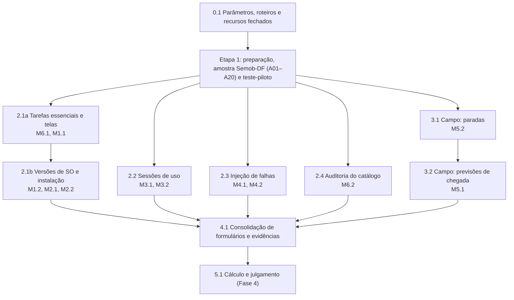

# Fase 3 — Cronograma de Execução

## 1. Objetivo e escopo

Este documento estabelece o **cronograma operacional das ações da avaliação** do aplicativo móvel **DF no Ponto** (versão `5.25.1(1149)`, plataforma Android), integrando o conjunto de entregáveis da atividade de **projetar a avaliação** (Fase 3) prevista na norma **ISO/IEC 25040:2011**.

Seu propósito é ordenar temporalmente as atividades da **Fase 4 (Execução e Conclusão da Avaliação)** — desde a preparação do ambiente e a obtenção dos catálogos até a coleta em laboratório, as medições em campo, a consolidação de evidências e o julgamento final — definindo dependências, durações estimadas, papéis responsáveis e folgas de contingência.

Este plano deriva diretamente da lógica de execução definida em [Método de Avaliação](1-metodo.md), das amostras e parâmetros fixados em [Procedimentos de Execução](2-procedimentos.md) e dos meios e papéis inventariados em [Recursos](3-recursos.md).

> **Escopo frente à gestão do projeto:** este cronograma disciplina exclusivamente a sequência técnica das atividades de medição e julgamento da avaliação do produto. O acompanhamento gerencial de *milestones*, *burndown* e fechamento de *issues* permanece centralizado em [Calendário e Progresso do Projeto](../gestao/calendario.md).

---

## 2. Alinhamento com as entregas e período de coleta

O prazo final do projeto é **22/11/2026**. Para que a coleta, a análise e a redação da Fase 4 caibam nesse prazo, os artefatos da Fase 3 ([Introdução](introducao.md), [Método de Avaliação](1-metodo.md), [Procedimentos de Execução](2-procedimentos.md), [Recursos](3-recursos.md) e este cronograma) são fechados até **17/11/2026**, com o plano congelado após o teste-piloto. O acompanhamento gerencial da *milestone* está em [Calendário e Progresso do Projeto](../gestao/calendario.md).

- **Período de coleta (referência para [Descrição do Produto](../fase1/3-descricao.md)):** **18/11/2026 a 19/11/2026**, com contingência de laboratório em 20/11/2026 e de campo em 21/11/2026.
- **Restrição de calendário:** 20/11/2026 é feriado nacional e 21/11/2026 é sábado; nesses dias a operação dos ônibus pode seguir tabela reduzida. Coletas de campo feitas na contingência devem registrar essa condição como limitação.
- **Consolidação, cálculo e julgamento:** 19/11/2026 a 21/11/2026. A revisão final e a entrega ocorrem em 22/11/2026.

---

## 3. Dependências entre atividades

Para assegurar a validade interna e a reprodutibilidade descritas em [Método de Avaliação](1-metodo.md) e [Procedimentos de Execução](2-procedimentos.md), a execução obedece às seguintes restrições de precedência:

1. **Fechamento dos parâmetros e instrumentos (Pré-condição):** nenhum ensaio oficial pode iniciar antes da fixação dos catálogos (`T01`–`T05`, `C01`–`C04`, `TE01`–`TE08`), das regras de pareamento, dos roteiros passo a passo e dos formulários de registro definidos em [Procedimentos de Execução](2-procedimentos.md).
2. **Captura prévia da base oficial da Semob-DF:** a extração e o arquivamento dos 20 primeiros itens distintos (`A01` a `A20`) do [Relatório de Linhas da Semob-DF](https://www.semob.df.gov.br/dados-do-sistema-de-transporte-publico-do-df), com data e hora de acesso, devem ocorrer **antes** da consulta no aplicativo para `M6.2` e **antes** da definição das entradas `L01`, `L02` e `P01` usadas em `M6.1`, `M1.1` e `M1.2`.
3. **Preparação do ambiente e teste-piloto:** a configuração dos aparelhos (`DISP-01`, `DISP-02`) e emuladores (`EMU-01`), a verificação da versão `5.25.1(1149)` e a realização de um **teste-piloto dos roteiros** (validando gravação de tela, cronometragem, bloqueio de rede/GPS e coleta no **GPSTest**) precedem todas as medições oficiais.
4. **Sequenciamento interno do laboratório:** a execução das tarefas essenciais no aparelho principal (`M6.1`) precede os testes multiplataforma de sistema operacional (`M1.2`), servindo como linha de base funcional para diferenciar defeitos funcionais gerais de falhas específicas de versão do Android.
5. **Teste-piloto antes do campo:** as saídas de campo (`M5.1` e `M5.2`) dependem apenas do teste-piloto (`1.3`), que valida os instrumentos de registro e o GPSTest. Laboratório e campo correm em paralelo, com avaliadores diferentes, para que a coleta de campo ocorra em dias úteis.
6. **Consolidação antes do julgamento:** o cálculo dos indicadores e a atribuição de notas em [Métricas e Critérios de Julgamento](../fase2/metricas-julgamento.md) ocorrem somente após a conferência integral dos formulários, a classificação dos casos não observáveis e a vinculação das evidências por exceção.

Figura 1. Dependências entre as atividades da avaliação. Fonte: elaboração própria (2026).

---

## 4. Cronograma detalhado das atividades de avaliação

Os papéis atribuídos na tabela seguem a definição da Seção 6 de [Recursos](3-recursos.md) (**Responsável pela execução**, **Responsável pelos registros**, **Responsável pela coleta de campo** e **Revisor dos procedimentos**), cujos integrantes nominais devem ser registrados naquele documento antes do teste-piloto (17/11/2026).

| Etapa / ID | Atividade de execução | Métricas / Entregáveis | Dependências | Início | Término | Duração estimada | Folga prevista | Papel responsável (Integrante) |
| :--- | :--- | :--- | :--- | :---: | :---: | :---: | :---: | :--- |
| **0.1** | Fechamento dos parâmetros, catálogos, roteiros e inventário de recursos | Conclusão de [Procedimentos](2-procedimentos.md) e [Recursos](3-recursos.md) (#45, #46, #47) | Fase 2 concluída | 16/11/2026 | 17/11/2026 | — | — | Revisor dos procedimentos *(A definir)* |
| **1.1** | Preparação do ambiente de laboratório, dispositivos (`DISP-01`, `DISP-02`), emuladores (`EMU-01`) e instalação da versão `5.25.1(1149)` | Ambiente configurado e ferramentas (`adb`, `logcat`, gravação, GPSTest) validadas | **0.1** | 17/11/2026 | 17/11/2026 | 3 h | 2 h | Responsável pela execução *(A definir)* |
| **1.2** | Coleta, ordenação e arquivamento da amostra oficial da Semob-DF (`A01`–`A20`) e seleção de `L01`, `L02` e `P01` | Base de referência oficial preservada com data/hora | **0.1** | 17/11/2026 | 17/11/2026 | 2 h | 2 h | Responsável pelos registros *(A definir)* |
| **1.3** | Execução do teste-piloto dos roteiros e validação dos formulários de coleta | Roteiros e planilhas calibrados sem ambiguidade | **1.1**, **1.2** | 17/11/2026 | 17/11/2026 | 3 h | 2 h | Revisor dos procedimentos e Responsável pela execução *(A definir)* |
| **2.1a** | **Laboratório — Tarefas essenciais e adaptabilidade de tela:** execução de `TE01`–`TE08` no aparelho principal e avaliação de 20 casos tela × configuração (`T01`–`T05` × `C01`–`C04`) | **M6.1** (8 tarefas) e **M1.1** (20 casos) | **1.3** | 18/11/2026 | 18/11/2026 | 3 h | 2 h | Responsável pela execução *(A definir)* |
| **2.1b** | **Laboratório — Compatibilidade de SO e instalabilidade:** execução de `TE01`–`TE08` em 3 versões do Android (9, 13 e a do aparelho físico) e 10 ciclos de instalação limpa e remoção com inspeção de diretórios | **M1.2** (3 versões), **M2.1** (10 ciclos) e **M2.2** (10 ciclos) | **2.1a** | 18/11/2026 | 19/11/2026 | 3 h | 2 h | Responsável pela execução *(A definir)* |
| **2.2** | **Laboratório — Sessão padronizada de uso contínuo:** execução de 20 sessões cronometradas de 2 min 30 s (50 min ativos) com gravação e monitoramento de logs | **M3.1** e **M3.2** (20 sessões) | **1.3** | 18/11/2026 | 18/11/2026 | 3 h 30 min | 2 h | Responsável pela execução *(A definir)* |
| **2.3** | **Laboratório — Ensaio com injeção de falhas:** execução de 10 interrupções de rede (30 s) e 10 desativações de localização/GPS (30 s) com medição temporal em vídeo | **M4.1** (10 ensaios) e **M4.2** (10 ensaios) | **1.3** | 18/11/2026 | 18/11/2026 | 2 h | 1 h | Responsável pela execução *(A definir)* |
| **2.4** | **Laboratório — Auditoria comparativa de catálogo:** confronto dos 20 itens oficiais (`A01`–`A20`) da Semob-DF com os registros do aplicativo | **M6.2** (20 itens) | **1.2**, **1.3** | 18/11/2026 | 18/11/2026 | 2 h | 1 h | Responsável pelos registros *(A definir)* |
| **3.1** | **Campo — Medição estática de paradas:** registro da posição de referência (GPSTest) nas 5 paradas selecionadas e comparação com o mapa do app | **M5.2** (5 paradas) | **1.3** | 18/11/2026 | 18/11/2026 | 2 h | 1 janela (2 h) | Responsável pela coleta de campo *(A definir)* |
| **3.2** | **Campo — Observação das previsões de chegada:** registro de 10 eventos de chegada (2 blocos de 5, com as linhas `L01` e `L02`) | **M5.1** (10 eventos) | **1.3**, **3.1** | 18/11/2026 | 19/11/2026 | 4 h (2 blocos de 2 h) | 2 janelas (4 h) | Responsável pela coleta de campo *(A definir)* |
| **4.1** | **Consolidação das evidências e formulários:** auditoria de preenchimento, classificação de pendências/exclusões, vinculação de capturas, logs e vídeos a cada caso e versionamento em `docs/fase4/` | Tabelas de contagem revisadas e evidências organizadas | **2.1b**, **2.2**, **2.3**, **2.4**, **3.2** | 19/11/2026 | 20/11/2026 | 4 h | 2 h | Responsável pelos registros *(A definir)* |
| **5.1** | **Cálculo e julgamento na Fase 4:** apuração das 12 métricas, atribuição das notas (1 a 4), julgamento dos objetivos `G1`–`G6` e elaboração do relatório da Fase 4 | Resultados consolidados e relatório final da avaliação | **4.1** | 20/11/2026 | 21/11/2026 | 4 h | 2 h | Toda a equipe / Revisor dos procedimentos *(A definir)* |

Tabela 1. Cronograma das atividades de avaliação. Fonte: elaboração própria (2026).

> **Nota sobre paralelismo:** as durações somam cerca de 35 h de execução, mais 24 h de folga. Para caber no período de coleta, após a **Etapa 1** as atividades de laboratório (`2.1a`/`2.1b`, `2.2`, `2.3` e `2.4`) e de campo (`3.1` e `3.2`) são executadas em paralelo por avaliadores diferentes, respeitando a precedência entre `2.1a` e `2.1b` e entre `3.1` e `3.2`.

---

## 5. Gestão de folgas e contingências

As folgas previstas na Seção 4 foram dimensionadas para absorver reexecuções previstas nas regras de [Procedimentos de Execução](2-procedimentos.md) e mitigar os riscos mapeados na Seção 7 de [Recursos](3-recursos.md):

| Fator de risco (conforme [Recursos](3-recursos.md)) | Atividades afetadas | Estratégia de folga e contingência aplicada |
| :--- | :--- | :--- |
| **Disponibilidade de aparelhos e emuladores** (`DISP-01`, `DISP-02`, `EMU-01`) | `1.1`, `2.1a`, `2.1b` | Reserva de **+2 h** em cada uma das atividades `1.1`, `2.1a` e `2.1b` para configuração de perfis alternativos ou substituição entre dispositivo físico e emulador Android caso alguma versão de SO ou resolução apresente impedimento técnico. |
| **Falha em ferramentas de gravação, log ou rede/GPS** | `2.2`, `2.3` | Folga de **+2 h** por bloco de ensaio para repetição imediata de sessões ou interrupções em que a gravação de tela ou a marcação temporal falhar, preservando o registro original de defeitos observados. |
| **Indisponibilidade ou instabilidade da fonte oficial da Semob-DF** | `1.2`, `2.4` | Folga de **+2 h** na captura inicial (`1.2`) para extração e arquivamento local de *backup* (captura datada) da lista `A01`–`A20`, evitando bloqueio posterior da auditoria `M6.2`. |
| **Condições climáticas (chuva) e segurança nos pontos de parada** | `3.1`, `3.2` | Reserva de **3 janelas completas de contingência** (+2 h para `3.1` e +4 h para `3.2`) em dias/turnos alternativos previamente registrados, permitindo reagendamento sem comprometer o prazo da Fase 4. |
| **Horário das paradas, intervalos de frota e operação das linhas** | `2.1a` (`TE05`), `3.2` | Dimensionamento de blocos de **2 h** por sessão de campo (para capturar 5 chegadas elegíveis) somado à folga de **2 janelas extras**, cobrindo horários de menor frequência de ônibus ou ausência temporária de operação da linha `L02`. |
| **Conectividade móvel instável em campo** | `3.1`, `3.2` | Margem de tempo dentro das janelas de contingência para repetição de observações apenas nos casos de perda de rede externa previstos nas regras de não observabilidade de [Procedimentos de Execução](2-procedimentos.md). |

---

## 6. Referências

- Equipe Carol Shaw. [Introdução da Fase 3](introducao.md).
- Equipe Carol Shaw. [Método de Avaliação — Fase 3](1-metodo.md).
- Equipe Carol Shaw. [Procedimentos de Execução — Fase 3](2-procedimentos.md).
- Equipe Carol Shaw. [Recursos — Fase 3](3-recursos.md).
- Equipe Carol Shaw. [Abordagem GQM e Metas de Avaliação — Fase 2](../fase2/planejamento-objetivos.md).
- Equipe Carol Shaw. [Métricas e Critérios de Julgamento — Fase 2](../fase2/metricas-julgamento.md).
- Equipe Carol Shaw. [Calendário e Progresso do Projeto](../gestao/calendario.md).
- ISO. *ISO/IEC 25040:2011 — Systems and software engineering — Systems and software Quality Requirements and Evaluation (SQuaRE) — Evaluation process*.

---

## Histórico de Versões

| ID | Descrição | Autor | Data | Revisor | Data |
| :-: | :--- | :--- | :---: | :--- | :---: |
| 01 | Criação inicial do cronograma de execução da avaliação (Fase 3), definindo sequência de atividades, dependências, durações, folgas e papéis responsáveis | [Cristiano](https://github.com/CristianoMoraiss) | 16/11/2026 | — | — |
| 02 | Datas das atividades ajustadas ao prazo de 22/11/2026, campo em paralelo ao laboratório, diagrama de dependências em Mermaid e evidências em `dados/fase4/` | [Bessa](https://github.com/bessazs) | 16/11/2026 | — | — |
| 03 | Quantidades e durações ajustadas às amostras revistas dos procedimentos (3 versões do Android, 10 ensaios de falha, 10 chegadas, 5 paradas, lista `A01`–`A20`) | [Bessa](https://github.com/bessazs) | 16/11/2026 | — | — |
