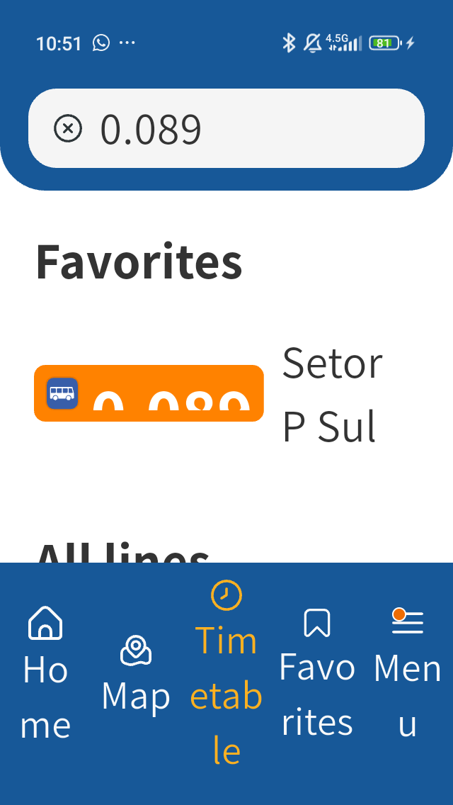
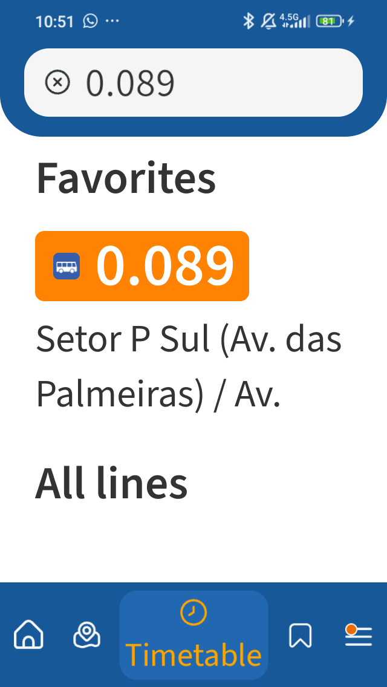
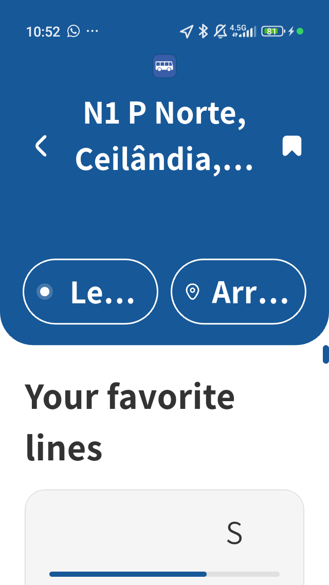
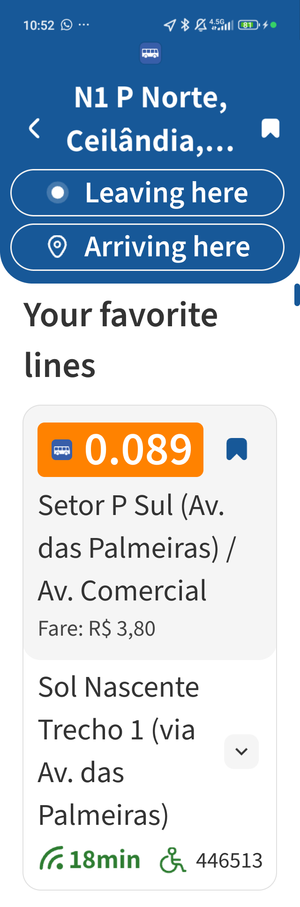

# Fase 4 — Resultados e Conclusões

## 1. Introdução e critério de julgamento

Este documento sintetiza os resultados da avaliação de qualidade do aplicativo móvel **DF no Ponto** (Android, versão `5.25.1(1149)`), avaliado em regime de caixa preta. No processo da **ISO/IEC 25040:2011**, ele reúne as atividades de *julgar os resultados* e *concluir a avaliação*: transforma as notas calculadas em [Análise de Dados](2-analise.md), a partir dos registros de [Coleta de Dados](1-coleta.md), em vereditos dos objetivos, respostas às questões e subsídios às decisões **D1**, **D2** e **D3**.

A Fase 4 preserva a arquitetura das fases anteriores: **3 características** da ISO/IEC 25010, **6 objetivos** (`G1` a `G6`), **12 questões** (`Q1.1` a `Q6.2`) e **12 métricas** (`M1.1` a `M6.2`), sem alterar fórmulas, limiares ou amostras.

### 1.1. Critério conservador da pior nota

As notas de 1 a 4 são **ordinais**, portanto não há média entre métricas. Cada objetivo recebe a **pior nota** de suas duas métricas filhas, como define [Julgamento dos Objetivos](../fase2/metricas-julgamento.md#julgamento-dos-objetivos).

| Pior nota nas métricas do objetivo | Veredito | Ação recomendada |
| :--- | :--- | :--- |
| Apenas notas 3 e 4 | **Satisfeito** | Operação regular e estável. |
| Pelo menos uma nota 2 | **Satisfeito com Ressalvas** | Abrir *issue* corretiva; não inviabiliza o uso, mas exige melhoria. |
| Pelo menos uma nota 1 | **Não Satisfeito** | Funcionalidade comprometida; exige correção imediata. |
| Métrica filha sem dados ou com caso obrigatório pendente | **Não avaliado (dados incompletos)** | Concluir a coleta; as notas já obtidas ficam visíveis. |

Tabela 1. Critérios de veredito dos objetivos. Fonte: Métricas e Critérios de Julgamento (Fase 2, 2026).

### 1.2. Panorama

- **As 12 métricas** têm dados; **`M1.2` tem amostra parcial** (4 tentativas, 1 versão válida).
- **9 métricas** receberam **Nota 4**, **1** recebeu **Nota 3** (`M5.1`), **1** recebeu **Nota 2** (`M1.1`) e **1** teve resultado parcial (`M1.2`).
- Dos 6 objetivos, **5 ficaram Satisfeitos** (`G2` a `G6`) e **1 ficou sem veredito definitivo** (`G1`).
- Das 12 hipóteses, 8 foram confirmadas, 2 refutadas e 2 verificadas em parte.
- Os resultados são **indicativos**: valem para a amostra, a versão, os aparelhos e o período observados, e não constituem certificação do aplicativo.

---

## 2. Julgamento dos objetivos GQM (G1 a G6)

| Objetivo | Característica | Métricas e notas | Regra | Veredito |
| :--- | :--- | :--- | :---: | :--- |
| **G1** — Adaptabilidade | Portabilidade | **M1.1:** 15/20 = 0,75 → **Nota 2** **M1.2:** 1/1 = 1,00, parcial (3 tentativas não observáveis) | $\min$ | **Não avaliado (dados incompletos)** |
| **G2** — Instalabilidade | Portabilidade | **M2.1:** 10/10 → **Nota 4** **M2.2:** 10/10 → **Nota 4** | $\min$ | **Satisfeito** |
| **G3** — Maturidade | Confiabilidade | **M3.1:** 20/20 → **Nota 4** **M3.2:** 20/20 → **Nota 4** | $\min$ | **Satisfeito** *(exposição reduzida)* |
| **G4** — Tolerância a Falhas | Confiabilidade | **M4.1:** 10/10 → **Nota 4** **M4.2:** 10/10 → **Nota 4** | $\min$ | **Satisfeito** |
| **G5** — Correção | Adequação Funcional | **M5.1:** mediana 3,34 min → **Nota 3** **M5.2:** 5/5 → **Nota 4** | $\min$ | **Satisfeito** |
| **G6** — Completude | Adequação Funcional | **M6.1:** 8/8 → **Nota 4** **M6.2:** 20/20 → **Nota 4** | $\min$ | **Satisfeito** |

Tabela 2. Vereditos dos objetivos G1 a G6. Fonte: elaboração própria (2026), com base em Análise de Dados.

### G1 — Adaptabilidade (Portabilidade)

`M1.1` ficou em $15/20 = 0{,}75$, **Nota 2**, no limite inferior da faixa. Os cinco defeitos ocorreram com **fonte a 200%** em tela compacta, incluindo `T03-C03` no mapa. As demais configurações passaram nas cinco telas. Em `M1.2`, o app concluiu `TE01` a `TE08` no **Android 13**. As três tentativas em emulador (Android 9, 10 e 17) foram **Não observáveis** após recusa de instalação relatada pela equipe. Como o roteiro também previa validar o Android 9, `G1` fica **Não avaliado (dados incompletos)**.

### G2 — Instalabilidade (Portabilidade)

Nos 10 ciclos, a instalação pela Play Store concluiu na primeira tentativa e nenhuma desinstalação deixou arquivo ou pasta atribuível ao app nos locais inspecionados. **Satisfeito.** O resultado vale só para os diretórios observáveis, já que o armazenamento privado do app não é inspecionado.

### G3 — Maturidade (Confiabilidade)

Nas 20 sessões, não houve encerramento inesperado nem congelamento superior a 5 s. **Satisfeito**, com a declaração obrigatória de que as sessões duraram **2 min 30 s** (50 min no total, metade do plano original), o que reduz a exposição e tende a favorecer o resultado.

### G4 — Tolerância a Falhas (Confiabilidade)

Nos 10 ensaios de queda de rede e nos 10 de perda de localização, o app permaneceu aberto, avisou a indisponibilidade em até 5 s e retomou o serviço em até 30 s. **Satisfeito.** A [Coleta de Dados](1-coleta.md#m42-perda-de-localizacao) registra os dez ensaios de `M4.2` entre 18h08 e 18h16, com um vídeo por ensaio.

### G5 — Correção (Adequação Funcional)

Em `M5.1`, a mediana do erro absoluto das 10 previsões válidas foi **3,34 min** (**Nota 3**); a hipótese de mediana até 5 min foi confirmada. O resultado varia bastante entre as linhas: a mediana foi 13,97 min na `0.089` (3 eventos, todos com perda de rastreio) e 0,95 min na `933.4` (7 eventos, sem perda). Em `M5.2`, as cinco paradas ficaram dentro da tolerância de 30 m (5/5, **Nota 4**), embora `P02` tenha ficado a 29 m e sua medição visual tenha sido feita com auxílio de IA. Pela pior nota, **G5 é Satisfeito na amostra**, com ressalva da variação observada em `M5.1` e da limitação da evidência de `M5.2`.

### G6 — Completude (Adequação Funcional)

As 8 tarefas essenciais foram concluídas e as 20 linhas sorteadas do Relatório de Linhas da Semob-DF (17/11/2026) foram encontradas no app. **Satisfeito**, dentro da amostra auditada.

---

## 3. Respostas às questões operacionais (Q1.1 a Q6.2)

| Questão | Resposta | Evidência |
| :--- | :--- | :--- |
| **Q1.1** — A interface se redimensiona sem sobreposições ou cortes em telas compactas, orientações e fontes ampliadas? | **Em parte.** 15 de 20 casos conformes. As cinco telas apresentaram cortes ou problemas de organização do conteúdo com fonte a 200%, incluindo o mapa. As configurações com fonte a 100% passaram. | $M_{1.1} = 0{,}75$ · Nota 2 |
| **Q1.2** — O app executa sem erros críticos de compatibilidade em diferentes versões do SO, incluindo legadas? | **Verificado no Android 13.** A equipe registrou recusa de instalação nos emuladores com Android 9, 10 e 17 e classificou as tentativas como não observáveis. | $M_{1.2} = 1/1$ (parcial, 4 tentativas) |
| **Q2.1** — A instalação nas lojas oficiais ocorre na primeira tentativa sem erro? | **Sim.** 10 de 10 ciclos pela Play Store. | $M_{2.1} = 1{,}00$ · Nota 4 |
| **Q2.2** — O app evita arquivos residuais no armazenamento compartilhado após a desinstalação? | **Sim, nos locais inspecionados.** 0 de 10 desinstalações com resíduo atribuível ao app. | $M_{2.2} = 1{,}00$ · Nota 4 |
| **Q3.1** — O app evita *crashes* durante sessões ativas? | **Sim, na janela observada.** 0 de 20 sessões com encerramento inesperado (sessões de 2 min 30 s). | $M_{3.1} = 1{,}00$ · Nota 4 |
| **Q3.2** — O sistema previne congelamentos superiores a 5 s? | **Sim, na janela observada.** 0 de 20 sessões com congelamento. | $M_{3.2} = 1{,}00$ · Nota 4 |
| **Q4.1** — O app evita quebras, avisa e retoma após queda de conexão? | **Sim.** 10 de 10 ensaios com aviso em até 5 s e retomada em até 30 s, sem modo *offline* previsto. | $M_{4.1} = 1{,}00$ · Nota 4 |
| **Q4.2** — O sistema reage apropriadamente à perda de GPS? | **Sim.** 10 de 10 ensaios: aviso, `TE01` e `TE04` disponíveis e posição retomada. | $M_{4.2} = 1{,}00$ · Nota 4 |
| **Q5.1** — As previsões de chegada refletem a aproximação física? | **Em parte, na amostra.** A mediana do erro foi 3,34 min (Nota 3), mas houve erros de até 38,97 min e diferença entre as linhas observadas. | $M_{5.1}$: 10 eventos válidos; mediana 3,34 min |
| **Q5.2** — A posição das paradas no mapa coincide com a posição real? | **Sim, para as 5 paradas avaliadas** (3 a 29 m, tolerância de 30 m). A posição dos veículos não faz parte da métrica. | $M_{5.2} = 1{,}00$ · Nota 4 |
| **Q6.1** — O catálogo de tarefas essenciais executa de ponta a ponta? | **Sim.** 8 de 8 tarefas conformes. | $M_{6.1} = 1{,}00$ · Nota 4 |
| **Q6.2** — A base de linhas do app está sincronizada com a Semob-DF? | **Sim, na amostra.** 20 de 20 linhas sorteadas, com código, sentido e itinerário correspondentes. | $M_{6.2} = 1{,}00$ · Nota 4 |

Tabela 3. Respostas às 12 questões operacionais. Fonte: elaboração própria (2026), com base em Análise de Dados.

---

## 4. Características e questões norteadoras (QN1 a QN3)

Cada característica recebe o **pior veredito** entre seus dois objetivos, e cada questão norteadora é respondida com o veredito da característica e as métricas que o determinaram. Não se calcula nota global do aplicativo.

| Questão norteadora | Característica (prioridade) | Objetivos | Veredito |
| :---: | :--- | :--- | :--- |
| **QN3** — Fidelidade da informação e utilidade pública | **Adequação Funcional** (1) · D3 | G5: Satisfeito G6: Satisfeito | **Satisfeita na amostra** |
| **QN2** — Resiliência operacional sob condições reais | **Confiabilidade** (2) · D2 | G3: Satisfeito G4: Satisfeito | **Satisfeita** |
| **QN1** — Universalidade e acesso equitativo | **Portabilidade** (3) · D1 | G1: dados incompletos G2: Satisfeito | **Não avaliada (dados incompletos)** |

Tabela 4. Veredito por característica e questão norteadora. Fonte: elaboração própria (2026).

### QN1 — Portabilidade

> *O DF no Ponto atende ao parque heterogêneo de dispositivos dos usuários do DF sem barreiras de hardware ou SO?*

**Resposta parcial.** A instalação é limpa (`M2.1` e `M2.2`, nota 4) e a interface passou nas configurações com fonte a 100%. Com fonte a 200%, houve **falhas nas cinco telas avaliadas** (`M1.1` = 0,75, Nota 2). A compatibilidade de SO foi validada apenas no **Android 13**. Como `G1` tem cobertura parcial de versões, a Portabilidade fica **Não avaliada (dados incompletos)**.

### QN2 — Confiabilidade

> *O aplicativo se mantém estável, resiliente a quedas de rede e recuperável durante os deslocamentos urbanos?*

**Resposta positiva dentro da amostra.** Nenhum *crash* nem congelamento em 20 sessões, e tratamento adequado de queda de rede e de perda de GPS em 20 ensaios induzidos. As sessões duraram 2 min 30 s e cada métrica foi avaliada em um único aparelho de laboratório com Android 13. O resultado indica estabilidade na janela observada, sem generalizar para uso prolongado ou para outros aparelhos.

### QN3 — Adequação Funcional

> *O aplicativo entrega informações completas e fidedignas para planejar viagens com segurança?*

**Resposta favorável, com ressalvas, na amostra.** Há evidência de completude (tarefas essenciais 8/8 e linhas 20/20), posição das paradas dentro da tolerância (5/5) e precisão do tempo de chegada com mediana de erro de 3,34 min (`M5.1`, Nota 3). Porém, os resultados de `M5.1` variam entre as linhas: na `0.089`, a mediana foi 13,97 min e houve perda de rastreio nos três eventos válidos; na `933.4`, a mediana foi 0,95 min e não houve perda nos sete eventos. A posição dos veículos não foi avaliada por restrição de método, e a conclusão se limita à amostra observada. Pela pior nota dos objetivos, a característica fica **Satisfeita na amostra**.

---

## 5. Pareceres para as decisões apoiadas (D1 a D3)

### D1 — Acessibilidade tecnológica e homologação de dispositivos *(Portabilidade)*

- **Parecer:** **parcial; manter, com melhoria pontual e homologação de versões legadas em aberto.**
- **Evidência favorável:** instalação 10/10 sem resíduo observável (G2 *Satisfeito*); 15 de 20 casos de tela conformes e Android 13 sem erros de compatibilidade.
- **Pontos de atenção:** cinco defeitos de layout em fonte a 200% (`T01-C03` a `T05-C03`), incluindo a tela do mapa, relevantes para usuários com baixa visão; a compatibilidade de SO foi validada apenas no Android 13.
- **Decisão apoiada:** não há base para recomendar refatoração geral de interface nem para homologar versões legadas. Recomenda-se corrigir com prioridade o comportamento em fonte ampliada e testar as versões legadas em dispositivos ou ambientes ARM antes de homologá-las.

### D2 — Resiliência operacional em ambiente urbano *(Confiabilidade)*

- **Parecer:** **favorável na amostra; manter, com confirmação em condições mais exigentes.**
- **Evidência favorável:** 0 *crashes* e 0 congelamentos em 20 sessões; 10/10 em queda de rede; 10/10 em perda de GPS (G3 e G4 *Satisfeitos*).
- **Pontos de atenção:** 50 min de exposição nas sessões de estabilidade, um aparelho por ensaio e testes em laboratório. Falta observar o uso da rede móvel em deslocamento.
- **Decisão apoiada:** não se identificou necessidade de priorizar arquitetura de tolerância a falhas com base nestes dados. A hipótese pessimista **H4.1** (falta de modo *offline* prejudicando o aviso) **foi refutada** nos 10 ensaios.

### D3 — Confiabilidade e utilidade dos dados de mobilidade *(Adequação Funcional)*

- **Parecer:** **favorável na amostra, com ressalvas sobre a variação dos erros de previsão e a evidência de posição.**
- **Evidência favorável:** catálogo de linhas sincronizado com a Semob-DF na amostra (20/20), tarefas essenciais completas (8/8), paradas dentro da tolerância (5/5) e mediana de erro de chegada de 3,34 min em `M5.1` (Nota 3).
- **Pontos de atenção:** em `M5.1`, a mediana foi 13,97 min na linha `0.089` (3 eventos, todos com perda de rastreio) e 0,95 min na linha `933.4` (7 eventos, sem perda). A posição dos veículos exibida no app tem defasagem da ordem de um minuto e ficou fora da métrica. `P02` ficou a 29 m do limite de 30 m e sua medição foi visual.
- **Decisão apoiada:** manter o processo de sincronização do catálogo, investigar as perdas de rastreio na linha `0.089` e reforçar a evidência da medição de `M5.2`. O resultado de `M5.1` sustenta o objetivo na amostra, mas não permite generalização para outras linhas, horários ou condições.

| Decisão | Parecer | Condição para fechamento |
| :---: | :--- | :--- |
| **D1** | Parcial: manter, com melhoria em fonte ampliada | Corrigir os cinco defeitos de layout com fonte a 200% e validar versões legadas em ambiente ARM |
| **D2** | Favorável na amostra: manter | Ampliar a duração dos testes e avaliar o uso da rede móvel em deslocamento |
| **D3** | Favorável na amostra, com ressalvas | Investigar perdas de rastreio em `M5.1`; reforçar a evidência de `M5.2` |

Tabela 5. Síntese dos pareceres para D1, D2 e D3. Fonte: elaboração própria (2026).

---

## 6. Recomendações de melhoria para o DF no Ponto

As recomendações abaixo são para a equipe do aplicativo e se baseiam nos testes feitos nesta avaliação.

**Prioridade:** **Alta** é o que pode fazer o passageiro tomar uma decisão errada sobre a viagem. **Média** é um problema que apareceu nos testes. **Baixa** é uma melhoria que não corrige defeito, mas pode ajudar no futuro.

| ID | Prioridade | Problema para o passageiro | O que os testes mostraram | O que melhorar | Métrica |
| :---: | :---: | :--- | :--- | :--- | :---: |
| **REC-01** | **Alta** | A previsão pode ficar muito imprecisa quando o veículo perde o rastreio. | Na linha `0.089`, os 3 eventos válidos tiveram perda de rastreio; os erros foram 13,32, 13,97 e 38,97 min. Na linha `933.4`, não houve perda nos 7 eventos válidos (mediana de erro de 0,95 min). O evento excluído `X01` também teve perda de rastreio, mas não teve chegada observada e não entrou no cálculo. | Manter o veículo na lista com um aviso como "sem sinal há X min", identificar quando a previsão deixa de ser em tempo real e investigar as perdas de rastreio da linha `0.089`. | `M5.1` |
| **REC-02** | **Média** | A mediana do erro esconde previsões com desvios grandes. | A mediana geral foi 3,34 min (Nota 3), mas 3 dos 10 eventos válidos tiveram erro superior a 10 min; o maior foi de 38,97 min. | Sinalizar quando a previsão estiver sujeita a grande incerteza ou desatualizada, sem apresentá-la como horário preciso. | `M5.1` |
| **REC-03** | **Média** | Com a letra do celular ampliada, partes das telas ficam cortadas ou sobrepostas. | Com a fonte a 200%, falharam as cinco telas avaliadas: busca, horários, mapa, detalhes da parada e favoritos. Os outros 15 casos passaram. | Ajustar o layout das cinco telas para acomodar texto ampliado e repetir os testes com fonte a 200% a cada nova versão. | `M1.1` |
| **REC-04** | **Média** | Uma parada pode estar um pouco fora do lugar real no mapa. | A parada `P02` ficou a 29 m do lugar real, quase no limite aceito (30 m). As outras 4 ficaram a no máximo 5 m. A medida foi feita nas imagens, com ajuda de IA, então pode ter pequena imprecisão. | Conferir a posição de `P02` pelas coordenadas e corrigir o cadastro se o erro se confirmar. Conferir também as outras paradas. | `M5.2` |
| **REC-05** | **Média** | O passageiro não sabe há quanto tempo a posição do ônibus foi atualizada. | A posição atualiza a cada cerca de 1 min. A informação de "última atualização" só aparece na tela de detalhes da viagem. Esse atraso não foi medido nos testes. | Mostrar a hora da última atualização também no mapa e na lista de horários. Ver se dá para atualizar com mais frequência. | `M5.1` `M5.2` |
| **REC-06** | **Baixa** | Não dá para saber se o app funciona bem em celulares com Android mais antigo. | O app só foi testado no Android 13. A equipe registrou recusa de instalação nos emuladores com Android 9, 10 e 17. A arquitetura foi levantada como possível causa. A compatibilidade nessas versões ficou sem verificação. | Informar a versão mínima de Android aceita e continuar testando nas versões antigas (Android 9 a 12). Avaliar criar uma versão para outros processadores, para facilitar os testes. | `M1.2` |
| **REC-07** | **Baixa** | Sem internet, o app não mostra nada útil. | Quando a internet ou o GPS caíram, o app avisou em até 5 s e voltou ao normal em até 30 s, sem travar, nos 10 testes de cada. O app não funciona sem internet. | Melhoria opcional: guardar no celular o que não muda (favoritos, horários de tabela, rotas recentes) para consultar sem internet, avisando que não são dados em tempo real. | `M4.1` `M4.2` |

**O que já está bom e deve ser mantido:** instalação sem erros, app sem travamentos nos testes, avisos quando a internet ou o GPS caem, lista de linhas igual à da Semob-DF na amostra e tarefas principais funcionando.

---

## 7. Ação de melhoria

Como a avaliação de `M1.1` identificou problemas de reorganização do conteúdo com a fonte do Android em 200%, optou-se por desenvolver **protótipos de alta fidelidade**. A escolha se deve à necessidade de verificar visualmente se textos e controles continuam legíveis e distinguíveis nesse nível de ampliação, um recurso importante de acessibilidade. Os protótipos permitem discutir uma proposta concreta, com textos, controles e hierarquia visual próximos de uma interface final, antes de implementar mudanças no aplicativo. As imagens “Depois” representam propostas de protótipo; não comprovam que as correções foram implementadas ou retestadas no app.

### T01-C03 — Resultado da busca

Na captura original, o código da linha e o nome aparecem prejudicados pelo espaço disponível, e o título “All lines” fica parcialmente encoberto pela navegação inferior. No protótipo, o código `0.089` permanece legível no cartão, o nome da linha pode quebrar em linhas sem se sobrepor aos demais elementos e o título e a navegação ficam visualmente separados.

| Antes — captura original (fonte a 200%) | Depois — protótipo de alta fidelidade |
| :---: | :---: |
| { width="280" } | { width="280" } |

### T04-C03 — Detalhes da parada

Na captura original, os botões de sentido são truncados (“Le...” e “Arr...”), dificultando distinguir partida de chegada; o título da parada e o cartão da linha favorita também ficam cortados. No protótipo, os botões mostram os rótulos completos (“Leaving here” e “Arriving here”) e o cabeçalho é reorganizado para dar mais espaço ao conteúdo da parada. O título ainda aparece abreviado com reticências, ponto que deve ser validado em uma próxima iteração.

| Antes — captura original (fonte a 200%) | Depois — protótipo de alta fidelidade |
| :---: | :---: |
| { width="280" } | { width="280" } |

---

## 8. Ameaças à validade e limitações

Os resultados seguem as ameaças previstas em [Método de Avaliação](../fase3/1-metodo.md#6-limitacoes-do-metodo-e-ameacas-a-validade). A tabela destaca o que se observou na execução.

| Dimensão | Ameaça observada | Tratamento | Limitação residual |
| :--- | :--- | :--- | :--- |
| **Externa** | Amostras pequenas e intencionais (2 a 20 casos); um único aparelho por ensaio; só Android 13; catálogo auditado em dia útil e uma data. | Contagem junto de cada nota; resultados tratados como indicativos. | Não se estimam taxas da população de usuários, nem se generaliza para outras versões, aparelhos ou linhas. |
| **Construto** | `M2.2` só vê armazenamento compartilhado; `M6.2` mede presença no catálogo, não a qualidade da oferta de transporte; `M3` com exposição reduzida. | Limites declarados em cada ficha. | Resíduos em áreas privadas, qualidade da oferta e falhas raras em uso longo não são observáveis. |
| **Conclusão** | Notas sensíveis a um caso (`M1.1` no limite inferior da Nota 2, `M5.2` com `P02` a 29 m, faixas sem Nota 3); diferença expressiva de erros de `M5.1` entre as duas linhas amostradas. | Limiares fixados antes da coleta, pior nota, sem médias entre notas, tabela de sensibilidade e apresentação dos resultados por linha. | `G1` fica não avaliado porque a compatibilidade de SO só foi validada no Android 13; `G5` é satisfeito na amostra, mas `M5.1` não se generaliza para outras linhas ou condições. |

Tabela 7. Ameaças à validade e limitações. Fonte: elaboração própria (2026).

---

## Referências

[1] ISO. *ISO/IEC 25040:2011 — Systems and software engineering — Systems and software Quality Requirements and Evaluation (SQuaRE) — Evaluation process*. Geneva: ISO, 2011.

[2] ISO. *ISO/IEC 25010:2011 — Systems and software engineering — Systems and software Quality Requirements and Evaluation (SQuaRE) — System and software quality models*. Geneva: ISO, 2011.

[3] ISO. *ISO/IEC 25023:2016 — Systems and software engineering — Systems and software Quality Requirements and Evaluation (SQuaRE) — Measurement of system and software product quality*. Geneva: ISO, 2016.

[4] W3C. *Web Content Accessibility Guidelines (WCAG) 2.1 — Success Criterion 1.4.4 Resize Text*. Disponível em: <https://www.w3.org/TR/WCAG21/#resize-text>.

[5] SEMOB-DF. *Dados do Sistema de Transporte Público do DF — Relatório de Linhas*. Disponível em: <https://www.semob.df.gov.br/dados-do-sistema-de-transporte-publico-do-df>.

[6] EQUIPE CAROL SHAW. [Propósito da Avaliação — Fase 1](../fase1/1-proposito.md); [Abordagem GQM e Metas de Avaliação — Fase 2](../fase2/planejamento-objetivos.md); [Métricas e Critérios de Julgamento — Fase 2](../fase2/metricas-julgamento.md); [Procedimentos de Execução — Fase 3](../fase3/2-procedimentos.md); [Coleta de Dados — Fase 4](1-coleta.md); [Análise de Dados — Fase 4](2-analise.md).

---

## Histórico de Versões

| ID | Descrição | Autor | Data | Revisor | Data |
| :-: | :--- | :--- | :---: | :--- | :---: |
| 01 | Emissão dos vereditos dos objetivos, respostas às questões norteadoras, pareceres das decisões D1-D3 e recomendações da Fase 4 (#50) | [João Guilherme Capozzi](https://github.com/jonas3688) | 18/11/2026 | [Cristiano Morais](https://github.com/CristianoMoraiss) | 21/11/2026 |
| 02 | Atualização com os dados coletados: vereditos de G1 a G6, respostas às questões, pareceres de D1 a D3, recomendações e ameaças à validade | [Pedro Ramos](https://github.com/PedroRSR) | 21/11/2026 | [Cristiano Morais](https://github.com/CristianoMoraiss) | 21/11/2026 |
| 03 | Atualização dos resultados, vereditos e recomendações de G5/D3 com os dados de M5.1 | [Pedro Ramos](https://github.com/PedroRSR) | 23/11/2026 | A definir | — |
| 04 | Inclusão da ação de melhoria e dos protótipos de alta fidelidade para os defeitos de M1.1 em fonte ampliada | [Pedro Ramos](https://github.com/PedroRSR) [Cristiano Morais](https://github.com/CristianoMoraiss) | 23/11/2026 | A definir | — |