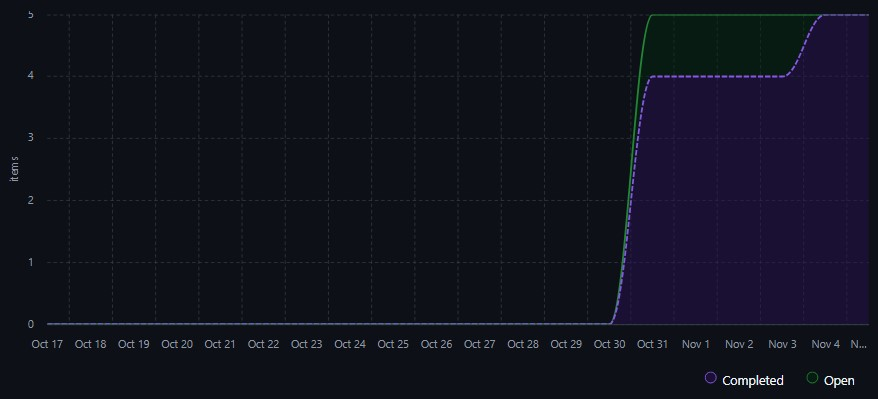

# Calendário e Progresso do Projeto

## 1. Introdução

Esta página foi desenvolvida para acompanhar o desenvolvimento das entregas ao longo do semestre adotada pela equipe Carol Shaw. Seu papel central é monitorar se o escopo definido para cada ciclo de desenvolvimento está sendo entregue dentro do prazo estipulado e avaliar a cadência do avanço das atividades ao longo do tempo.

## 2. Métrica de Progresso (Taxa de Conclusão de Issues)

Para quantificar a evolução das atividades em cada milestone, adota-se a fórmula de porcentagem de conclusão de issues:

$$\text{Taxa de Conclusão (\%)} = \left( \frac{\text{Issues Concluídas}}{\text{Total de Issues}} \right) \times 100$$

**Definição dos Parâmetros:**

- **Issues Concluídas:** Quantidade de issues associadas à milestone que foram finalizadas, revisadas e fechadas após merge na branch principal (`main`).
- **Total de Issues:** Quantidade total de tarefas previstas e cadastradas para o escopo da respectiva milestone.

A métrica indica a completude do escopo acordado para a entrega, devendo ser confrontada com a distribuição temporal (gráfico de *burndown*) para verificar se a conclusão ocorreu de forma gradual e sustentável ou de forma abrupta.

## 3. Milestone: Entrega 1

### 3.1. Objetivo da Milestone

A milestone **Entrega 1** teve como objetivo consolidar as fundações analíticas e de documentação do projeto de avaliação do aplicativo **DF no Ponto**, englobando:

1. **Desenvolvimento da Fase 1 do Processo de Avaliação:** definição do propósito da avaliação, identificação dos requisitantes e partes interessadas, descrição detalhada do produto de software, justificativa das necessidades e seleção do modelo de qualidade baseado na ISO/IEC 25010.
2. **Desenvolvimento da Fase 2 do Processo de Avaliação:** planejamento da avaliação, desdobramento da abordagem GQM (*Goal Question Metric*) e definição dos critérios e métricas de julgamento técnico.
3. **Implantação da Plataforma de Documentação (GitPages):** estruturação inicial da GitPage da equipe com MkDocs Material para abrigar os artefatos do projeto.
4. **Primeira Versão do Artigo Científico:** redação inicial do artigo em LaTeX reportando a metodologia e as especificações de qualidade.
5. **Tabela de Contribuição da Equipe:** documentação do papel e da dedicação dos membros do grupo na fase inicial.

### 3.2. Dados Reais da Entrega 1

Os dados reais obtidos no repositório GitHub evidenciam a totalidade das issues cadastradas para a Entrega 1:

| Propriedade / Indicador | Dado Real da Milestone |
| :--- | :--- |
| **Nome da Milestone** | Entrega 1 |
| **Data de Abertura das Issues** | 31/10/2026 |
| **Data de Conclusão / Fechamento** | 04/11/2026 |
| **Total de Issues Cadastradas** | 5 |
| **Issues Concluídas** | 5 |
| **Taxa de Conclusão de Escopo** | **100%** |
| **Padrão de Fechamento** | Abertas e fechadas no mesmo dia, execeto a issue #7 que foi fechada apenas no dia 04/11, mas foi concluida no dia 31/10 |

#### Detalhamento das Issues da Entrega 1

| Nº Issue | Título da Tarefa | Abertura | Fechamento | Status |
| :---: | :--- | :---: | :---: | :---: |
| [#3](https://github.com/FCTE-Qualidade-de-Software-1/2026-2_T02_CAROL_SHAW/issues/3) | Definir requisitos da avaliação e modelo de qualidade (Fase 1) | 31/10/2026 | 31/10/2026 | Concluída |
| [#4](https://github.com/FCTE-Qualidade-de-Software-1/2026-2_T02_CAROL_SHAW/issues/4) | Especificação da Avaliação e Desdobramento GQM (Fase 2) | 31/10/2026 | 31/10/2026 | Concluída |
| [#5](https://github.com/FCTE-Qualidade-de-Software-1/2026-2_T02_CAROL_SHAW/issues/5) | Organização do relatório em LaTeX e criação da GitPage | 31/10/2026  | 31/10/2026  | Concluída |
| [#6](https://github.com/FCTE-Qualidade-de-Software-1/2026-2_T02_CAROL_SHAW/issues/6) | Análise de requisitos, metodologia e revisão técnica global | 31/10/2026  | 31/10/2026  | Concluída |
| [#7](https://github.com/FCTE-Qualidade-de-Software-1/2026-2_T02_CAROL_SHAW/issues/7) | Refinamentos e correções do artigo | 31/10/2026  | 04/11/2026  | Concluída |

**Cálculo da Taxa de Conclusão da Entrega 1:**

$$\text{Taxa de Conclusão (Entrega 1)} = \left( \frac{5}{5} \right) \times 100 = 100\%$$

### 3.3. Análise Crítica: Registro Retroativo e Prazos Maquiados

Devido à falta de planejamento do projeto e à falta de organização entre os membros da equipe, as issues referentes à Entrega 1 foram criadas e fechadas no mesmo dia apenas para seguir as regras do projeto. Esse procedimento incorreto resultou em dados retroativos e prazos maquiados: embora a taxa formal de conclusão aponte 100%, os tempos de ciclo ficaram artificialmente registrados na faixa de 20 a 30 minutos por atividade. Na realidade, o trabalho foi desenvolvido de maneira desordenada e desassistida ao longo de dias, sem qualquer rastreamento prévio no GitHub Projects. Esse registro tardio anulou a gestão visual no quadro Kanban, mascarou atrasos reais e impediu que a equipe e a professora acompanhassem o verdadeiro ritmo de avanço do projeto durante a Entrega 1.

### 3.4. Gráfico de Burndown da Entrega 1

O gráfico de *burndown* a seguir ilustra a anomalia gerada pelo registro retroativo na Entrega 1. Durante quase todo o ciclo (de 17/10 a 30/10), o quadro não registrava nenhuma issue. No dia 31/10, as 5 issues foram cadastradas e concluídas:

*Gráfico de Burndown da Entrega 1 - 17/10/2026 a 04/11/2026 - Fonte Github Projects*

## 4. Ações de Correção para a Entrega 2 e Ciclo Corretivo

Para sanar em definitivo as falhas de rastreabilidade identificadas na Entrega 1, a equipe estabeleceu a seguinte diretriz de governança:

> **"A partir de agora, toda tarefa será criada como Issue e movida no Projects antes do código ser feito."**

As regras operacionais obrigatórias para a fase de correção e para a Entrega 2 são:

1. **Criação Prévia no Backlog:** Nenhuma atividade de documentação, correção ou codificação pode ser iniciada sem que uma Issue formal tenha sido previamente cadastrada no repositório, vinculada à Milestone correspondente e com *Assignees* definidos.
2. **Estimativa de Esforço Declarada:** Toda issue deve conter em seu corpo uma estimativa inicial em horas de trabalho (ex: `Tempo estimado: 2 horas`), possibilitando comparar tempo previsto versus tempo real.
3. **Movimentação Obrigatória no Kanban:** O responsável pela tarefa deve obrigatoriamente movimentar o cartão no quadro [GitHub Projects ](https://github.com/orgs/FCTE-Qualidade-de-Software-1/projects/44):
   - De `To Do` para `In Progress` imediatamente antes de iniciar a execução;
   - De `In Progress` para `In Review` no momento da abertura do Pull Request;
   - De `In Review` para `Done` somente após a revisão por pares (*code review*) e a conclusão do *merge* na branch `main`.
4. **Isolamento em Branches (Git Flow):** Todo desenvolvimento ocorre em branch temática específica da issue (ex: `docs/gestao_calendario`), eliminando commits diretos desordenados.
5. **Fim do Registro Retroativo:** Fica estritamente vedada a criação de issues após a conclusão do trabalho, assegurando que o *burndown*, o *Lead Time* e o *Cycle Time* reflitam dados verídicos e auditáveis.

## 5. Milestone: Correção Entrega 1

### 5.1. Objetivo da Milestone

A milestone **Correção Entrega 1** foi instituída para executar o plano de melhoria contínua e atender pontualmente aos feedbacks recebidos na avaliação inicial da disciplina, reestruturando com dados reais as seguintes áreas:

1. **Reestruturação e Implantação do Framework PSM-CID:** revisão estrutural e criação de páginas analíticas dedicadas na GitPage (Visão Geral, Calendário e Progresso, Recursos e Custos, Desempenho do Processo e Acompanhamento Geral).
2. **Revisão e Aprofundamento do GQM (Fase 2):** revisão completa da metodologia GQM, detalhando o embasamento teórico das métricas, escalas de pontuação, métodos de cálculo e questões norteadoras.
3. **Alinhamento entre as Fases 1 e 2:** reforço da coesão e rastreabilidade entre as fases de avaliação do produto, vinculando as necessidades dos requisitantes aos Objetivos de Desenvolvimento Sustentável (ODS).
4. **Verificação e Validação do Artigo Científico:** revisão integral do texto acadêmico em LaTeX, sanando inconsistências conceituais e ajustando citações científicas e referencial teórico.

### 5.2. Dados da Milestone "Correção Entrega 1"

A milestone de correção foi aberta no dia 7 de Novembro de 2026, com o escopo de 5 frentes de trabalho estruturantes:

<iframe src="https://grafana.cryptoskate.org/d-solo/advlzzz/psm?orgId=1&from=1794054790773&to=1794398235289&timezone=browser&var-sprint=Corre%C3%A7%C3%A3o%20Entrega%201&theme=light&panelId=panel-10" width="600git" height="350" frameborder="0"></iframe>

#### Detalhamento das Tarefas da Correção da Entrega 1

| Tarefa / Frente de Correção | Escopo Principal | Tempo Aprox. | Status |
| :--- | :--- | :---: | :---: |
| **Reestruturação da Gestão e Visão Geral (PSM-CID)** | Redefinição do framework PSM-CID, fluxo de trabalho e regras Kanban | ~12 horas | Concluído |
| **Revisão e reestruturação do GQM** | Revisar a metodologia utilizada, incluindo a explicação e o embasamento teórico das métricas, escalas, métodos de cálculo e questões adotadas, garantindo sua coerência e fundamentação. | ~10 horas | Em Andamento |
| **Alinhamento entre as Fases 1 e 2** |  Verificar e aprimorar a coesão entre as duas fases, incluindo questões norteadoras que servirão de guia para a aplicação do GQM, bem como revisar a seleção e a utilização dos Objetivos de Desenvolvimento Sustentável (ODS). | ~2 horas | Em Andamento |
| **Verificação e validação do artigo** |  Realizar uma revisão geral do artigo, identificando e corrigindo possíveis inconsistências conceituais, metodológicas e textuais, assegurando o alinhamento com os demais artefatos do projeto. | ~4 horas | Em Andamento |

**Cálculo da Taxa de Conclusão da Correção:**

<iframe src="https://grafana.cryptoskate.org/d-solo/advlzzz/psm?orgId=1&from=1794054790773&to=1794398235289&timezone=browser&var-sprint=Corre%C3%A7%C3%A3o%20Entrega%201&theme=light&panelId=panel-12" width="450" height="200" frameborder="0"></iframe>

*Cálculo feito apenas sobre as issues abertas até o momento*

### 5.3. Gráfico de Burndown da Correção da Entrega 1

Diferentemente da Entrega 1, o gráfico de *burndown* da fase de correção reflete uma taxa de consumo de escopo progressiva, à medida que os artefatos foram revisados, documentados e submetidos via Pull Request:

<iframe src="https://grafana.cryptoskate.org/d-solo/advlzzz/psm?orgId=1&from=1794054790773&to=1794398235289&timezone=browser&var-sprint=Corre%C3%A7%C3%A3o%20Entrega%201&theme=light&panelId=panel-1" width="450" height="200" frameborder="0"></iframe>

## Tabela de Contribuição

| Nome do Membro | Contribuição | Data | Commit |
| :--- | :--- | :---: | :---: |
| [João Guilherme Fonseca](https://github.com/JoaoGuilherme14) | Criação e estruturação da página de Calendário e Progresso | 09/11/2026 | [Commit](https://github.com/FCTE-Qualidade-de-Software-1/2026-2_T02_CAROL_SHAW/commit/85e6b2578b0a683bb75f82016d24ec5fd2136496) |
| [Vitor Bessa](https://github.com/Bessazs) | Adição da tabela de desempenho da milestone e do grafico de burndow| 11/11/2026 | [Commit](xxx) |